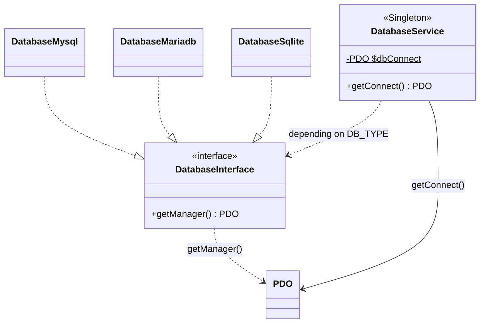

# DatabaseService: Handling data

DatabaseService is a class for managing the data in the database. It lets you run SQL queries, fetch data, and insert, update and delete data.

This class is a Singleton, which means there is only one instance of this class in the application.
It is instantiated automatically by the framework and is available in controllers.



DatabaseService implements the [PHP Data Objects (PDO)](https://www.php.net/manual/fr/book.pdo.php){:target="_blank"} interface to give PHP access to databases

!!! info "Going further"

    For more information about the PDO object, see the [official documentation](https://www.php.net/manual/fr/book.pdo.php){:target="_blank"}.


## Prerequisites
You need a MySQL, MariaDB or SQLite database to use this class.
Some database connection details are required to configure the database connection.


## Installation

To use the DatabaseService class, you must fill in the database connection details in your project's `.env` file.

You must edit the following variables in the `.env` file:


| Variable | Default value | Description                                                                       |
|--------|-------------------|-----------------------------------------------------------------------------------|
| **DB_HOST_STATUS**       | false             | `true` to enable the database connection, `false` to disable it                   |
| **DB_TYPE**  | mysql             | the database type `mysql` `mariadb` `sqlite`                                      |
| **DB_HOST**  | 127.0.0.1         | the IP address or name of the database server                                     |
| **DB_SOCKET**  | 3306              | the database port (socket)                                                        |
| **DB_USER**  | root              | the database user name                                                            |
| **DB_PASSWORD**  | root              | the database user's password                                                      |
| **DB_NAME**  | app_db              | the database name                                                               |

Example database configuration in the `.env` file:

```dotenv
## << Config Database
## to enable the database connection, set DB_HOST_STATUS=true
DB_HOST_STATUS=false
## Database type (mysql,mariadb)
DB_TYPE=mysql
## IP or name of the database server
DB_HOST=127.0.0.1
## Database port
DB_SOCKET=3306
## Database user name
DB_USER=root
## Database user's password
DB_PASSWORD=root
## Database name
DB_NAME=app_db
## >> Config Database
```

## Basic usage

Here is a simple example of using the DatabaseService class:

```php
// Get the PHP PDO object
$comBase = DatabaseService::getConnect();
// SQL query
$statementPDO = $comBase->query("SELECT * FROM user");
// Fetch the query results
$users = $statementPDO->fetchAll();
```

$commBase is a PDO object used to run SQL queries on the database.
$commBase->query() runs an SQL query on the database.
$statementPDO is a PDOStatement object that holds the query results.
$statementPDO->fetchAll() fetches the query results.

## Advanced usage

For more advanced use of the DatabaseService class, you can use the following methods:

### query($sql)

The query($sql) method runs an SQL query on the database.

```php
$statementPDO = $comBase->query("SELECT * FROM user");
```

### prepare($sql)

The prepare($sql) method prepares an SQL query on the database.

```php
$statementPDO = $comBase->prepare("SELECT * FROM user WHERE id = :id");
$statementPDO->execute(['id' => 1]);
```

### execute($params)

The execute($params) method executes a prepared statement with parameters.

```php
$statementPDO->execute(['id' => 1]);
```

### fetchAll()

The fetchAll() method fetches all the query results.

```php
$users = $statementPDO->fetchAll();
```

### fetch()

The fetch() method fetches a single result from the query.

```php
$user = $statementPDO->fetch();
```

