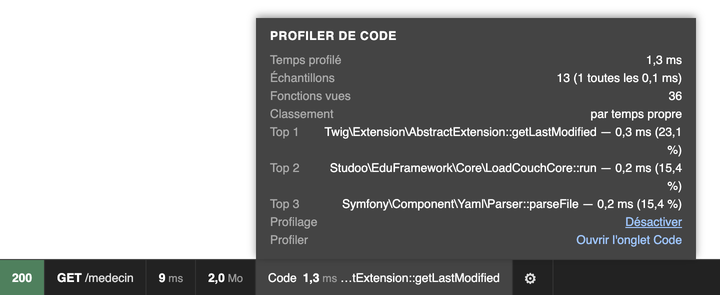
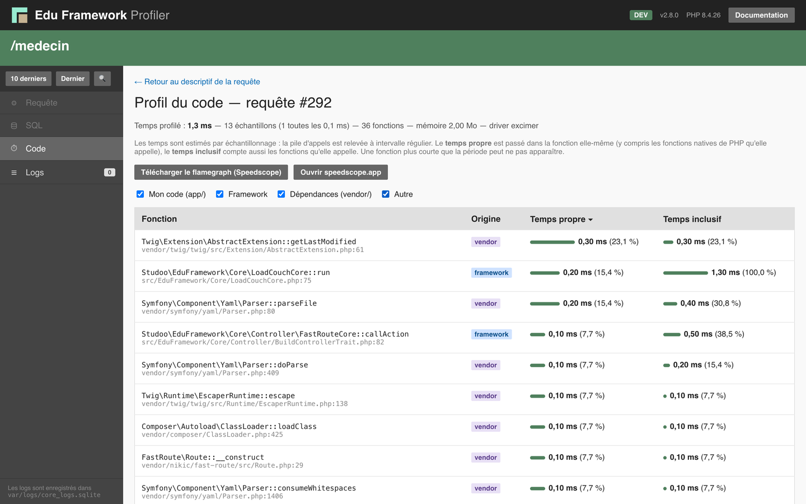
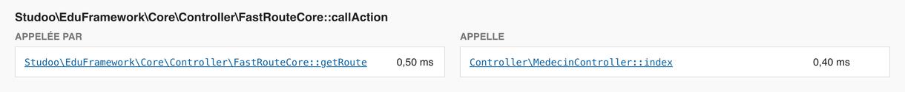
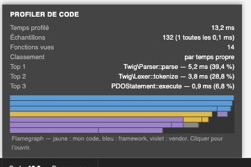
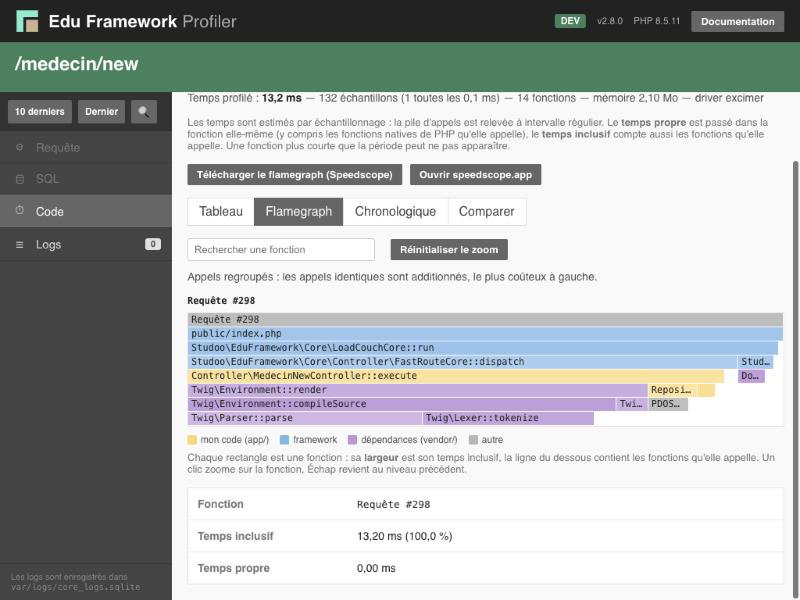
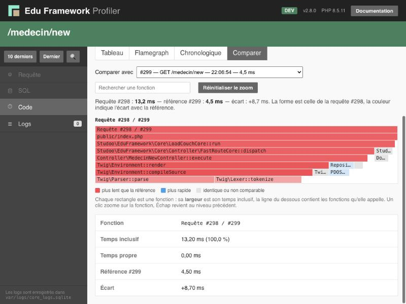
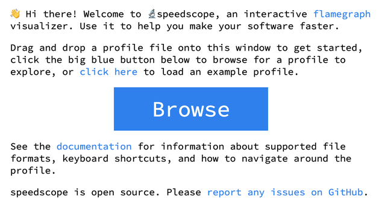
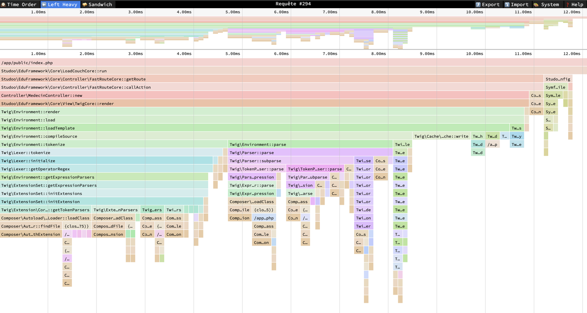
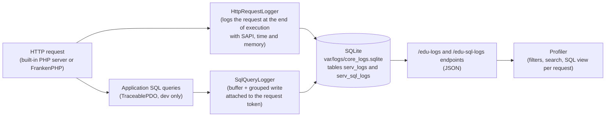

# The debug bar and the profiler

In development mode (`APP_ENV=dev`), Edu Framework displays a **debug bar** at the bottom of every page (inspired by Symfony's *Web Debug Toolbar*) and provides a **profiler page** to browse the history of HTTP requests received by the server.

These tools are available from version **v2.3.0** onwards.

## Prerequisites

The debug bar is active when `APP_ENV=dev`. The profiler and request logging additionally require the `pdo_sqlite` PHP extension.

To enable dev mode:

```dotenv
## << Config application
## to enable dev mode, set APP_ENV=dev
APP_ENV=dev
## >> Config application
```

- the `pdo_sqlite` PHP extension is installed (it is used to store the request logs).

!!! warning "Production mode"

    The `/_debug/profiler`, `/edu-logs` and `/edu-sql-logs` routes are registered **only in dev mode**.
    They are therefore not accessible when `APP_ENV=prod`.

## The debug bar

The bar is displayed automatically at the bottom of every page. Each block shows information on hover:

| Block               | Information                                                                |
|---------------------|----------------------------------------------------------------------------|
| :material-check-network: **HTTP status**  | Response code and label (200 OK, 404 Not Found, ...) - the background is coloured according to the status family (2xx green, 4xx orange, 5xx red) |
| :material-map-marker-radius: **Route**         | Requested path, executed controller and route parameters               |
| :material-timer: **Execution time**    | Total duration of the request in milliseconds                                |
| :material-memory: **Memory**             | Peak memory usage and PHP limit (`memory_limit`)                    |
| :material-database: **SQL**               | **Number of SQL queries** executed during the request and cumulative SQL time; on hover: slowest query and link to the [profiler's SQL view](#sql-queries) (`#sql/{token}`). The block is hidden if there are no queries |
| :material-text-box-outline: **DevTool**         | **Token of the current request** and link to its [details in the profiler](#the-profiler) (`#request/{token}`); if the request is not logged, link to the list of requests |
| :material-application-brackets: **DEV**   | PHP version and SAPI in use; database type, host and name on hover (visible only if `DB_HOST_STATUS=true`); **development services** on hover: application (HTTP/HTTPS), MariaDB, Mailpit (web interface and SMTP), DbGate and phpMyAdmin — the web interface URLs are **clickable** (open in a new tab), the ports are read from the `.env` (`HTTP_PORT`, `HTTPS_PORT`, `DB_HOST`/`DB_SOCKET`, `MAILER_UI_PORT`, `MAILER_SMTP_PORT`, `DBGATE_PORT`, `PMA_PORT`) with the default values from `compose.yaml` when missing. Columns containing links are properly aligned with the other information. |
| :material-package-variant: **Edu Framework** | Framework version, release date and link to the documentation  |

!!! tip "Accessing Docker services from the bar"

    The DEV block panel lists the development services published on the host with their URLs:
    the application (`http://localhost:80` and `https://localhost:443`), MariaDB, Mailpit
    (`http://localhost:8025`, SMTP `localhost:1025`), DbGate (`http://localhost:8082`) and
    phpMyAdmin (`http://localhost:8081`). Custom ports in the `.env` are
    automatically taken into account (see ["The application in Docker"](../installation/docker.md)).

!!! tip "Collapsing the bar"

    The `×` button on the right of the bar collapses it.
    A button with the Edu Framework logo then appears at the bottom right of the screen to show it again.
    This state is remembered (localStorage) from one page to the next.

## The profiler

The profiler is a page (in the style of the *Symfony Profiler*) that lets you browse the HTTP requests logged by the server (built-in PHP server or FrankenPHP).

It is available at:

```
http://localhost:8042/_debug/profiler
```

or, if the application is served by FrankenPHP (see the ["The application in Docker"](../installation/docker.md) documentation):

```
https://localhost/_debug/profiler
```

Since the log database is shared (the Docker container mounts the project folder), the profiler displays **all** received requests, whichever server handled them.

### Features

- list of received requests, from most recent to oldest;
- counter of the number of requests per **status family** (2xx, 3xx, 4xx, 5xx): filter tabs at the top of the **Logs** and **Search** views (a click filters the results by family, the **All** tab shows all requests; in the Search view, the form's Status field is kept in sync);
- **HTTP request details**: the `/_debug/profiler#request/{token}` page describes the selected request (status, method, URL, IP, SAPI, duration, memory, raw line) — this is the page opened by the DevTool block of the debug bar; the URL of a request in the list is also clickable;
- **SQL view of an HTTP request**: the `/_debug/profiler#sql/{token}` page lists the SQL queries executed during the selected request (see ["SQL queries"](#sql-queries)) — accessible from the *SQL queries* line of the details page and from the SQL block of the debug bar;
- combinable filters:

| Filter      | Description                                                        | Example                    |
|-------------|--------------------------------------------------------------------|----------------------------|
| **Method** | HTTP method (`GET`, `POST`, `PUT`, `DELETE`, ...)                 | `GET`                      |
| **Status**  | Full code or code family (2, 3, 4 or 5 for 2xx to 5xx)      | `404` or `4`               |
| **Search** | Text search in the event                              | `favicon`                  |
| **IP**      | Client IP address                                               | `127.0.0.1`                |
| **SAPI**    | Server that handled the request                                    | `cli-server` or `frankenphp` |
| **URL**     | Fragment of the request path                                   | `/ville`                   |
| **Token**   | Log identifier                                                 | `42`                       |
| **From / Until** | Date bounds (`YYYY-MM-DD` format, local time)           | `2026-10-01`               |

## The logs API

The profiler relies on an internal endpoint that returns the logs in JSON format:

```
GET /edu-logs
```

Request parameters:

| Parameter  | Description                                             | Default    |
|------------|---------------------------------------------------------|-----------|
| `page`     | Page number                                       | `1`       |
| `limit`    | Number of logs per page (maximum 100)                   | `20`      |
| `method`   | Filter on the HTTP method                              | —         |
| `status`   | Filter on the full status (`500`) or its family (`5`) | —        |
| `search`   | Text search                                     | —         |
| `ip`       | Filter on the client IP address                       | —         |
| `sapi`     | Filter on the SAPI that served the request (`cli-server`, `frankenphp`, ...) | — |
| `url`      | Filter on the request path                      | —         |
| `token`    | Filter on the log identifier                         | —         |
| `from`     | Start date (`YYYY-MM-DD`)                            | —         |
| `until`    | End date (`YYYY-MM-DD`)                              | —         |

Example response:

```json
{
    "total": 42,
    "page": 1,
    "pages": 3,
    "limit": 20,
    "counts": {
        "all": 42,
        "2": 40,
        "3": 0,
        "4": 2,
        "5": 0
    },
    "logs": [
        {
            "id": 42,
            "event_date": "2026-10-05 12:34:56",
            "event": {
                "raw": "[Mon Oct  5 12:34:56 2026] 127.0.0.1:65229 [200]: GET /",
                "timestamp": "Mon Oct  5 12:34:56 2026",
                "ip_port": "127.0.0.1:65229",
                "status_code": "200",
                "method": "GET",
                "path": "/",
                "sapi": "cli-server",
                "execution_time_ms": 183.4,
                "memory_mb": 14.0,
                "error_message": "ParseError : syntax error, unexpected token \"return\" (fichier app/Controller/HomeController.php, ligne 17)"
            }
        }
    ]
}
```

## SQL queries

In dev mode, every SQL query executed during an HTTP request is **measured and attached to the request token** (like Symfony's *Doctrine panel*). The profiler's SQL view (`/_debug/profiler#sql/{token}`) lists, for an HTTP request:

- the **chronological table** of SQL queries: sequence number, query, duration (coloured above 20 ms and 100 ms), number of rows returned or affected, time;
- a **badge** on identical queries executed several times: number of executions and cumulative time of the group (`×3 requêtes identiques — 4,5 ms au total`);
- the **cumulative SQL time** and its **share of the HTTP request time** (Example: `12,3 ms — 34 % du temps de la requête HTTP (36,1 ms)`).

### How collection works

Collection is handled by three framework classes, **only in dev mode**:

- `PdoFactory` creates the connections: in dev mode (with the `pdo_sqlite` extension, as for HTTP request logging), the application connection is a `TraceablePDO` — which remains a regular `PDO` (`DatabaseService::getConnect()` is unchanged for your code);
- `TraceablePDO` measures the execution time of `query()` and `exec()`, and `TraceablePDOStatement` that of each `execute()` of a prepared statement (via `PDO::ATTR_STATEMENT_CLASS`);
- `SqlQueryLogger` buffers the queries together with the token of the current HTTP request, then writes them **grouped in a single transaction** at the end of the request into the `serv_sql_logs` table of the log database.

In **production** (`APP_ENV=prod`), the factory returns a native `PDO` connection: the tracing classes are **neither instantiated nor loaded**, and no measurement or collection takes place.

Queries executed outside a logged HTTP request are never collected: CLI commands, internal profiler routes (`/_debug/...`, `/edu-logs`, `/edu-sql-logs`) and queries on the log database itself — the link is made through the token, which is absent in these contexts.

## The SQL queries API

The profiler relies on an internal endpoint that returns the SQL queries of an HTTP request in JSON format:

```
GET /edu-sql-logs?token=42
```

| Parameter  | Description                                             | Default    |
|------------|---------------------------------------------------------|-----------|
| `token`    | Log identifier of the HTTP request (the `#` from the DevTool block is accepted: `#42`) | required |

Example response:

```json
{
    "token": 42,
    "total": 3,
    "total_duration_ms": 2.6,
    "groups": [
        { "query": "SELECT * FROM ville WHERE nom = :nom", "count": 2, "duration_ms": 1.6 },
        { "query": "SELECT 1", "count": 1, "duration_ms": 1.0 }
    ],
    "queries": [
        {
            "id": 1,
            "query": "SELECT 1",
            "duration_ms": 1.0,
            "rows_count": 1,
            "event_date": "2026-10-17 15:04:25"
        }
    ]
}
```

- `queries`: chronological list of executions (`rows_count` is `null` if the driver does not provide the information, Example: `-1` for a `SELECT` on PostgreSQL);
- `groups`: identical queries grouped together with their number of executions and their cumulative time.

## The code profiler

The code profiler measures **the time spent in each PHP function** during an HTTP request, to find out what is slowing a page down. It relies on the [Excimer](https://www.mediawiki.org/wiki/Excimer){:target="_blank"} extension (Wikimedia), a **sampling** profiler: every 0.1 ms, Excimer records the current call stack. A function present in 30% of the samples consumed about 30% of the request time. The overhead stays low (a few %) and it works with FrankenPHP, including in worker mode.

!!! warning "Already available with FrankenPHP in Docker"

    If your application runs on the **FrankenPHP in Docker** runtime (`frankenphp` service, see ["The application in Docker"](../installation/docker.md)), the code profiler is **already set up**: the Excimer extension is installed in the image and on-demand profiling is enabled by default (`EDU_PROFILER=trigger`).
    There is nothing to install or configure: open the application (`https://localhost`) and click the **Code** block of the debug bar.

    The installation described below only applies when running **outside Docker** (built-in PHP server, for example `http://localhost:8042`).

!!! info "A statistical result"

    A very short function (less than 0.1 ms) may never appear in the profile. The times shown are estimates: `number of samples × 0.1 ms`.

### Installing the extension

The framework's Docker image installs Excimer by default (build argument `EDU_PROFILER=1`). To build an image without the profiler:

```bash
EDU_PROFILER_BUILD=0 docker compose build
```

Outside Docker, install the extension with PECL (`pecl install excimer`) then enable it in `php.ini` (`extension=excimer`). The `php bin/edu check:config` command tells you whether the extension is loaded.

### Enabling profiling

Profiling is configured with the `EDU_PROFILER` variable in the `.env`:

```bash
## << Config profiler de code
EDU_PROFILER=trigger
EDU_PROFILER_KEEP=50
## >> Config profiler de code
```

| Value     | Behaviour                                                                 |
|-----------|------------------------------------------------------------------------------|
| `off`     | Profiler disabled, the **Code** block is hidden                              |
| `trigger` | (default) On-demand profiling: **Code** button in the debug bar, or `?_profile=1` parameter in the URL |
| `on`      | Every request is profiled                                                  |

`EDU_PROFILER_KEEP` sets the number of profiles kept (the oldest ones are deleted, 50 by default).

In `trigger` mode, a click on the **Code** block sets the `edu_profile=1` cookie and reloads the page: this page **and the following ones** are profiled, until you click **Désactiver** (Disable) in the block's panel.

### Reading the profile

- The **Code** block of the debug bar shows the profiled time and the most expensive function; its panel lists the top 3 functions.

<figure markdown="span">
{width="720"}
<figcaption>The Code block panel: profiled time, top 3 functions and Disable link</figcaption>
</figure>

- The profiler's **Code** tab (`/_debug/profiler#code/{token}`) shows the table of all functions, sortable by **self time** (time spent in the function itself) or **inclusive time** (the function and the functions it calls), and filterable by origin (`app`, `framework`, `vendor`). Clicking a function shows its callers and callees.

<figure markdown="span">

<figcaption>The profiler's Code tab, all origins checked, sorted by self time</figcaption>
</figure>

<figure markdown="span">

<figcaption>After clicking a function: its callers (Called by) and its callees (Calls)</figcaption>
</figure>

- The **Flamegraph**, **Chronologique** (Time order) and **Comparer** (Compare) tabs of the **Code** tab display the request's *flamegraph* directly in the profiler (see below).
- The panel of the debug bar's **Code** block shows a **mini-flamegraph** of the request: a click opens it full size in the profiler.

<figure markdown="span">
{width="360"}
<figcaption>The mini-flamegraph in the Code block panel: calls taking more than 1% of the time, coloured by origin</figcaption>
</figure>

- The **Télécharger le flamegraph (Speedscope)** (Download the flamegraph) button exports the call stacks, to be opened on [speedscope.app](https://www.speedscope.app){:target="_blank"} for deeper analysis (see further down).

### The built-in flamegraph

The table in the **Code** tab adds up the times per function, but it does not show **the sequence of calls**. The *flamegraph* does: you can see at a glance which path through the code consumes the time.

The profiler draws the flamegraph **without leaving the page and without downloading a file**. Choose a view with the tabs above the table:

| Tab               | URL                                   | What it shows |
|-------------------|---------------------------------------|-----------------|
| **Tableau** (Table) | `/_debug/profiler#code/{token}`       | The table of functions (self time and inclusive time) |
| **Flamegraph**    | `/_debug/profiler#code/{token}/flame` | Identical calls **grouped** and sorted, the most expensive on the left (Speedscope's *Left Heavy* view) |
| **Chronologique** (Time order) | `/_debug/profiler#code/{token}/time`  | Calls in **the order in which they happened**: the horizontal axis is the time elapsed since the start of the request (Speedscope's *Time Order* view) |
| **Comparer** (Compare) | `/_debug/profiler#code/{token}/diff/{autre}` | The **differential** flamegraph of two profiled requests (see below) |

<figure markdown="span">

<figcaption>The flamegraph of a request to /medecin/new: under Twig\Environment::compileSource, template compilation takes up most of the width</figcaption>
</figure>

**Reading the graph.** Each rectangle is a function:

- **the width** is the time spent in the function **and in everything it calls** (the inclusive time);
- **from top to bottom**, you go down the call stack: the first row is the whole request, then the entry point (`public/index.php`), then the functions it calls, and so on;
- **the colour** indicates where the code comes from: **yellow** for your code (`app/`), **blue** for the framework, **purple** for dependencies (`vendor/`), **grey** for the rest. The shade varies from one function to the next to tell two neighbouring rectangles apart.

Look for **wide yellow rectangles**: that is the time consumed by your own code.

**Navigating.**

- **Hovering** over a rectangle shows the function name, its file, its inclusive time and its self time.
- A **click** zooms in on the function: it takes the full width, and its parents remain displayed, dimmed, above it. The **call path** above the graph lets you go back up with one click, the ++esc++ key goes up one level and the **Réinitialiser le zoom** (Reset zoom) button returns to the whole request.
- Below the graph, the **details** of the zoomed function give its file, its origin, its times and the **Voir les appelants et les appelés** (See callers and callees) link, which shows the same tables as the **Tableau** tab.
- The **Rechercher une fonction** (Search for a function) field highlights the functions whose name contains the text entered and shows the total time they represent (Example: `Twig` or `Repository`).

!!! info "Calls grouped in « … (autres) »"

    To keep the graph readable and lightweight, calls that represent less than **0.1%** of the request time are grouped into a **… (autres)** (others) rectangle (Flamegraph view) or are not drawn (Time order view). The Speedscope file, however, contains all call stacks.

### Comparing two requests

The **Comparer** (Compare) tab answers the question: "*Why is this page slower than it was a moment ago?*".

1. Profile the page **twice**: for example before and after a change, or on the first load and then the next one.
2. Open the **Code** tab of one of the two requests, then the **Comparer** tab.
3. Choose the **reference** request in the **Comparer avec** (Compare with) list. Requests profiled on **the same URL** are suggested first, and the previous one is selected by default.

The **shape** of the graph is that of the displayed request. The **colour** indicates the difference with the reference for the same call path: **red** if the request is slower, **blue** if it is faster, **grey** if the time is identical. The darker the colour, the bigger the difference. Hovering and the details show the reference time and the difference in ms.

<figure markdown="span">

<figcaption>First load of /medecin/new compared with the next one: the Twig template compilation (in red) does not exist in the reference</figcaption>
</figure>

!!! tip "A path that has disappeared"

    A call present only in the reference is not drawn, since the shape is that of the displayed request: its time appears in the difference of the function that called it. To see it, reverse the comparison by opening the **Comparer** tab of the other request.

### Reading the flamegraph with Speedscope

The built-in flamegraph is enough in most cases. To go further (all call stacks without grouping, mouse-wheel zoom, *Sandwich* view), export the profile to Speedscope.

[Speedscope](https://github.com/jlfwong/speedscope){:target="_blank"} is an open source flamegraph viewer that runs in the browser.

**1. Export the profile.** In the **Code** tab of a request, click **Télécharger le flamegraph (Speedscope)**. The browser saves an `edu-profile-{token}.speedscope.json` file.

**2. Open the file.** Click **Ouvrir speedscope.app** (Open speedscope.app), then **Browse** to choose the file, or drag and drop it directly into the window.

<figure markdown="span">
{width="634"}
<figcaption>The speedscope.app home screen: Browse button or drag and drop of the file</figcaption>
</figure>

!!! info "The file stays on your computer"

    speedscope.app reads the file **in the browser**: the profile is not sent to any server.
    It does, however, contain the function names and file paths of your application.

**3. Read the graph.** Each rectangle is a function call:

- **the width** of a rectangle is the time spent in the function **and in everything it calls** (the inclusive time);
- **from top to bottom**, you go down the call stack: the first row is the entry point (`public/index.php`), the row below contains the functions it calls, and so on;
- **each colour** corresponds to a function, which helps you spot the same function in several places.

To find what is slowing a page down, look for **wide rectangles on the bottom rows**: that is where the time is actually consumed.

**4. Choose a view.** The three tabs at the top left (or the ++1++, ++2++, ++3++ keys) change the presentation:

| View           | What it shows                                                                 | When to use it |
|----------------|-----------------------------------------------------------------------------------|------------------|
| **Time Order** | Call stacks in the **chronological order** of the request (the horizontal axis is elapsed time) | Understanding how the request unfolds: routing, controller, template rendering, ... |
| **Left Heavy** | Identical calls are **grouped** and sorted, the most expensive on the left       | Quickly finding the most expensive call path |
| **Sandwich**   | A table of functions (self time and total time). A selected function shows its **callers** above and its **callees** below | Analysing a specific function called from several places |

<figure markdown="span">

<figcaption>The Left Heavy view of a request to /medecin/new: under Twig\Environment::compileSource, template compilation takes up almost the entire width</figcaption>
</figure>

**5. Navigate.** The mouse wheel (or pinching on a touchpad) zooms, dragging moves the view, and clicking a rectangle shows the function's details at the bottom of the screen (self time, total time, file).

!!! example "Example: compiling a Twig template"

    On the first request to `/medecin/new` after its template was modified, the **Left Heavy** view (screenshot above) shows that almost the whole request (about 11 ms out of 12) is spent under `Twig\Environment::compileSource`: Twig **compiles** the template into PHP (`Lexer::tokenize` then `Parser::parse`) before rendering it.
    The result is cached in `var/cache/twig`: subsequent requests on this page no longer pay this cost.
    So before optimising a page, profile **several requests** so you don't mistake a first-load cost for a real performance problem.

### The code profile API

```
GET /edu-code-profile?token=42
```

| Parameter | Description                                                         | Default |
|-----------|---------------------------------------------------------------------|--------|
| `token`   | Log identifier of the HTTP request (`#42` accepted)               | required |
| `full`    | `1`: adds all functions (`functions`) and the call graph (`edges`) | — |
| `format`  | `speedscope`: returns the request's Speedscope file; `flame`: returns the built-in flamegraph tree (`tree` key) | —      |
| `order`   | With `format=flame`: `heavy` (grouped calls) or `time` (chronological order) | `heavy` |
| `compare` | With `format=flame`: token of another profiled request, for the differential flamegraph (`compare`, `compare_summary` keys, and `base_ms` / `delta_ms` in each node) | — |
| `min`     | With `format=flame`: minimum share of the total time for a call to be kept (from `0` to `0.1`) | `0.001` |
| `depth`   | With `format=flame`: maximum depth of the tree (`0`: unlimited) | `0` |

The response contains `status` (`ready`, or `pending` as long as the profile has not been saved), `summary` (`driver`, `period_ms`, `samples`, `wall_ms`, `peak_mb`, `functions_count`) and `top` (most expensive functions). With `format=flame`, each node of `tree` contains `name`, `origin`, `file`, `line`, `start` and `value` (position and width in samples), `self`, `ms`, `self_ms`, `pct` and `children`. Profiles are stored, compressed, in the `serv_code_profiles` table of the log database.

## Log storage

The HTTP requests handled by the framework are recorded in a dedicated **SQLite** database:

- file: `var/logs/core_logs.sqlite`
- table: `serv_logs` (columns `id`, `event_date`, `event_desc`)
- table: `serv_sql_logs` (columns `id`, `request_id` (HTTP request token), `query`, `duration_ms`, `rows_count`, `event_date`) — SQL queries collected by `SqlQueryLogger`, indexed on `request_id`

Collection is handled by the `HttpRequestLogger` class, in two steps like the Symfony profiler: the log line is **reserved at the start of the request** — its identifier (the *token*) is then available to the DevTool block of the debug bar, which links to the request details — then **completed at the end of the request** with the final status, the execution time and the memory. This is what makes it possible to measure, per request, the **execution time** and the **memory used** — two indicators also shown by the debug bar — whichever server serves it (built-in PHP server via `php bin/edu start`, or FrankenPHP in Docker). The `php bin/edu start` command parses the server output only to **display it in the console**: it no longer writes to the log database.

If an error occurs (exception caught by the framework: 500 error, `ErrorHttpStatusException` thrown by a controller, ...), the framework passes it to `HttpRequestLogger::setError()` and the request log carries an `error_message` key describing the cause of the error — exception message, **file and line** where it occurred. The description is visible in the log context (it can be filtered with the **Search** field) and on the request details page, so you can identify and fix the error directly from the logs. A request that completed without error does not carry this key.

To make debugging easier, the request log also carries the **request variables**, displayed as tables on the request details page:

- `get` and `post`: the `$_GET` and `$_POST` variables, captured **at the start of the request** as sent by the client (before any changes made by the controller);
- `session`: the `$_SESSION` variables, captured **at the end of the request** (after the controller has run), only if the application started a session. Objects stored in the session are recorded with all their properties (including private and protected ones) and a `__class` key indicating their class.

Each key is present only if it contains variables. **Sensitive variables** — whose name contains `pass`, `pwd`, `secret`, `mot_de_passe` or `mdp` (case-insensitive) — are masked (`******`), including in nested arrays: a password is never stored in plain text in the log database. The raw body of a JSON request (`php://input`) is not captured.

Each event carries the keys:

| Key | Description |
|-----|-------------|
| `raw`, `timestamp`, `ip_port`, `status_code`, `method`, `path` | same format as the built-in PHP server output |
| `sapi` | server that received the request (`cli-server`, `frankenphp`, ...): shown in the profiler and filterable (**SAPI** field) |
| `execution_time_ms` | total execution time of the request in milliseconds |
| `memory_mb` | peak memory used by the request in megabytes |
| `error_message` | description of the error behind the response (class, message, file and line of the exception): only present if an error was caught |

Since events have the same format for all servers, the profiler shows the complete history, even if both servers run at the same time. To avoid SQLite lock errors between the host machine and the container, the connection waits up to 5 seconds for the database to become available (`PRAGMA busy_timeout`).



!!! info

    Requests from the profiler and the debug bar (`/_debug/...`, `/edu-logs` and `/edu-sql-logs`) are not logged, to avoid filling the database every time a tools page is displayed.

!!! note "Limitations"

    - only requests **executed by PHP** are logged: static files served directly by the web server (assets from `public/upload/`, ...) are not, whether by the built-in server or by Caddy;
    - in the Docker container, the client IP is the one seen by FrankenPHP (Docker network): the profiler's IP filter gives the IP of the Docker bridge, not `127.0.0.1`;
    - in FrankenPHP worker mode (not enabled by default), peak memory is cumulative over the lifetime of the worker: `memory_mb` then reflects the worker and not just the request;
    - the debug bar's **SQL** block counts the queries executed up to the page rendering: queries executed afterwards (if any) are not counted in the block, but they are in the profiler;
    - SQL queries are collected **only in dev mode**: in production, the connection is a native `PDO`, with no measurement and no writing to the log database.

## Adding your own logs

The `LogsService` class can be used directly in your application (controller, CLI command, ...) to record and read your own events.

### Recording a log

```php
use Studoo\EduFramework\Core\Logs\LogsService;

LogsService::addLog('My custom event');
```

### Reading the logs

```php
use Studoo\EduFramework\Core\Logs\LogsService;

// Fetch the last 20 logs
$logs = LogsService::getLogs(20, 0);

// Fetch filtered logs (all requests with a 404)
$logs = LogsService::getLogs(20, 0, ['status' => '404']);

// Count the total number of logs
$nbLogs = LogsService::countLogs();

// Count logs per status family (2xx to 5xx)
$counts = LogsService::countByStatusFamily();
```

!!! note "Available filters"

    The `getLogs()`, `countLogs()` and `countByStatusFamily()` methods accept the same filters as the API: `method`, `status`, `search`, `ip`, `url`, `token`, `from` and `until`.
