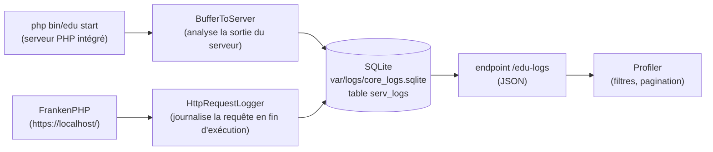

# La barre de debug et le profiler

En mode développement (`APP_ENV=dev`), Edu Framework affiche une **barre de debug** en bas de chaque page (inspirée de la *Web Debug Toolbar* de Symfony) et met à disposition une **page de profiler** pour naviguer dans l'historique des requêtes HTTP reçues par le serveur.

Ces outils sont disponibles à partir de la version **v2.3.0**.

## Prérequis

La barre de debug est active lorsque `APP_ENV=dev`. Le profiler et l'enregistrement des requêtes nécessitent en plus l'extension PHP `pdo_sqlite`.

Pour activer le mode dev :

```dotenv
## << Config application
## pour activer le mode dev, il faut mettre APP_ENV=dev
APP_ENV=dev
## >> Config application
```

- l'extension PHP `pdo_sqlite` est installée (elle est utilisée pour stocker les logs des requêtes).

!!! warning "Mode production"

    Les routes `/_debug/profiler` et `/edu-logs` ne sont enregistrées **qu'en mode dev**.
    Elles ne sont donc pas accessibles lorsque `APP_ENV=prod`.

## La barre de debug

La barre s'affiche automatiquement en bas de chaque page. Chaque bloc affiche une information au survol :

| Bloc                | Information                                                                |
|---------------------|----------------------------------------------------------------------------|
| :material-check-network: **Statut HTTP**  | Code et libellé de la réponse (200 OK, 404 Not Found, ...) - le fond est coloré selon la famille du statut (2xx vert, 4xx orange, 5xx rouge) |
| :material-map-marker-radius: **Route**         | Chemin appelé, controller exécuté et paramètres de la route               |
| :material-timer: **Temps d'exécution**    | Durée totale de la requête en millisecondes                                |
| :material-memory: **Mémoire**             | Pic d'utilisation mémoire et limite PHP (`memory_limit`)                    |
| :material-text-box-outline: **DevTool**         | Lien vers la page du [profiler](#le-profiler) |
| :material-application-brackets: **DEV**   | Version de PHP et SAPI utilisée; type, hôte et nom de la base de données au survol (visible uniquement si `DB_HOST_STATUS=true`)                                            |
| :material-package-variant: **Edu Framework** | Version du framework, date de livraison et lien vers la documentation  |

!!! tip "Réduire la barre"

    Le bouton `×` à droite de la barre permet de la réduire.
    Un bouton avec le logo Edu Framework apparaît alors en bas à droite de l'écran pour la réafficher.
    Cet état est mémorisé (localStorage) d'une page à l'autre.

## Le profiler

Le profiler est une page (style *Symfony Profiler*) qui permet de naviguer dans les requêtes HTTP journalisées par le serveur (serveur PHP intégré ou FrankenPHP).

Elle est disponible à l'adresse :

```
http://localhost:8042/_debug/profiler
```

ou, si l'application est servie par FrankenPHP (voir la doc [« L'application dans Docker »](../installation/docker.md)) :

```
https://localhost/_debug/profiler
```

La base des logs étant partagée (le conteneur Docker monte le dossier du projet), le profiler affiche **toutes** les requêtes reçues, quel que soit le serveur qui les a traitées.

### Fonctionnalités

- liste des requêtes reçues, de la plus récente à la plus ancienne ;
- compteur du nombre de requêtes par **famille de statut** (2xx, 3xx, 4xx, 5xx) ;
- filtres combinables :

| Filtre      | Description                                                        | Exemple                    |
|-------------|--------------------------------------------------------------------|----------------------------|
| **Méthode** | Méthode HTTP (`GET`, `POST`, `PUT`, `DELETE`, ...)                 | `GET`                      |
| **Statut**  | Code complet ou famille de code (2, 3, 4 ou 5 pour 2xx à 5xx)      | `404` ou `4`               |
| **Recherche** | Recherche textuelle dans l'événement                              | `favicon`                  |
| **IP**      | Adresse IP du client                                               | `127.0.0.1`                |
| **SAPI**    | Serveur ayant traité la requête                                    | `cli-server` ou `frankenphp` |
| **URL**     | Fragment du chemin de la requête                                   | `/ville`                   |
| **Token**   | Identifiant du log                                                 | `42`                       |
| **From / Until** | Bornes de date (format `YYYY-MM-DD`, heure locale)           | `2026-10-01`               |

## L'API des logs

Le profiler s'appuie sur un endpoint interne qui retourne les logs au format JSON :

```
GET /edu-logs
```

Paramètres de la requête :

| Paramètre  | Description                                             | Défaut    |
|------------|---------------------------------------------------------|-----------|
| `page`     | Numéro de la page                                       | `1`       |
| `limit`    | Nombre de logs par page (maximum 100)                   | `20`      |
| `method`   | Filtre sur la méthode HTTP                              | —         |
| `status`   | Filtre sur le statut complet (`500`) ou sa famille (`5`) | —        |
| `search`   | Recherche textuelle                                     | —         |
| `ip`       | Filtre sur l'adresse IP du client                       | —         |
| `sapi`     | Filtre sur le SAPI ayant servi la requête (`cli-server`, `frankenphp`, ...) | — |
| `url`      | Filtre sur le chemin de la requête                      | —         |
| `token`    | Filtre sur l'identifiant du log                         | —         |
| `from`     | Date de début (`YYYY-MM-DD`)                            | —         |
| `until`    | Date de fin (`YYYY-MM-DD`)                              | —         |

Exemple de réponse :

```json
{
    "total": 42,
    "page": 1,
    "pages": 3,
    "limit": 20,
    "counts": {
        "all": 42,
        "2": 40,
        "3": 0,
        "4": 2,
        "5": 0
    },
    "logs": [
        {
            "id": 42,
            "event_date": "2026-10-05 12:34:56",
            "event": {
                "raw": "[Mon Oct  5 12:34:56 2026] 127.0.0.1:65229 [200]: GET /",
                "timestamp": "Mon Oct  5 12:34:56 2026",
                "ip_port": "127.0.0.1:65229",
                "status_code": "200",
                "method": "GET",
                "path": "/",
                "sapi": "cli-server"
            }
        }
    ]
}
```

## Le stockage des logs

Les requêtes HTTP sont enregistrées dans une base **SQLite** dédiée :

- fichier : `var/logs/core_logs.sqlite`
- table : `serv_logs` (colonnes `id`, `event_date`, `event_desc`)

La collecte s'adapte au serveur qui sert l'application, afin de faire cohabiter les deux environnements :

| Serveur | SAPI | Collecte des requêtes |
|---------|------|-----------------------|
| `php bin/edu start` (serveur PHP intégré) | `cli-server` | la commande `start` analyse la sortie du serveur (classes `BufferFormat` et `BufferToServer`) et enregistre chaque ligne |
| FrankenPHP (Docker, `https://localhost/`) | autre que `cli-server` | la classe `HttpRequestLogger` journalise chaque requête en fin d'exécution (`APP_ENV=dev` requis) |

Les deux mécanismes produisent des événements **au même format** (même JSON, même ligne brute que le serveur intégré), dans la même base : le profiler affiche donc l'historique complet, même si les deux serveurs tournent simultanément. Chaque événement porte une clé `sapi` qui identifie le serveur à l'origine de la requête (`cli-server` pour le serveur PHP intégré, `frankenphp` pour FrankenPHP) : elle est affichée dans le profiler et filtrable (champ **SAPI** de l'API). Pour éviter les erreurs de verrou SQLite entre le poste et le conteneur, la connexion attend jusqu'à 5 secondes la disponibilité de la base (`PRAGMA busy_timeout`).



!!! info

    Les requêtes du profiler et de la barre de debug (`/_debug/...` et `/edu-logs`) ne sont pas journalisées, afin d'éviter le remplissage de la base à chaque affichage d'une page d'outils.

!!! note "Limitations sous FrankenPHP"

    - les fichiers statiques servis directement par Caddy (CSS, JS, images, ...) ne passent pas par PHP : ils ne sont pas journalisés ;
    - dans le conteneur Docker, l'IP du client est celle vue par FrankenPHP (réseau Docker) : le filtre IP du profiler donne l'IP du pont Docker, pas `127.0.0.1`.

## Ajouter ses propres logs

La classe `LogsService` peut être utilisée directement dans votre application (controller, commande CLI, ...) pour enregistrer et lire vos propres événements.

### Enregistrer un log

```php
use Studoo\EduFramework\Core\Logs\LogsService;

LogsService::addLog('Mon événement personnalisé');
```

### Lire les logs

```php
use Studoo\EduFramework\Core\Logs\LogsService;

// Récupère les 20 derniers logs
$logs = LogsService::getLogs(20, 0);

// Récupère les logs filtrés (toutes les requêtes en 404)
$logs = LogsService::getLogs(20, 0, ['status' => '404']);

// Compte le nombre total de logs
$nbLogs = LogsService::countLogs();

// Compte les logs par famille de statut (2xx à 5xx)
$counts = LogsService::countByStatusFamily();
```

!!! note "Filtres disponibles"

    Les méthodes `getLogs()`, `countLogs()` et `countByStatusFamily()` acceptent les mêmes filtres que l'API : `method`, `status`, `search`, `ip`, `url`, `token`, `from` et `until`.
