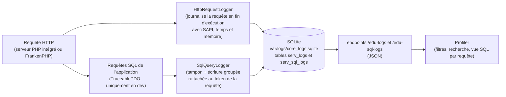

# La barre de debug et le profiler

En mode développement (`APP_ENV=dev`), Edu Framework affiche une **barre de debug** en bas de chaque page (inspirée de la *Web Debug Toolbar* de Symfony) et met à disposition une **page de profiler** pour naviguer dans l'historique des requêtes HTTP reçues par le serveur.

Ces outils sont disponibles à partir de la version **v2.3.0**.

## Prérequis

La barre de debug est active lorsque `APP_ENV=dev`. Le profiler et l'enregistrement des requêtes nécessitent en plus l'extension PHP `pdo_sqlite`.

Pour activer le mode dev :

```dotenv
## << Config application
## pour activer le mode dev, il faut mettre APP_ENV=dev
APP_ENV=dev
## >> Config application
```

- l'extension PHP `pdo_sqlite` est installée (elle est utilisée pour stocker les logs des requêtes).

!!! warning "Mode production"

    Les routes `/_debug/profiler`, `/edu-logs` et `/edu-sql-logs` ne sont enregistrées **qu'en mode dev**.
    Elles ne sont donc pas accessibles lorsque `APP_ENV=prod`.

## La barre de debug

La barre s'affiche automatiquement en bas de chaque page. Chaque bloc affiche une information au survol :

| Bloc                | Information                                                                |
|---------------------|----------------------------------------------------------------------------|
| :material-check-network: **Statut HTTP**  | Code et libellé de la réponse (200 OK, 404 Not Found, ...) - le fond est coloré selon la famille du statut (2xx vert, 4xx orange, 5xx rouge) |
| :material-map-marker-radius: **Route**         | Chemin appelé, controller exécuté et paramètres de la route               |
| :material-timer: **Temps d'exécution**    | Durée totale de la requête en millisecondes                                |
| :material-memory: **Mémoire**             | Pic d'utilisation mémoire et limite PHP (`memory_limit`)                    |
| :material-database: **SQL**               | **Nombre de requêtes SQL** exécutées pendant la requête et temps SQL cumulé ; au survol : requête la plus lente et lien vers la [vue SQL du profiler](#les-requetes-sql) (`#sql/{token}`). Le bloc est masqué s'il n'y a aucune requête |
| :material-text-box-outline: **DevTool**         | **Token de la requête en cours** et lien vers son [descriptif dans le profiler](#le-profiler) (`#request/{token}`) ; si la requête n'est pas journalisée, lien vers la liste des requêtes |
| :material-application-brackets: **DEV**   | Version de PHP et SAPI utilisée; type, hôte et nom de la base de données au survol (visible uniquement si `DB_HOST_STATUS=true`) ; **services de développement** au survol : application (HTTP/HTTPS), MariaDB, Mailpit (interface web et SMTP), DbGate et phpMyAdmin — les URLs des interfaces web sont **cliquables** (ouverture dans un nouvel onglet), les ports sont lus dans le `.env` (`HTTP_PORT`, `HTTPS_PORT`, `DB_HOST`/`DB_SOCKET`, `MAILER_UI_PORT`, `MAILER_SMTP_PORT`, `DBGATE_PORT`, `PMA_PORT`) avec les valeurs par défaut du `compose.yaml` en cas d'absence. Les colonnes contenant des liens sont correctement alignées avec les autres informations. |
| :material-package-variant: **Edu Framework** | Version du framework, date de livraison et lien vers la documentation  |

!!! tip "Accès aux services Docker depuis la barre"

    Le panneau du bloc DEV liste les services de développement publiés sur l'hôte avec leurs URLs :
    l'application (`http://localhost:80` et `https://localhost:443`), MariaDB, Mailpit
    (`http://localhost:8025`, SMTP `localhost:1025`), DbGate (`http://localhost:8082`) et
    phpMyAdmin (`http://localhost:8081`). Les ports personnalisés dans le `.env` sont
    automatiquement pris en compte (voir [« L'application dans Docker »](../installation/docker.md)).

!!! tip "Réduire la barre"

    Le bouton `×` à droite de la barre permet de la réduire.
    Un bouton avec le logo Edu Framework apparaît alors en bas à droite de l'écran pour la réafficher.
    Cet état est mémorisé (localStorage) d'une page à l'autre.

## Le profiler

Le profiler est une page (style *Symfony Profiler*) qui permet de naviguer dans les requêtes HTTP journalisées par le serveur (serveur PHP intégré ou FrankenPHP).

Elle est disponible à l'adresse :

```
http://localhost:8042/_debug/profiler
```

ou, si l'application est servie par FrankenPHP (voir la doc [« L'application dans Docker »](../installation/docker.md)) :

```
https://localhost/_debug/profiler
```

La base des logs étant partagée (le conteneur Docker monte le dossier du projet), le profiler affiche **toutes** les requêtes reçues, quel que soit le serveur qui les a traitées.

### Fonctionnalités

- liste des requêtes reçues, de la plus récente à la plus ancienne ;
- compteur du nombre de requêtes par **famille de statut** (2xx, 3xx, 4xx, 5xx) : onglets de filtrage en tête des vues **Logs** et **Recherche** (un clic filtre les résultats sur la famille, l'onglet **Tous** affiche toutes les requêtes ; dans la vue Recherche, le champ Statut du formulaire est synchronisé) ;
- **descriptif d'une requête HTTP** : la page `/_debug/profiler#request/{token}` décrit la requête sélectionnée (statut, méthode, URL, IP, SAPI, durée, mémoire, ligne brute) — c'est la page ouverte par le bloc DevTool de la barre de debug ; l'URL d'une requête dans la liste est également cliquable ;
- **vue SQL d'une requête HTTP** : la page `/_debug/profiler#sql/{token}` liste les requêtes SQL exécutées pendant la requête sélectionnée (voir [« Les requêtes SQL »](#les-requetes-sql)) — accessible depuis la ligne *Requêtes SQL* du descriptif et le bloc SQL de la barre de debug ;
- filtres combinables :

| Filtre      | Description                                                        | Exemple                    |
|-------------|--------------------------------------------------------------------|----------------------------|
| **Méthode** | Méthode HTTP (`GET`, `POST`, `PUT`, `DELETE`, ...)                 | `GET`                      |
| **Statut**  | Code complet ou famille de code (2, 3, 4 ou 5 pour 2xx à 5xx)      | `404` ou `4`               |
| **Recherche** | Recherche textuelle dans l'événement                              | `favicon`                  |
| **IP**      | Adresse IP du client                                               | `127.0.0.1`                |
| **SAPI**    | Serveur ayant traité la requête                                    | `cli-server` ou `frankenphp` |
| **URL**     | Fragment du chemin de la requête                                   | `/ville`                   |
| **Token**   | Identifiant du log                                                 | `42`                       |
| **From / Until** | Bornes de date (format `YYYY-MM-DD`, heure locale)           | `2026-10-01`               |

## L'API des logs

Le profiler s'appuie sur un endpoint interne qui retourne les logs au format JSON :

```
GET /edu-logs
```

Paramètres de la requête :

| Paramètre  | Description                                             | Défaut    |
|------------|---------------------------------------------------------|-----------|
| `page`     | Numéro de la page                                       | `1`       |
| `limit`    | Nombre de logs par page (maximum 100)                   | `20`      |
| `method`   | Filtre sur la méthode HTTP                              | —         |
| `status`   | Filtre sur le statut complet (`500`) ou sa famille (`5`) | —        |
| `search`   | Recherche textuelle                                     | —         |
| `ip`       | Filtre sur l'adresse IP du client                       | —         |
| `sapi`     | Filtre sur le SAPI ayant servi la requête (`cli-server`, `frankenphp`, ...) | — |
| `url`      | Filtre sur le chemin de la requête                      | —         |
| `token`    | Filtre sur l'identifiant du log                         | —         |
| `from`     | Date de début (`YYYY-MM-DD`)                            | —         |
| `until`    | Date de fin (`YYYY-MM-DD`)                              | —         |

Exemple de réponse :

```json
{
    "total": 42,
    "page": 1,
    "pages": 3,
    "limit": 20,
    "counts": {
        "all": 42,
        "2": 40,
        "3": 0,
        "4": 2,
        "5": 0
    },
    "logs": [
        {
            "id": 42,
            "event_date": "2026-10-05 12:34:56",
            "event": {
                "raw": "[Mon Oct  5 12:34:56 2026] 127.0.0.1:65229 [200]: GET /",
                "timestamp": "Mon Oct  5 12:34:56 2026",
                "ip_port": "127.0.0.1:65229",
                "status_code": "200",
                "method": "GET",
                "path": "/",
                "sapi": "cli-server",
                "execution_time_ms": 183.4,
                "memory_mb": 14.0,
                "error_message": "ParseError : syntax error, unexpected token \"return\" (fichier app/Controller/HomeController.php, ligne 17)"
            }
        }
    ]
}
```

## Les requêtes SQL

En mode dev, chaque requête SQL exécutée pendant une requête HTTP est **mesurée et rattachée au token de la requête** (comme le *Doctrine panel* de Symfony). La vue SQL du profiler (`/_debug/profiler#sql/{token}`) liste pour une requête HTTP :

- le **tableau chronologique** des requêtes SQL : numéro d'ordre, requête, durée (colorée au-delà de 20 ms et 100 ms), nombre de lignes retournées ou affectées, heure ;
- un **badge** sur les requêtes identiques exécutées plusieurs fois : nombre d'exécutions et temps cumulé du groupe (`×3 requêtes identiques — 4,5 ms au total`) ;
- le **temps SQL cumulé** et sa **part du temps de la requête HTTP** (Exemple : `12,3 ms — 34 % du temps de la requête HTTP (36,1 ms)`).

### Comment fonctionne la collecte

La collecte est assurée par trois classes du framework, **uniquement en mode dev** :

- `PdoFactory` fabrique les connexions : en mode dev (avec l'extension `pdo_sqlite`, comme pour la journalisation des requêtes HTTP), la connexion applicative est une `TraceablePDO` — qui reste un `PDO` classique (`DatabaseService::getConnect()` est inchangé pour votre code) ;
- `TraceablePDO` mesure le temps d'exécution de `query()` et `exec()`, et `TraceablePDOStatement` celui de chaque `execute()` de statement préparé (via `PDO::ATTR_STATEMENT_CLASS`) ;
- `SqlQueryLogger` met les requêtes en mémoire tampon avec le token de la requête HTTP en cours, puis les écrit **groupées en une transaction** en fin de requête dans la table `serv_sql_logs` de la base des logs.

En **production** (`APP_ENV=prod`), la fabrique retourne une connexion `PDO` native : les classes de tracing ne sont **ni instanciées ni chargées**, aucune mesure ni collecte n'a lieu.

Les requêtes exécutées hors d'une requête HTTP journalisée ne sont jamais collectées : commandes CLI, routes internes du profiler (`/_debug/...`, `/edu-logs`, `/edu-sql-logs`) et requêtes de la base des logs elle-même — le rattachement se fait par le token, absent dans ces contextes.

## L'API des requêtes SQL

Le profiler s'appuie sur un endpoint interne qui retourne les requêtes SQL d'une requête HTTP au format JSON :

```
GET /edu-sql-logs?token=42
```

| Paramètre  | Description                                             | Défaut    |
|------------|---------------------------------------------------------|-----------|
| `token`    | Identifiant du log de la requête HTTP (le `#` du bloc DevTool est accepté : `#42`) | requis |

Exemple de réponse :

```json
{
    "token": 42,
    "total": 3,
    "total_duration_ms": 2.6,
    "groups": [
        { "query": "SELECT * FROM ville WHERE nom = :nom", "count": 2, "duration_ms": 1.6 },
        { "query": "SELECT 1", "count": 1, "duration_ms": 1.0 }
    ],
    "queries": [
        {
            "id": 1,
            "query": "SELECT 1",
            "duration_ms": 1.0,
            "rows_count": 1,
            "event_date": "2026-10-17 15:04:25"
        }
    ]
}
```

- `queries` : liste chronologique des exécutions (`rows_count` à `null` si le pilote ne fournit pas l'information, Exemple : `-1` pour un `SELECT` sous PostgreSQL) ;
- `groups` : requêtes identiques regroupées avec leur nombre d'exécutions et leur temps cumulé.

## Le profiler de code

Le profiler de code mesure **le temps passé dans chaque fonction PHP** pendant une requête HTTP, pour repérer ce qui ralentit une page. Il s'appuie sur l'extension [Excimer](https://www.mediawiki.org/wiki/Excimer){:target="_blank"} (Wikimedia), un profiler **par échantillonnage** : toutes les 0,1 ms, Excimer relève la pile d'appels en cours. Une fonction présente dans 30 % des relevés a consommé environ 30 % du temps de la requête. Le coût reste faible (quelques %) et fonctionne avec FrankenPHP, y compris en mode worker.

!!! info "Un résultat statistique"

    Une fonction très courte (moins de 0,1 ms) peut ne jamais apparaître dans le profil. Les temps affichés sont des estimations : `nombre de relevés × 0,1 ms`.

### Installer l'extension

L'image Docker du framework installe Excimer par défaut (argument de build `EDU_PROFILER=1`). Pour construire une image sans profiler :

```bash
EDU_PROFILER_BUILD=0 docker compose build
```

Hors Docker, installez l'extension avec PECL (`pecl install excimer`) puis activez-la dans le `php.ini` (`extension=excimer`). La commande `php bin/edu check:config` indique si l'extension est chargée.

### Activer le profilage

Le profilage se règle avec la variable `EDU_PROFILER` du `.env` :

```bash
## << Config profiler de code
EDU_PROFILER=trigger
EDU_PROFILER_KEEP=50
## >> Config profiler de code
```

| Valeur    | Comportement                                                                 |
|-----------|------------------------------------------------------------------------------|
| `off`     | Profiler désactivé, le bloc **Code** est masqué                              |
| `trigger` | (défaut) Profilage à la demande : bouton **Code** de la barre de debug, ou paramètre `?_profile=1` dans l'URL |
| `on`      | Chaque requête est profilée                                                  |

`EDU_PROFILER_KEEP` fixe le nombre de profils conservés (les plus anciens sont supprimés, 50 par défaut).

En mode `trigger`, un clic sur le bloc **Code** pose le cookie `edu_profile=1` et recharge la page : cette page **et les suivantes** sont profilées, jusqu'au clic sur **Désactiver** dans le panneau du bloc.

### Lire le profil

- Le bloc **Code** de la barre de debug affiche le temps profilé et la fonction la plus coûteuse ; son panneau liste le top 3 des fonctions.
- L'onglet **Code** du profiler (`/_debug/profiler#code/{token}`) affiche le tableau de toutes les fonctions, triable par **temps propre** (temps passé dans la fonction elle-même) ou **temps inclusif** (fonction et fonctions appelées), filtrable par origine (`app`, `framework`, `vendor`). Un clic sur une fonction affiche ses appelants et ses appelés.
- Le bouton **Télécharger (Speedscope)** exporte les piles d'appels, à ouvrir sur [speedscope.app](https://www.speedscope.app){:target="_blank"} pour obtenir un *flamegraph*.

### L'API du profil de code

```
GET /edu-code-profile?token=42
```

| Paramètre | Description                                                         | Défaut |
|-----------|---------------------------------------------------------------------|--------|
| `token`   | Identifiant du log de la requête HTTP (`#42` accepté)               | requis |
| `full`    | `1` : ajoute toutes les fonctions (`functions`) et le graphe d'appels (`edges`) | — |
| `format`  | `speedscope` : retourne le fichier Speedscope de la requête         | —      |

La réponse contient `status` (`ready`, ou `pending` tant que le profil n'est pas enregistré), `summary` (`driver`, `period_ms`, `samples`, `wall_ms`, `peak_mb`, `functions_count`) et `top` (fonctions les plus coûteuses). Les profils sont stockés, compressés, dans la table `serv_code_profiles` de la base des logs.

## Le stockage des logs

Les requêtes HTTP traitées par le framework sont enregistrées dans une base **SQLite** dédiée :

- fichier : `var/logs/core_logs.sqlite`
- table : `serv_logs` (colonnes `id`, `event_date`, `event_desc`)
- table : `serv_sql_logs` (colonnes `id`, `request_id` (token de la requête HTTP), `query`, `duration_ms`, `rows_count`, `event_date`) — requêtes SQL collectées par `SqlQueryLogger`, indexée sur `request_id`

La collecte est assurée par la classe `HttpRequestLogger`, en deux temps comme le profiler de Symfony : la ligne de log est **réservée en début de requête** — son identifiant (le *token*) est alors disponible pour le bloc DevTool de la barre de debug, qui fait le lien vers le descriptif de la requête — puis **complétée en fin de requête** avec le statut final, le temps d'exécution et la mémoire. C'est ce qui permet de mesurer par requête le **temps d'exécution** et la **mémoire utilisée** — deux indicateurs également affichés par la barre de debug — quel que soit le serveur qui la sert (serveur PHP intégré via `php bin/edu start`, ou FrankenPHP dans Docker). La commande `php bin/edu start` analyse la sortie du serveur uniquement pour l'**afficher dans la console** : elle n'écrit plus dans la base des logs.

Si une erreur survient (exception attrapée par le framework : erreur 500, `ErrorHttpStatusException` levée par un controller, ...), le framework la transmet à `HttpRequestLogger::setError()` et le log de la requête porte une clé `error_message` décrivant la cause de l'erreur — message de l'exception, **fichier et ligne** où elle s'est produite. La description est visible dans le contexte du log (elle est filtrable par le champ **Recherche**) et sur la page descriptif de la requête, afin d'identifier et corriger l'erreur directement depuis les logs. Une requête qui s'est déroulée sans erreur ne porte pas la clé.

Chaque événement porte les clés :

| Clé | Description |
|-----|-------------|
| `raw`, `timestamp`, `ip_port`, `status_code`, `method`, `path` | même format que la sortie du serveur PHP intégré |
| `sapi` | serveur à l'origine de la requête (`cli-server`, `frankenphp`, ...) : affiché dans le profiler et filtrable (champ **SAPI**) |
| `execution_time_ms` | temps d'exécution total de la requête en millisecondes |
| `memory_mb` | pic de mémoire utilisée par la requête en mégaoctets |
| `error_message` | description de l'erreur à l'origine de la réponse (classe, message, fichier et ligne de l'exception) : uniquement présente si une erreur a été interceptée |

Les événements étant au même format pour tous les serveurs, le profiler affiche l'historique complet, même si les deux serveurs tournent simultanément. Pour éviter les erreurs de verrou SQLite entre le poste et le conteneur, la connexion attend jusqu'à 5 secondes la disponibilité de la base (`PRAGMA busy_timeout`).



!!! info

    Les requêtes du profiler et de la barre de debug (`/_debug/...`, `/edu-logs` et `/edu-sql-logs`) ne sont pas journalisées, afin d'éviter le remplissage de la base à chaque affichage d'une page d'outils.

!!! note "Limitations"

    - seules les requêtes **exécutées par PHP** sont journalisées : les fichiers statiques servis directement par le serveur web (assets de `public/upload/`, ...) ne le sont pas, que ce soit par le serveur intégré ou par Caddy ;
    - dans le conteneur Docker, l'IP du client est celle vue par FrankenPHP (réseau Docker) : le filtre IP du profiler donne l'IP du pont Docker, pas `127.0.0.1` ;
    - en mode worker de FrankenPHP (non activé par défaut), le pic de mémoire est cumulé sur la durée de vie du worker : `memory_mb` reflète alors le worker et non la seule requête ;
    - le bloc **SQL** de la barre de debug compte les requêtes exécutées jusqu'au rendu de la page : les requêtes exécutées après (si elles existent) ne sont pas comptées dans le bloc, mais le sont dans le profiler ;
    - les requêtes SQL ne sont collectées **qu'en mode dev** : en production, la connexion est un `PDO` natif, sans mesure ni écriture dans la base des logs.

## Ajouter ses propres logs

La classe `LogsService` peut être utilisée directement dans votre application (controller, commande CLI, ...) pour enregistrer et lire vos propres événements.

### Enregistrer un log

```php
use Studoo\EduFramework\Core\Logs\LogsService;

LogsService::addLog('Mon événement personnalisé');
```

### Lire les logs

```php
use Studoo\EduFramework\Core\Logs\LogsService;

// Récupère les 20 derniers logs
$logs = LogsService::getLogs(20, 0);

// Récupère les logs filtrés (toutes les requêtes en 404)
$logs = LogsService::getLogs(20, 0, ['status' => '404']);

// Compte le nombre total de logs
$nbLogs = LogsService::countLogs();

// Compte les logs par famille de statut (2xx à 5xx)
$counts = LogsService::countByStatusFamily();
```

!!! note "Filtres disponibles"

    Les méthodes `getLogs()`, `countLogs()` et `countByStatusFamily()` acceptent les mêmes filtres que l'API : `method`, `status`, `search`, `ip`, `url`, `token`, `from` et `until`.
