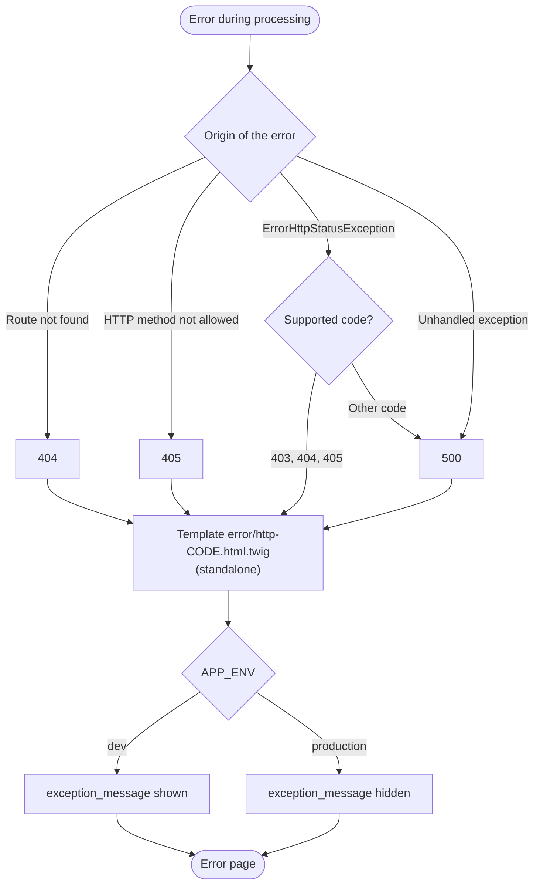

# HTTP errors

The framework displays a formatted error page for the main HTTP errors (from version v2.5.0).

| Code | Page                       | When does it occur?                                      |
|------|----------------------------|----------------------------------------------------------|
| 404  | Page not found             | The requested route does not exist                       |
| 405  | Method not allowed         | The HTTP method is not allowed (Example: POST instead of GET) |
| 403  | Forbidden                  | The controller throws an `ErrorHttpStatusException` with code 403 |
| 500  | Internal server error      | An unhandled exception occurred during processing        |

Each page shows the error code, an explanatory message, the exception message **in development mode only** and a link back to the home page.

The path of an error, from its cause to the page displayed:



## Customizing the error pages

The error pages are Twig templates located in the `app/Template/error/` folder of **your project**:

```
├── app
│   └── Template
│       └── error
│           ├── http-403.html.twig
│           ├── http-404.html.twig
│           ├── http-405.html.twig
│           └── http-500.html.twig
```

You can change their content (text, style, structure) like any other template; they receive three variables:

| Variable            | Description                                              |
|---------------------|----------------------------------------------------------|
| `code`              | The HTTP error code (Example: 404)                       |
| `name`              | The framework name                                       |
| `exception_message` | The exception message (only set in dev mode)             |

!!! info "Standalone pages"

    The error pages **do not extend** `base.html.twig`: they are standalone, with their own CSS.
    This way, they still work even if the error comes from your templates or your layout.

## Raising an HTTP error from a controller

The `ErrorHttpStatusException` class lets you interrupt processing and display an error page from a controller. The second parameter is the HTTP code.

Example: denying access to a page:

```php
<?php

namespace Controller;

use Studoo\EduFramework\Core\Controller\Request;
use Studoo\EduFramework\Core\Exception\ErrorHttpStatusException;

class AdminController
{
    public function index(Request $request): string|null
    {
        if ($request->get('token') !== 'my-secret-token') {
            // Display the 403 error page (forbidden)
            throw new ErrorHttpStatusException('Administrators only', 403);
        }

        // ... normal processing
    }
}
```

The supported codes are `403`, `404` and `405`; any other code displays the 500 page.

## Development mode

In development mode (`APP_ENV=dev` in the ".env" file), the error pages show the **exception message** in a red box: useful for understanding and fixing the error. The error is also **logged with the request** in the logs database (`error_message` key: class, message, file and line of the exception) — see [the debug bar and the profiler](debug-bar.md) to read and search it.

In production (or if `APP_ENV` is not defined), this message is **hidden**: visitors only see a generic error page. This is a good security practice: error messages can reveal internal information (paths, queries, configuration).

!!! warning "Warning"

    Configuration errors (Example: the "routes.yaml" file not found) also trigger the 500 page.
    The original message is shown in development mode to help you fix the problem.
