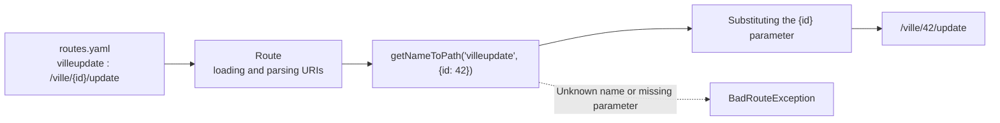

# Route: generating a URL from a route name

The `Route` class rebuilds a route's URL from its **name**, instead of hard-coding its path in templates or controllers.

This feature is available from version **v2.1.0**.

!!! info "A route's name"

    A route's name is the **top-level key** defined in the route configuration file `app/Config/routes.yaml`:

    ```yaml
    villeread:                    # <-- route name
      uri: /ville
      controller: Controller\VilleReadController
      httpMethod: [GET]
    villeupdate:
      uri: '/ville/{id}/update'
      controller: Controller\VilleUpdateController
      httpMethod: [GET, POST]
    ```

    If you change a route's `uri`, every link generated by `getNameToPath()` follows automatically.

!!! info "Several methods in the same controller"

    Since version **v2.4.0**, the `controller` key in the `app/Config/routes.yaml` file can point to a specific controller method using the syntax `Controller\MedecinController::index` (see [One controller, several routes](../build/controller-edu.md#one-controller-several-routes-several-methods)).

    This changes nothing for `getNameToPath()`: URL generation relies only on the route's **name** and `uri`.

## How is the URL built?



## Using it in a Twig template

`getNameToPath` is a Twig function available in all your templates:

```twig
{{ getNameToPath('villeread') }}
```

Result:

```text
/ville
```

### With route parameters

If the route contains parameters (e.g. `/ville/{id}/update`), you must pass them as the second argument, as an associative array:

```twig
{{ getNameToPath('villeupdate', {'id': ville.id}) }}
```

Result (for `ville.id` = 42):

```text
/ville/42/update
```

Example in a link:

```twig
<a href="{{ getNameToPath('villeupdate', {'id': ville.id}) }}">Edit</a>
```

## Using it in a controller

The same feature is available in PHP through the `Route` class:

```php
use Studoo\EduFramework\Core\Controller\Route;

$url = (new Route())->getNameToPath('villeupdate', ['id' => 42]);
// $url contains: /ville/42/update
```

This is useful for redirects after processing a form:

```php
header('Location: ' . (new Route())->getNameToPath('villeread'));
```

## Error handling

If the route name or a parameter is incorrect, a `BadRouteException` is thrown:

| Cause                                  | Message                    |
|----------------------------------------|----------------------------|
| The route name does not exist           | `La route n'existe pas`    |
| A route parameter is missing            | `Le paramètre n'existe pas` |

```php
use Studoo\EduFramework\Core\Exception\BadRouteException;

try {
    $url = (new Route())->getNameToPath('villeupdate'); // missing id parameter
} catch (BadRouteException $e) {
    // Le paramètre n'existe pas
}
```

!!! warning "Routes with a required parameter"

    A route with a required parameter (e.g. `/ville/{id}/delete`) **must** receive a value for that parameter.
    However, an optional parameter (e.g. `/user/{id}[/{name}]`) can be omitted:
    `getNameToPath('user', {'id': 1})` generates `/user/1`.
