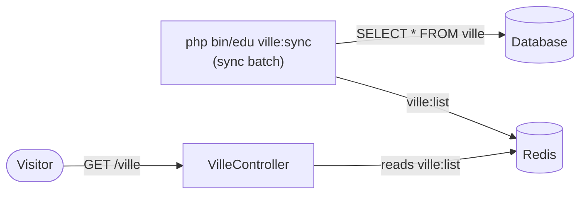

# Caching data with Redis

## Introduction

In the [CRUD](dataservice-select.md), the list of cities is read from the database **every time the page is displayed**: 1,000 visitors means 1,000 identical `SELECT` queries, even though the list only changes from time to time.

A **cache** keeps a copy of the data in very fast storage. Here we use [Redis](https://redis.io){:target="_blank"}, a "key => value" database that keeps everything in memory.

We are going to build the following scenario:

1. a **synchronisation batch** (a CLI command) reads the cities from the database and copies them into Redis;
2. the `/ville` page reads the cities **from Redis**, without any SQL query.



| Step | What we build | What we learn |
|------|---------------|---------------|
| 1 | Nothing: we observe | Measure the cost of a page with the debug bar |
| 2 | The `ville:sync` command | Write to a cache, convert objects to JSON |
| 3 | Reading the cities from the cache | Read a cache and rebuild the objects |
| 4 | Nothing: we observe | Explore the keys with Redis Insight and `redis-cli` |
| 5 | Updating the cache | Data freshness: the real problem of any cache |

## Prerequisites

!!! info "Required reading"

    - [Build the CRUD](dataservice-select.md): the `Ville` entity, the `VilleRepository` and the `VilleController`
    - [Build a CLI command](new-command-edu.md): the `make:command` command

!!! warning "Warning"

    The application cache is available from Edu Framework v2.16.0.

### Start Redis

With Docker, the `compose.yaml` file provides two services: `redis` (the server) and `redisinsight` (a web interface to explore the data).

```shell
docker compose up -d redis redisinsight
```

!!! warning "Project created before v2.16"

    If the command answers `no such service: redis`, your `compose.yaml` file does not contain these services yet: add them by following step 3.3 of the [Migrate from version 2.15 to version 2.16](../migrate/migration-2_15-2_16.md) page.

In the `.env` file, choose the `redis` driver:

```diff
-- CACHE_DRIVER=file
++ CACHE_DRIVER=redis
```

Check the connection with the `check:config` command:

```shell
php bin/edu check:config
```

```text
Cache check :
  [*] Driver du cache : redis (variable CACHE_DRIVER)
  [*] Serveur Redis 127.0.0.1:6379 joignable (version 8.x)
```

!!! tip "Without Redis"

    Steps 1, 2, 3 and 5 also work with `CACHE_DRIVER=file`: the cache is then stored in files in the `var/cache/data` folder. The code stays **exactly the same**, which is the whole point of the `CacheService` service. Only step 4 and the "Going further" section require Redis.

### Cache variables

| Variable | Role | Default value |
|----------|------|---------------|
| `CACHE_DRIVER` | `redis`, `file` (files) or `none` (no cache) | `file` |
| `CACHE_PREFIX` | Prefix added to every key | `edu:` |
| `CACHE_TTL` | Default lifetime of a value, in seconds (`0` = no expiration) | `3600` |
| `REDIS_HOST`, `REDIS_PORT` | Address of the Redis server | `127.0.0.1`, `6379` |
| `REDIS_PASSWORD`, `REDIS_DB` | Redis password and database number | none, `0` |

## Step 1: observe the cost of the SQL query

Development mode must be enabled (`APP_ENV=dev`) to display the [debug bar](debug-bar.md).

Open the `/ville` page and look at the debug bar at the bottom of the page: the **SQL** block shows `1 req SQL`. Reload the page: the query runs again, on every display.

!!! question "Your turn"

    Hover over the SQL block: how long does the query take? How many SQL queries would 10,000 visits of the page run?

## Step 2: the synchronisation batch

### Add the syncCache() method to the repository

We add a method to the `app/Repository/VilleRepository.php` file that copies every city into the cache.

```diff
 <?php

 namespace Repository;

 use Entity\Ville;
+use Studoo\EduFramework\Core\Cache\CacheService;
+use Studoo\EduFramework\Core\Exception\ErrorCacheException;
 use Studoo\EduFramework\Core\Service\DatabaseService;

 class VilleRepository
 {
     // ... getVilles(), createVille() ...
+
+    /**
+     * Copies every city from the database into the cache
+     * @return int Number of cities copied
+     * @throws ErrorCacheException
+     */
+    public function syncCache(): int
+    {
+        // 1. Read from the database: the only SQL query of the sync
+        $villes = $this->getVilles();
+
+        // 2. Convert the Ville objects into arrays: the cache stores JSON
+        $lignes = [];
+        foreach ($villes as $ville) {
+            $lignes[] = [
+                'id' => $ville->getId(),
+                'nom' => $ville->getNom(),
+                'code_postal' => $ville->getCodePostal(),
+                'nombre_habitant' => $ville->getNombreHabitant(),
+            ];
+        }
+
+        // 3. Write to the cache, without expiration (0): the batch is what refreshes the data
+        $cache = CacheService::getCache();
+        if ($cache->set('ville:list', $lignes, 0) === false) {
+            throw new ErrorCacheException("The list of cities was not stored in the cache");
+        }
+        $cache->set('ville:sync:meta', ['date' => date('d/m/Y H:i:s'), 'total' => count($lignes)], 0);
+
+        return count($lignes);
+    }
 }
```

Explanations:

- `CacheService::getCache()` returns the application cache, according to `CACHE_DRIVER`.
- `set(key, value, lifetime)` stores a value. The lifetime is in seconds; `0` means "no expiration".
- The `ville:list` key follows the Redis convention: words separated by `:`, from the most general to the most specific (`ville:list`, `ville:sync:meta`, `ville:42`...).
- The `ville:sync:meta` key keeps the date of the last synchronisation: the page will be able to display it.

!!! info "Why convert the objects into arrays?"

    The cache stores values in **JSON** format, a text format readable by any language. A PHP array becomes JSON without any loss; a `Ville` object, however, has private properties that would not be stored. So we store arrays, and rebuild the `Ville` objects when reading (step 3).

### Create the ville:sync command

Generate the command skeleton:

```shell
php bin/edu make:command villeSync
```

Then complete the `app/Command/VilleSyncCommand.php` file:

```php
<?php

namespace Command;

use Repository\VilleRepository;
use Studoo\EduFramework\Commands\Extends\CommandManage;
use Studoo\EduFramework\Core\Cache\CacheService;
use Studoo\EduFramework\Core\ConfigCore;
use Studoo\EduFramework\Core\Exception\ErrorCacheException;
use Symfony\Component\Console\Attribute\AsCommand;
use Symfony\Component\Console\Command\Command;
use Symfony\Component\Console\Input\InputInterface;
use Symfony\Component\Console\Input\InputOption;
use Symfony\Component\Console\Output\OutputInterface;

#[AsCommand(
    name: 'ville:sync',
    description: 'Copies the cities from the database into the cache (sync batch)'
)]
class VilleSyncCommand extends CommandManage
{
    protected function configure(): void
    {
        // --json option: structured output for a script, a cron job or an AI agent
        $this->addOption('json', null, InputOption::VALUE_NONE, 'JSON output');
    }

    public function execute(InputInterface $input, OutputInterface $output): int
    {
        if (ConfigCore::getEnv('DB_HOST_STATUS') !== 'true') {
            self::$stdOutput->error('The database is disabled (DB_HOST_STATUS=false in the .env file)');
            return Command::FAILURE;
        }

        $debut = microtime(true);
        try {
            $total = (new VilleRepository())->syncCache();
        } catch (ErrorCacheException $exception) {
            self::$stdOutput->error('Synchronisation failed: ' . $exception->getMessage());
            return Command::FAILURE;
        }
        $duree = round((microtime(true) - $debut) * 1000, 1);

        if ($input->getOption('json') === true) {
            $output->writeln(json_encode(['total' => $total, 'duree_ms' => $duree]));
            return Command::SUCCESS;
        }

        self::$stdOutput->success(
            $total . ' city(ies) copied into the cache in ' . $duree . ' ms (driver '
            . CacheService::getCache()->getDriverName() . ')'
        );

        return Command::SUCCESS;
    }
}
```

The command contains almost no logic: it calls `syncCache()` and displays the result. The `syncCache()` method stays in the repository, because we will reuse it in step 5.

### Run the batch

```shell
php bin/edu ville:sync
```

```text
 [OK] 3 city(ies) copied into the cache in 4.5 ms (driver redis)
```

With Docker, the command runs inside the application container:

```shell
docker compose exec frankenphp php bin/edu ville:sync
```

!!! warning "Redis server stopped"

    If Redis does not respond, the command fails with the message "Le serveur Redis <127.0.0.1:6379> est injoignable" (the Redis server is unreachable) and a `Command::FAILURE` return code. Start Redis (`docker compose up -d redis`) and run the command again.

## Step 3: read the cities from the cache

### Add the getVillesFromCache() method to the repository

```diff
 class VilleRepository
 {
     // ... getVilles(), createVille(), syncCache() ...
+
+    /**
+     * Reads the cities from the cache, without any SQL query
+     * @return Ville[]|null null if the cities are not in the cache (batch never run)
+     * @throws ErrorCacheException
+     */
+    public function getVillesFromCache(): array|null
+    {
+        $lignes = CacheService::getCache()->get('ville:list');
+        if ($lignes === null) {
+            return null;
+        }
+
+        // The cache returns arrays: we rebuild the Ville objects
+        $villes = [];
+        foreach ($lignes as $ligne) {
+            $villes[] = new Ville($ligne['id'], $ligne['nom'], $ligne['code_postal'], $ligne['nombre_habitant']);
+        }
+
+        return $villes;
+    }
 }
```

`get(key)` returns the value, or `null` if the key does not exist (the batch has never been run, or the cache was cleared with `php bin/edu cache:clear`).

### Update the VilleController controller

```diff
 <?php

 namespace Controller;

 use Entity\Ville;
 use Repository\VilleRepository;
+use Studoo\EduFramework\Core\Cache\CacheService;
 use Studoo\EduFramework\Core\Controller\ControllerInterface;
 use Studoo\EduFramework\Core\Controller\Request;
 use Studoo\EduFramework\Core\Controller\Route;
 use Studoo\EduFramework\Core\View\TwigCore;

 class VilleController implements ControllerInterface
 {
 	public function execute(Request $request): string|null
 	{
 		// ... form handling (POST) ...

 		return TwigCore::getEnvironment()->render('ville/ville.html.twig',
 		    [
 		        "titre"   => 'VilleController',
 		        "request" => $request,
-		        "villes" => (new VilleRepository())->getVilles()
+		        "villes"  => (new VilleRepository())->getVillesFromCache(),
+		        "sync"    => CacheService::getCache()->get('ville:sync:meta')
 		    ]
 		);
 	}
 }
```

### Update the ville.html.twig view

```diff
         <h2>Liste des villes</h2>
-        <ul>
-            
-                <li>{{ ville.getNom() }} ({{ ville.getCodePostal() }}) - {{ ville.getNombreHabitant() }} habitants</li>
-            
-        </ul>
+        
+            <div class="alert alert-warning" role="alert">
+                The cities are not in the cache yet: run <code>php bin/edu ville:sync</code>
+            </div>
+        
+            <p>Data read from the cache, synchronised on {{ sync.date }} ({{ sync.total }} cities)</p>
+            <ul>
+                
+                    <li>{{ ville.getNom() }} ({{ ville.getCodePostal() }}) - {{ ville.getNombreHabitant() }} habitants</li>
+                
+            </ul>
+        
```

### Check the result

Reload the `/ville` page and compare the debug bar:

| | Before (step 1) | After (step 3) |
|---|---|---|
| SQL block | `1 req SQL` | **gone**: no SQL query |
| Cache block | not shown | `2 hit 0 miss`, in green |

Hover over the Cache block: it lists each read (`get ville:list`, `get ville:sync:meta`) and its duration, often less than a millisecond.

!!! info "Hit and miss"

    A read that finds the value is a **hit**, a read that does not find it is a **miss**. The block turns orange as soon as there is a miss. Try it: clear the cache with `php bin/edu cache:clear --app-only`, reload the page and look at the message and the Cache block.

## Step 4: look at the data in Redis

### With Redis Insight

Open Redis Insight: [http://localhost:5540](http://localhost:5540){:target="_blank"} (the link is also in the panel of the **DEV** block of the debug bar). On first launch, accept the terms of use: the connection to the `redis` service then appears in the list.

You will find your two keys, with the `edu:` prefix (`CACHE_PREFIX` variable):

- `edu:ville:list`: the list of cities, in JSON format
- `edu:ville:sync:meta`: the date and number of cities of the last synchronisation

### With redis-cli

`redis-cli` is the Redis command-line client:

```shell
docker compose exec redis redis-cli
```

```text
127.0.0.1:6379> KEYS edu:*
1) "edu:ville:list"
2) "edu:ville:sync:meta"
127.0.0.1:6379> GET edu:ville:list
"[{\"id\":1,\"nom\":\"Paris\",\"code_postal\":\"75000\",\"nombre_habitant\":2200000},...]"
127.0.0.1:6379> TTL edu:ville:list
(integer) -1
```

`TTL` gives the time left before a key expires, in seconds: `-1` means "no expiration", which is the `0` passed to `set()`.

!!! warning "The KEYS command"

    `KEYS` goes through **every** key and blocks the server while doing so: handy for learning, to be avoided in production. The framework uses `SCAN`, which goes through the keys in small batches (for example in `php bin/edu cache:clear`).

## Step 5: data freshness

### The problem

Create a city with the form of the `/ville` page (for example Toulouse): it is stored in the database... but **it does not appear in the list**. The page displays the copy made by the last batch: the cached data is **stale**.

Run `php bin/edu ville:sync` again: Toulouse appears.

This is the central problem of any cache: **when should the copy be updated?**

### Three strategies

| Strategy | Principle | Advantage | Drawback |
|----------|-----------|-----------|----------|
| Periodic batch | The batch runs regularly (every 5 minutes) | Simple, no impact on the pages | The data can be up to 5 minutes late |
| Update on write (*write-through*) | The cache is updated right after each `INSERT`, `UPDATE` or `DELETE` | Data always up to date | No write must be forgotten |
| Lazy read (*cache-aside*) | The page reads the cache; if the value is missing, it runs the SQL query and caches the result for a limited time | No batch to schedule | The first visitor after expiration waits for the SQL query |

### Schedule the batch

On a Linux server, a **cron** job runs the batch at a regular interval (here every 5 minutes):

```text
*/5 * * * * cd /path/to/project && php bin/edu ville:sync --json >> var/logs/ville-sync.log
```

To test in development, a simple loop in a terminal is enough:

```shell
while true; do php bin/edu ville:sync; sleep 300; done
```

### Update the cache on write

The creation form calls `syncCache()` right after the `INSERT`: this is why we put the synchronisation in the repository.

```diff
 		if ($request->getHttpMethod() === "POST") {
 			$ville = new Ville(
 				0,
 				$request->get('nom'),
 				$request->get('code_postal'),
 				(int) $request->get('nombre_habitant')
 			);

-			(new VilleRepository())->createVille($ville);
+			$repository = new VilleRepository();
+			$repository->createVille($ville);
+			// Write-through: the cache is updated with the new city
+			$repository->syncCache();

 			header('Location: ' . (new Route())->getNameToPath('ville'));
 			return null;
 		}
```

!!! question "Your turn"

    Add the call to `syncCache()` to the update (`VilleUpdateController`) and delete (`VilleDeleteController`) controllers of the CRUD. Check that an updated or deleted city is immediately up to date in the list.

### Lazy reading with remember()

The `remember()` method implements the *cache-aside* strategy in one line: it reads the key and, if it is missing, runs the function, stores its result for the given lifetime, then returns it.

```php
$lignes = CacheService::getCache()->remember('ville:list', 300, function () {
    // Runs only if ville:list is missing from the cache (at most once every 5 minutes)
    return DatabaseService::getConnect()
        ->query('SELECT id, nom, code_postal, nombre_habitant FROM ville')
        ->fetchAll(\PDO::FETCH_ASSOC);
});
```

Look at the debug bar: on the first display, `0 hit 1 miss` and `1 req SQL`; on the following displays, `1 hit` and no SQL query, for 5 minutes.

## Going further (Redis only)

`CacheService::getRedis()` gives access to the Redis client ([Predis](https://github.com/predis/predis){:target="_blank"}) to use **every** Redis command. The client applies the same prefix as the cache: `$redis->get('ville:list')` reads the `edu:ville:list` key.

### An atomic replacement

While a very long list is being written, a visitor could read an incomplete value. The solution: write to a temporary key, then **rename** it. The `RENAME` command is atomic: the `ville:list` key switches from the old value to the new one in a single step.

```diff
         $cache = CacheService::getCache();
-        if ($cache->set('ville:list', $lignes, 0) === false) {
+        if ($cache->set('ville:list:tmp', $lignes, 0) === false) {
             throw new ErrorCacheException("The list of cities was not stored in the cache");
         }
+        // RENAME replaces ville:list with ville:list:tmp in a single operation
+        CacheService::getRedis()->rename('ville:list:tmp', 'ville:list');
```

### One hash per city

To read **a single** city without loading the whole list, Redis offers the **hash** type: a dictionary of fields within a single key.

```php
$redis = CacheService::getRedis();
foreach ((new VilleRepository())->getVilles() as $ville) {
    $cle = 'ville:' . $ville->getId();            // ville:1, ville:2...
    $redis->hset($cle, 'nom', $ville->getNom());
    $redis->hset($cle, 'code_postal', $ville->getCodePostal());
    $redis->hset($cle, 'nombre_habitant', $ville->getNombreHabitant());
}

// Reading one city: ['nom' => 'Marseille', 'code_postal' => '13000', 'nombre_habitant' => '800000']
$marseille = $redis->hgetall('ville:2');
```

!!! info "Watch out for types"

    The fields of a hash are always **strings**: `'800000'` and not `800000`. The cache JSON, on the other hand, keeps the types (numbers, booleans, `null`).

In Redis Insight, compare the key types: `String` for `edu:ville:list`, `Hash` for `edu:ville:2`.

## Summary

### Useful commands

| Command | Role |
|---------|------|
| `php bin/edu ville:sync` | Copies the cities into the cache (our batch) |
| `php bin/edu check:config` | Checks the cache driver and the connection to Redis |
| `php bin/edu cache:clear --app-only` | Clears the application cache (the `edu:*` keys in Redis) |
| `docker compose exec redis redis-cli` | Opens the Redis command-line client |

### Project files

``` hl_lines="3 5 8 12 16"
├── app
│   ├── Command
│   │   └── VilleSyncCommand.php
│   ├── Config
│   │   ├── commands.yaml
│   │   └── routes.yaml
│   ├── Controller
│   │   └── VilleController.php
│   ├── Entity
│   │   └── Ville.php
│   ├── Repository
│   │   └── VilleRepository.php
│   └── Template
│       └── ville
│           └── ville.html.twig
```

### In Symfony

| Edu Framework | Symfony |
|---------------|---------|
| `CacheService::getCache()` | The [Cache](https://symfony.com/doc/current/components/cache.html){:target="_blank"} component (`CacheInterface`) |
| `remember()` | `$cache->get('key', function (ItemInterface $item) { ... })` |
| `CACHE_DRIVER=redis` | `RedisAdapter` |
| The `ville:sync` batch run by cron | A Console command scheduled with the [Scheduler](https://symfony.com/doc/current/scheduler.html){:target="_blank"} component |

## Going further

- [Build a CLI command](new-command-edu.md)
- [The debug bar and the profiler](debug-bar.md)
- [Redis command reference](https://redis.io/docs/latest/commands/){:target="_blank"}
