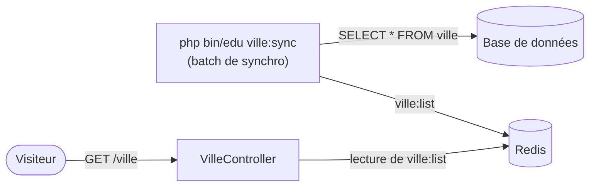

# Mettre des données en cache avec Redis

## Introduction

Dans le [CRUD](dataservice-select.md), la liste des villes est lue dans la base de données **à chaque affichage de la page** : 1 000 visiteurs, c'est 1 000 fois la même requête `SELECT`, alors que la liste ne change que de temps en temps.

Un **cache** garde une copie des données dans une mémoire très rapide. Ici, nous utilisons [Redis](https://redis.io){:target="_blank"}, une base de données « clé => valeur » qui garde tout en mémoire vive.

Nous allons construire le scénario suivant :

1. un **batch de synchronisation** (une commande CLI) lit les villes dans la base de données et les copie dans Redis ;
2. la page `/ville` lit les villes **dans Redis**, sans aucune requête SQL.



| Étape | Ce que l'on construit | Ce que l'on apprend |
|-------|-----------------------|---------------------|
| 1 | Rien : on observe | Mesurer le coût d'une page avec la barre de debug |
| 2 | La commande `ville:sync` | Écrire dans un cache, convertir des objets en JSON |
| 3 | La lecture des villes dans le cache | Lire un cache et reconstruire les objets |
| 4 | Rien : on observe | Explorer les clés avec Redis Insight et `redis-cli` |
| 5 | La mise à jour du cache | La fraîcheur des données : le vrai problème d'un cache |

## Prérequis

!!! info "Lecture obligatoire"

    - [Construire le CRUD](dataservice-select.md) : l'entité `Ville`, le `VilleRepository` et le `VilleController`
    - [Construire une commande CLI](new-command-edu.md) : la commande `make:command`

!!! warning "Attention"

    Le cache applicatif est disponible à partir de la version v2.16.0 d'Edu Framework.

### Démarrer Redis

Avec Docker, le fichier `compose.yaml` fournit deux services : `redis` (le serveur) et `redisinsight` (une interface web pour explorer les données).

```shell
docker compose up -d redis redisinsight
```

Dans le fichier `.env`, choisissez le driver `redis` :

```diff
-- CACHE_DRIVER=file
++ CACHE_DRIVER=redis
```

Vérifiez la connexion avec la commande `check:config` :

```shell
php bin/edu check:config
```

```text
Cache check :
  [*] Driver du cache : redis (variable CACHE_DRIVER)
  [*] Serveur Redis 127.0.0.1:6379 joignable (version 8.x)
```

!!! tip "Sans Redis"

    Les étapes 1, 2, 3 et 5 fonctionnent aussi avec `CACHE_DRIVER=file` : le cache est alors stocké dans des fichiers du dossier `var/cache/data`. Le code reste **exactement le même**, c'est tout l'intérêt du service `CacheService`. Seules l'étape 4 et la partie « Pour aller plus loin » nécessitent Redis.

### Les variables du cache

| Variable | Rôle | Valeur par défaut |
|----------|------|-------------------|
| `CACHE_DRIVER` | `redis`, `file` (fichiers) ou `none` (pas de cache) | `file` |
| `CACHE_PREFIX` | Préfixe ajouté à toutes les clés | `edu:` |
| `CACHE_TTL` | Durée de vie par défaut d'une valeur, en secondes (`0` = pas d'expiration) | `3600` |
| `REDIS_HOST`, `REDIS_PORT` | Adresse du serveur Redis | `127.0.0.1`, `6379` |
| `REDIS_PASSWORD`, `REDIS_DB` | Mot de passe et numéro de base Redis | aucun, `0` |

## Étape 1 : constater le coût de la requête SQL

Le mode développement doit être actif (`APP_ENV=dev`) pour afficher la [barre de debug](debug-bar.md).

Ouvrez la page `/ville` et regardez la barre de debug en bas de la page : le bloc **SQL** affiche `1 req SQL`. Rechargez la page : la requête est exécutée à nouveau, à chaque affichage.

!!! question "À vous de jouer"

    Survolez le bloc SQL : quelle est la durée de la requête ? Combien de requêtes SQL seraient exécutées pour 10 000 visites de la page ?

## Étape 2 : le batch de synchronisation

### Ajouter la méthode syncCache() au repository

Nous ajoutons au fichier `app/Repository/VilleRepository.php` une méthode qui copie toutes les villes dans le cache.

```diff
 <?php

 namespace Repository;

 use Entity\Ville;
+use Studoo\EduFramework\Core\Cache\CacheService;
+use Studoo\EduFramework\Core\Exception\ErrorCacheException;
 use Studoo\EduFramework\Core\Service\DatabaseService;

 class VilleRepository
 {
     // ... getVilles(), createVille() ...
+
+    /**
+     * Copie toutes les villes de la base de données dans le cache
+     * @return int Nombre de villes copiées
+     * @throws ErrorCacheException
+     */
+    public function syncCache(): int
+    {
+        // 1. Lecture dans la base de données : la seule requête SQL de la synchro
+        $villes = $this->getVilles();
+
+        // 2. Conversion des objets Ville en tableaux : le cache stocke du JSON
+        $lignes = [];
+        foreach ($villes as $ville) {
+            $lignes[] = [
+                'id' => $ville->getId(),
+                'nom' => $ville->getNom(),
+                'code_postal' => $ville->getCodePostal(),
+                'nombre_habitant' => $ville->getNombreHabitant(),
+            ];
+        }
+
+        // 3. Écriture dans le cache, sans expiration (0) : c'est le batch qui rafraîchit les données
+        $cache = CacheService::getCache();
+        if ($cache->set('ville:list', $lignes, 0) === false) {
+            throw new ErrorCacheException("La liste des villes n'a pas été enregistrée dans le cache");
+        }
+        $cache->set('ville:sync:meta', ['date' => date('d/m/Y H:i:s'), 'total' => count($lignes)], 0);
+
+        return count($lignes);
+    }
 }
```

Explications :

- `CacheService::getCache()` retourne le cache de l'application, selon `CACHE_DRIVER`.
- `set(clé, valeur, durée)` enregistre une valeur. La durée de vie est en secondes ; `0` signifie « pas d'expiration ».
- La clé `ville:list` suit la convention de Redis : des mots séparés par `:`, du plus général au plus précis (`ville:list`, `ville:sync:meta`, `ville:42`...).
- La clé `ville:sync:meta` garde la date de la dernière synchronisation : la page pourra l'afficher.

!!! info "Pourquoi convertir les objets en tableaux ?"

    Le cache stocke les valeurs au format **JSON**, un format texte lisible par n'importe quel langage. Un tableau PHP devient du JSON sans perte ; un objet `Ville`, lui, a des propriétés privées qui ne seraient pas enregistrées. On stocke donc des tableaux, et on reconstruit les objets `Ville` à la lecture (étape 3).

### Créer la commande ville:sync

Générez le squelette de la commande :

```shell
php bin/edu make:command villeSync
```

Puis complétez le fichier `app/Command/VilleSyncCommand.php` :

```php
<?php

namespace Command;

use Repository\VilleRepository;
use Studoo\EduFramework\Commands\Extends\CommandManage;
use Studoo\EduFramework\Core\Cache\CacheService;
use Studoo\EduFramework\Core\ConfigCore;
use Studoo\EduFramework\Core\Exception\ErrorCacheException;
use Symfony\Component\Console\Attribute\AsCommand;
use Symfony\Component\Console\Command\Command;
use Symfony\Component\Console\Input\InputInterface;
use Symfony\Component\Console\Input\InputOption;
use Symfony\Component\Console\Output\OutputInterface;

#[AsCommand(
    name: 'ville:sync',
    description: 'Copie les villes de la base de données dans le cache (batch de synchro)'
)]
class VilleSyncCommand extends CommandManage
{
    protected function configure(): void
    {
        // Option --json : sortie structurée pour un script, une tâche cron ou un agent IA
        $this->addOption('json', null, InputOption::VALUE_NONE, 'Sortie au format JSON');
    }

    public function execute(InputInterface $input, OutputInterface $output): int
    {
        if (ConfigCore::getEnv('DB_HOST_STATUS') !== 'true') {
            self::$stdOutput->error('La base de données est désactivée (DB_HOST_STATUS=false dans le fichier .env)');
            return Command::FAILURE;
        }

        $debut = microtime(true);
        try {
            $total = (new VilleRepository())->syncCache();
        } catch (ErrorCacheException $exception) {
            self::$stdOutput->error('Synchronisation impossible : ' . $exception->getMessage());
            return Command::FAILURE;
        }
        $duree = round((microtime(true) - $debut) * 1000, 1);

        if ($input->getOption('json') === true) {
            $output->writeln(json_encode(['total' => $total, 'duree_ms' => $duree]));
            return Command::SUCCESS;
        }

        self::$stdOutput->success(
            $total . ' ville(s) copiée(s) dans le cache en ' . $duree . ' ms (driver '
            . CacheService::getCache()->getDriverName() . ')'
        );

        return Command::SUCCESS;
    }
}
```

La commande ne contient presque pas de logique : elle appelle `syncCache()` et affiche le résultat. La méthode `syncCache()` reste dans le repository, car nous la réutiliserons à l'étape 5.

### Lancer le batch

```shell
php bin/edu ville:sync
```

```text
 [OK] 3 ville(s) copiée(s) dans le cache en 4.5 ms (driver redis)
```

Avec Docker, la commande s'exécute dans le conteneur de l'application :

```shell
docker compose exec frankenphp php bin/edu ville:sync
```

!!! warning "Serveur Redis arrêté"

    Si Redis ne répond pas, la commande échoue avec le message « Le serveur Redis <127.0.0.1:6379> est injoignable » et un code de retour `Command::FAILURE`. Démarrez Redis (`docker compose up -d redis`) puis relancez la commande.

## Étape 3 : lire les villes dans le cache

### Ajouter la méthode getVillesFromCache() au repository

```diff
 class VilleRepository
 {
     // ... getVilles(), createVille(), syncCache() ...
+
+    /**
+     * Lit les villes dans le cache, sans requête SQL
+     * @return Ville[]|null null si les villes ne sont pas dans le cache (batch jamais lancé)
+     * @throws ErrorCacheException
+     */
+    public function getVillesFromCache(): array|null
+    {
+        $lignes = CacheService::getCache()->get('ville:list');
+        if ($lignes === null) {
+            return null;
+        }
+
+        // Le cache rend des tableaux : on reconstruit les objets Ville
+        $villes = [];
+        foreach ($lignes as $ligne) {
+            $villes[] = new Ville($ligne['id'], $ligne['nom'], $ligne['code_postal'], $ligne['nombre_habitant']);
+        }
+
+        return $villes;
+    }
 }
```

`get(clé)` retourne la valeur, ou `null` si la clé n'existe pas (le batch n'a jamais été lancé, ou le cache a été vidé avec `php bin/edu cache:clear`).

### Modifier le controller VilleController

```diff
 <?php

 namespace Controller;

 use Entity\Ville;
 use Repository\VilleRepository;
+use Studoo\EduFramework\Core\Cache\CacheService;
 use Studoo\EduFramework\Core\Controller\ControllerInterface;
 use Studoo\EduFramework\Core\Controller\Request;
 use Studoo\EduFramework\Core\Controller\Route;
 use Studoo\EduFramework\Core\View\TwigCore;

 class VilleController implements ControllerInterface
 {
 	public function execute(Request $request): string|null
 	{
 		// ... traitement du formulaire (POST) ...

 		return TwigCore::getEnvironment()->render('ville/ville.html.twig',
 		    [
 		        "titre"   => 'VilleController',
 		        "request" => $request,
-		        "villes" => (new VilleRepository())->getVilles()
+		        "villes"  => (new VilleRepository())->getVillesFromCache(),
+		        "sync"    => CacheService::getCache()->get('ville:sync:meta')
 		    ]
 		);
 	}
 }
```

### Modifier la vue ville.html.twig

```diff
         <h2>Liste des villes</h2>
-        <ul>
-            
-                <li>{{ ville.getNom() }} ({{ ville.getCodePostal() }}) - {{ ville.getNombreHabitant() }} habitants</li>
-            
-        </ul>
+        
+            <div class="alert alert-warning" role="alert">
+                Les villes ne sont pas encore dans le cache : lancez <code>php bin/edu ville:sync</code>
+            </div>
+        
+            <p>Données lues dans le cache, synchronisées le {{ sync.date }} ({{ sync.total }} villes)</p>
+            <ul>
+                
+                    <li>{{ ville.getNom() }} ({{ ville.getCodePostal() }}) - {{ ville.getNombreHabitant() }} habitants</li>
+                
+            </ul>
+        
```

### Constater le résultat

Rechargez la page `/ville` et comparez la barre de debug :

| | Avant (étape 1) | Après (étape 3) |
|---|---|---|
| Bloc SQL | `1 req SQL` | **absent** : aucune requête SQL |
| Bloc Cache | absent | `2 hit 0 miss`, en vert |

Survolez le bloc Cache : il détaille chaque lecture (`get ville:list`, `get ville:sync:meta`) et son temps, souvent inférieur à une milliseconde.

!!! info "Hit et miss"

    Une lecture qui trouve la valeur est un **hit** (« touché »), une lecture qui ne la trouve pas est un **miss** (« raté »). Le bloc devient orange dès qu'il y a un miss. Faites le test : videz le cache avec `php bin/edu cache:clear --app-only`, rechargez la page et observez le message et le bloc Cache.

## Étape 4 : observer les données dans Redis

### Avec Redis Insight

Ouvrez Redis Insight : [http://localhost:5540](http://localhost:5540){:target="_blank"} (le lien est aussi dans le panneau du bloc **DEV** de la barre de debug). Au premier lancement, acceptez les conditions d'utilisation : la connexion au service `redis` apparaît dans la liste.

Vous retrouvez vos deux clés, avec le préfixe `edu:` (variable `CACHE_PREFIX`) :

- `edu:ville:list` : la liste des villes, au format JSON
- `edu:ville:sync:meta` : la date et le nombre de villes de la dernière synchronisation

### Avec redis-cli

`redis-cli` est le client en ligne de commande de Redis :

```shell
docker compose exec redis redis-cli
```

```text
127.0.0.1:6379> KEYS edu:*
1) "edu:ville:list"
2) "edu:ville:sync:meta"
127.0.0.1:6379> GET edu:ville:list
"[{\"id\":1,\"nom\":\"Paris\",\"code_postal\":\"75000\",\"nombre_habitant\":2200000},...]"
127.0.0.1:6379> TTL edu:ville:list
(integer) -1
```

`TTL` donne le temps restant avant l'expiration d'une clé, en secondes : `-1` signifie « pas d'expiration », c'est le `0` passé à `set()`.

!!! warning "La commande KEYS"

    `KEYS` parcourt **toutes** les clés et bloque le serveur pendant ce temps : pratique pour apprendre, à éviter en production. Le framework utilise `SCAN`, qui parcourt les clés par petits paquets (Exemple : dans `php bin/edu cache:clear`).

## Étape 5 : la fraîcheur des données

### Le problème

Créez une ville avec le formulaire de la page `/ville` (Exemple : Toulouse) : elle est bien enregistrée dans la base de données... mais **elle n'apparaît pas dans la liste**. La page affiche la copie faite par le dernier batch : les données du cache sont **périmées**.

Relancez `php bin/edu ville:sync` : Toulouse apparaît.

C'est le problème central de tout cache : **quand mettre à jour la copie ?**

### Trois stratégies

| Stratégie | Principe | Avantage | Inconvénient |
|-----------|----------|----------|--------------|
| Batch périodique | Le batch est relancé régulièrement (toutes les 5 minutes) | Simple, aucun impact sur les pages | Les données ont jusqu'à 5 minutes de retard |
| Mise à jour à l'écriture (*write-through*) | Le cache est mis à jour juste après chaque `INSERT`, `UPDATE` ou `DELETE` | Données toujours à jour | Il ne faut oublier aucune écriture |
| Lecture paresseuse (*cache-aside*) | La page lit le cache ; si la valeur est absente, elle fait la requête SQL et la met en cache pour un temps limité | Pas de batch à planifier | Le premier visiteur après l'expiration attend la requête SQL |

### Planifier le batch

Sur un serveur Linux, une tâche **cron** lance le batch à intervalle régulier (ici toutes les 5 minutes) :

```text
*/5 * * * * cd /chemin/du/projet && php bin/edu ville:sync --json >> var/logs/ville-sync.log
```

Pour tester en développement, une simple boucle dans un terminal suffit :

```shell
while true; do php bin/edu ville:sync; sleep 300; done
```

### Mettre à jour le cache à l'écriture

Le formulaire de création appelle `syncCache()` juste après l'`INSERT` : c'est l'intérêt d'avoir placé la synchronisation dans le repository.

```diff
 		if ($request->getHttpMethod() === "POST") {
 			$ville = new Ville(
 				0,
 				$request->get('nom'),
 				$request->get('code_postal'),
 				(int) $request->get('nombre_habitant')
 			);

-			(new VilleRepository())->createVille($ville);
+			$repository = new VilleRepository();
+			$repository->createVille($ville);
+			// Write-through : le cache est mis à jour avec la nouvelle ville
+			$repository->syncCache();

 			header('Location: ' . (new Route())->getNameToPath('ville'));
 			return null;
 		}
```

!!! question "À vous de jouer"

    Ajoutez l'appel à `syncCache()` dans les controllers de modification (`VilleUpdateController`) et de suppression (`VilleDeleteController`) du CRUD. Vérifiez qu'une ville modifiée ou supprimée est aussitôt à jour dans la liste.

### La lecture paresseuse avec remember()

La méthode `remember()` réalise la stratégie *cache-aside* en une ligne : elle lit la clé et, si elle est absente, exécute la fonction, enregistre son résultat pour la durée donnée, puis le retourne.

```php
$lignes = CacheService::getCache()->remember('ville:list', 300, function () {
    // Exécuté uniquement si ville:list est absente du cache (au plus une fois toutes les 5 minutes)
    return DatabaseService::getConnect()
        ->query('SELECT id, nom, code_postal, nombre_habitant FROM ville')
        ->fetchAll(\PDO::FETCH_ASSOC);
});
```

Observez la barre de debug : au premier affichage, `0 hit 1 miss` et `1 req SQL` ; aux affichages suivants, `1 hit` et aucune requête SQL, pendant 5 minutes.

## Pour aller plus loin (Redis uniquement)

`CacheService::getRedis()` donne accès au client Redis ([Predis](https://github.com/predis/predis){:target="_blank"}) pour utiliser **toutes** les commandes Redis. Le client applique le même préfixe que le cache : `$redis->get('ville:list')` lit la clé `edu:ville:list`.

### Un remplacement atomique

Pendant l'écriture d'une très longue liste, un visiteur pourrait lire une valeur incomplète. La solution : écrire dans une clé temporaire, puis la **renommer**. La commande `RENAME` est atomique : la clé `ville:list` passe d'un coup de l'ancienne à la nouvelle valeur.

```diff
         $cache = CacheService::getCache();
-        if ($cache->set('ville:list', $lignes, 0) === false) {
+        if ($cache->set('ville:list:tmp', $lignes, 0) === false) {
             throw new ErrorCacheException("La liste des villes n'a pas été enregistrée dans le cache");
         }
+        // RENAME remplace ville:list par ville:list:tmp en une seule opération
+        CacheService::getRedis()->rename('ville:list:tmp', 'ville:list');
```

### Un hash par ville

Pour lire **une seule** ville sans charger toute la liste, Redis propose le type **hash** : un dictionnaire de champs dans une même clé.

```php
$redis = CacheService::getRedis();
foreach ((new VilleRepository())->getVilles() as $ville) {
    $cle = 'ville:' . $ville->getId();            // ville:1, ville:2...
    $redis->hset($cle, 'nom', $ville->getNom());
    $redis->hset($cle, 'code_postal', $ville->getCodePostal());
    $redis->hset($cle, 'nombre_habitant', $ville->getNombreHabitant());
}

// Lecture d'une ville : ['nom' => 'Marseille', 'code_postal' => '13000', 'nombre_habitant' => '800000']
$marseille = $redis->hgetall('ville:2');
```

!!! info "Attention aux types"

    Les champs d'un hash sont toujours des **chaînes de caractères** : `'800000'` et non `800000`. Le JSON du cache, lui, conserve les types (nombres, booléens, `null`).

Dans Redis Insight, comparez les types des clés : `String` pour `edu:ville:list`, `Hash` pour `edu:ville:2`.

## Récapitulatif

### Les commandes utiles

| Commande | Rôle |
|----------|------|
| `php bin/edu ville:sync` | Copie les villes dans le cache (notre batch) |
| `php bin/edu check:config` | Vérifie le driver du cache et la connexion à Redis |
| `php bin/edu cache:clear --app-only` | Vide le cache applicatif (les clés `edu:*` de Redis) |
| `docker compose exec redis redis-cli` | Ouvre le client en ligne de commande de Redis |

### Les fichiers du projet

``` hl_lines="3 5 8 12 16"
├── app
│   ├── Command
│   │   └── VilleSyncCommand.php
│   ├── Config
│   │   ├── commands.yaml
│   │   └── routes.yaml
│   ├── Controller
│   │   └── VilleController.php
│   ├── Entity
│   │   └── Ville.php
│   ├── Repository
│   │   └── VilleRepository.php
│   └── Template
│       └── ville
│           └── ville.html.twig
```

### Dans Symfony

| Edu Framework | Symfony |
|---------------|---------|
| `CacheService::getCache()` | Le composant [Cache](https://symfony.com/doc/current/components/cache.html){:target="_blank"} (`CacheInterface`) |
| `remember()` | `$cache->get('clé', function (ItemInterface $item) { ... })` |
| `CACHE_DRIVER=redis` | `RedisAdapter` |
| Le batch `ville:sync` lancé par cron | Une commande Console planifiée avec le composant [Scheduler](https://symfony.com/doc/current/scheduler.html){:target="_blank"} |

## Pour aller plus loin

- [Construire une commande CLI](new-command-edu.md)
- [La barre de debug et le profiler](debug-bar.md)
- [Documentation des commandes Redis](https://redis.io/docs/latest/commands/){:target="_blank"}
