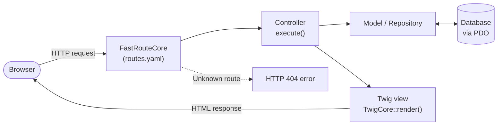

# What is MVC?

Edu Framework uses the MVC pattern to organize and structure web applications.

MVC (Model-View-Controller) is one of the oldest and most widely used software design patterns. 

It separates concerns into three components - the model holds the data and business logic, the view displays the user interface and the controller handles user input and coordinates the model and the view.

MVC makes code easier to maintain by decoupling the user interface from the business logic.

## The request lifecycle in Edu Framework

## Controller

The controller is the intermediary between the model and the view. It handles user events, performs the necessary processing and coordinates updates between the model and the view.

The controller interprets user actions, manipulates the model's data accordingly and updates the view to reflect the changes.

- **Interaction:** The controller interacts with the view by receiving user events and updating the view with new data from the model. It interacts with the model by calling the appropriate methods to manipulate the data and retrieve the information needed for display in the view.
- **Technical:** The controller is often paired with a routing system to handle HTTP requests and call the appropriate methods based on the requested URL.
- **Keywords:** HTTP Request, GET, POST

## Model

The model represents the application's data and business logic. It is responsible for managing the data, its structure, its consistency and its relationships. 

It encapsulates business rules and read/write operations on the database or any other storage system, and provides an interface for interacting with that data.

The model is independent of the user interface and of the control mechanisms.

- **Interaction:** The model interacts with the controller layer by providing methods that let the controller manipulate the data and retrieve the information needed for display in the view. 
- **Technical:** The model layer is often paired with an ORM (Object-Relational Mapping) to handle CRUD (Create, Read, Update, Delete)
- **Keywords:** business logic, data, ORM, CRUD

## View

The view is the part of the application that handles displaying data to the user. It is responsible for presenting and formatting the information coming from the model. 

The view is passive, which means it does not handle user events or modify data directly. It simply displays the data and passes user actions on to the controller.

- **Interaction:** The view interacts with the controller and also gets the model's data through the controller in order to display it on screen. 
- **Technical:** The View layer is often paired with a template engine for managing display formats flexibly. 
- **Keywords:** Template engine

!!! info "TWIG template engine"

    Edu Frame uses the TWIG template engine: [https://twig.symfony.com](https://twig.symfony.com){:target="_blank"}

# Why use MVC

The MVC (Model-View-Controller) pattern is used for several reasons, which mainly stem from its design based on **separation of concerns (SoC)**. 

Here are some key benefits of using the MVC pattern:

1. **Easier maintenance:** By separating the different aspects of the application (data, presentation and control), it is easier to locate and fix problems, make changes or add new features. Developers can work on specific parts of the application without affecting the others.
2. **Code reusability:** Separation of concerns makes it possible to create modular, reusable components, which reduces code duplication and makes it easier to develop more complex applications.
3. **Better collaboration:** In projects involving several developers, separation of concerns makes collaboration easier. Developers can work in parallel on different aspects of the application, such as business logic, the user interface and event handling, without interfering with one another.
4. **Flexibility and scalability:** The MVC pattern makes it easy to modify or extend the different parts of the application without affecting the rest. For example, you can change the user interface without changing the business logic or data management.
5. **Better code organization:** The MVC pattern enforces a clear, well-organized structure on the application's code, which makes the code easier for developers to understand and navigate.
6. **Testability:** Separation of concerns makes it easier to write unit and integration tests for the different parts of the application, since they depend less on one another.
