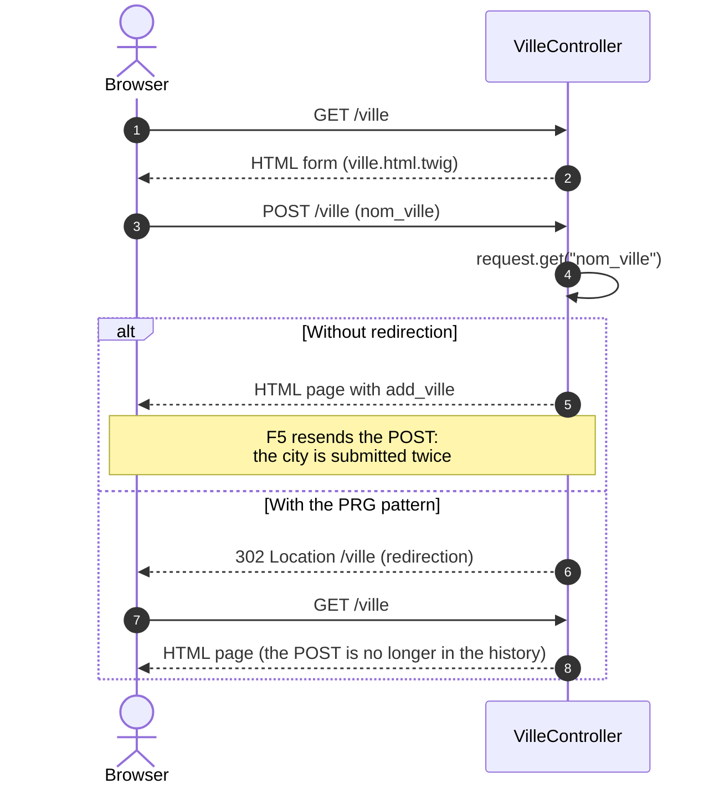

# How to build a form?

To handle a post in a controller, you need an HTML form in the twig file and some processing in the controller.

## The steps to handle a post in a controller

- Create a controller
- Create a form in the twig file
- Add processing in the controller
- Understand how the [Request](../boost/resquet.md) class works to retrieve the form data

### Creating a controller

We are going to create a "ville" page with the following command:

```Shell
php bin/edu make:controller Ville
```

The command will generate a "VilleController.php" controller in the "app/Controller" folder and a "ville.html.twig" file in the "app/Template/ville" folder.
Here is the tree of the generated files:

``` hl_lines="5 8 9"
├── app
│   ├── Config
│   │   └── routes.yaml
│   ├── Controller
│   │   └── VilleController.php
│   └── Template
│       ├── base.html.twig
│       └── ville
│           └── ville.html.twig
```

### Modify the routes configuration file

By default, routes use the GET method. To be able to send data with POST, you must modify the route in the routes configuration file.
Select the route of your controller in the "app/Config/routes.yaml" file and add the POST method.

Example for the /ville route:

```diff
ville:
  uri: /ville
  controller: Controller\VilleController
-  httpMethod: [GET]
+  httpMethod: [GET,POST]
```

!!! warning "Warning"

    If you get an "HTTP 405 Method Not Allowed" error, check that the POST method has been added to the routes configuration file.

### Create a form in the twig file

Create a form using the POST method in the twig file to send the data to the controller.
Select the "ville.html.twig" file in the "app/Template/ville" folder

Here is an example of a form:

```diff


{{ titre }}


    <h1>{{ titre }}</h1>
+    
+        <div class="alert alert-success" role="alert">
+            The city is {{ add_ville }}
+        </div>
+    
+
+    <p>Create a new city</p>
+    <form action="/ville" method="post">
+        <label for="nom_ville">City</label>
+        <input type="text" id="nom_ville" name="nom_ville">
+        <input type="submit" value="Send">
+    </form>

```

In this example, we display a form to create a new city. 

The city is displayed if it is not null (if condition in twig syntax).
The city is displayed with the twig syntax `{{ nom_ville }}`.

Have a look at the [Twig](https://twig.symfony.com/doc/3.x/){:target="_blank"} documentation for more information about forms.

### Add processing in the controller

Add processing in the controller to retrieve the form data.

Example of processing:

```diff
<?php

namespace Controller;

use Studoo\EduFramework\Core\Controller\ControllerInterface;
use Studoo\EduFramework\Core\Controller\Request;
use Studoo\EduFramework\Core\View\TwigCore;
use Twig\Error\LoaderError;
use Twig\Error\RuntimeError;
use Twig\Error\SyntaxError;

class VilleController implements ControllerInterface
{
	public function execute(Request $request): string|null
	{
		return TwigCore::getEnvironment()->render('ville/ville.html.twig',
		    [
		        "titre"   => 'VilleController',
- 		        "request" => $request,
+ 		        "add_ville" => $request->get('nom_ville')
		    ]
		);
	}
}
```

In this example, we retrieve the city from the form in the controller with the `get($key)` method of the [Request](../boost/resquet.md#getkey) class.

<video controls>
<source src="../assets/screen-form-simple.mp4" type="video/mp4">
</video>

Here is the lifecycle of a form submission, compared with the **PRG** (Post/Redirect/Get) pattern recommended after processing:



### If the route changes in the form

If you have changed the route in the routes configuration file, you must change the form action in the twig file. That gets tough if you have several routes to manage.
To get around this problem, you can use the twig function `{{ getNameToPath('NOM_ROUTE') }}` to generate the URL of the route.

In the example, the route is called "ville":

``` hl_lines="5"
hello:
    uri: /hello
    controller: Controller\HelloController
    httpMethod: [GET]
ville:
    uri: /ville
    controller: Controller\VilleController
    httpMethod: [GET, POST]
```

We are going to use the `getNameToPath('NOM_ROUTE')` function in the "ville.html.twig" file, more precisely in the form:

```diff


{{ titre }}


    <h1>{{ titre }}</h1>
        
            <div class="alert alert-success" role="alert">
                    The city is {{ add_ville }}
                </div>
        

        <p>Create a new city</p>
--        <form action="/ville" method="post">
++        <form action="{{ getNameToPath('ville') }}" method="post">
            <label for="nom_ville">City</label>
            <input type="text" id="nom_ville" name="nom_ville">
            <input type="submit" value="Send">
        </form>

```

<video controls>
<source src="../assets/screen-form-path.mp4" type="video/mp4">
</video>

!!! info "Going further"

    To go further with generating URLs from the route name (routes with parameters, redirections, ...),
    you can read the documentation of the [Route](../boost/route.md) class.

    To understand how to handle HTTP requests, you can read the documentation of the [Request](../boost/resquet.md) class.

    To secure your form against CSRF attacks, you can read the documentation
    [Protecting a form (CSRF)](csrf.md).
