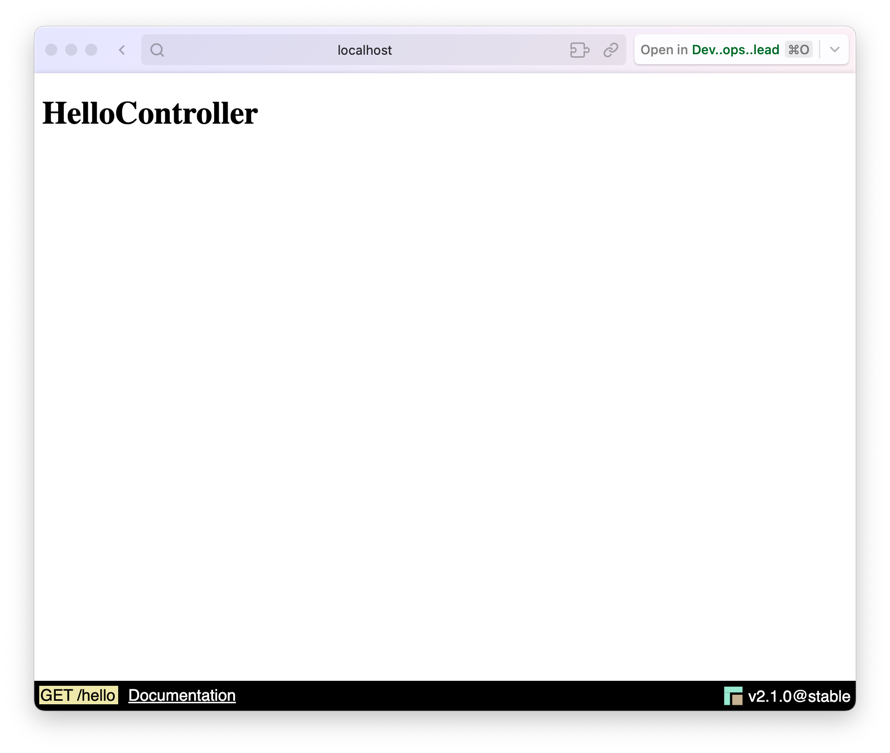
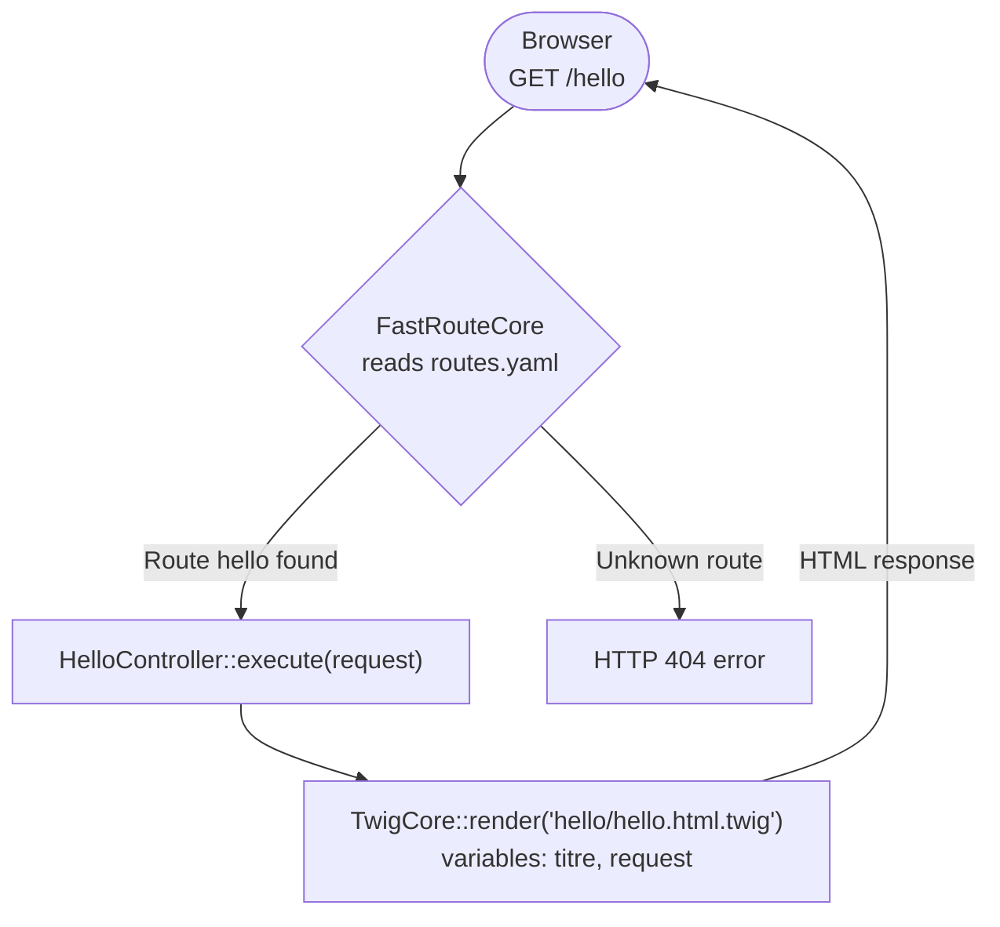

# How to create a controller?

!!! info "Reminder: what is a controller?"

    A controller is the intermediary between the model and the view. It handles user events, performs the necessary processing and coordinates updates between the model and the view.

Creating a controller couldn't be simpler: the "edu" command is there to help you. 

You can use it at the root of your project by typing the following command:

```Shell
php bin/edu make:controller NOM_DU_CONTROLLER
```

Don't forget to replace **"NOM_DU_CONTROLLER"** with the name of your controller.

<br>

# Example: creating a controller

We are going to create a "Hello" page with the following command:

```Shell
php bin/edu make:controller Hello
```

The command will generate a "HelloController.php" controller in the "app/Controller" folder and a "hello.html.twig" file in the "app/Template/hello" folder.
Here is the tree of the generated files:

``` hl_lines="5 8 9"
├── app
│   ├── Config
│   │   └── routes.yaml
│   ├── Controller
│   │   └── HelloController.php
│   └── Template
│       ├── base.html.twig
│       └── hello
│           └── hello.html.twig
```

### The HelloController.php file
This command will create a "HelloController.php" file in the "app/Controller" folder. 

```php 
<?php

namespace Controller;

use Studoo\EduFramework\Core\Controller\ControllerInterface;
use Studoo\EduFramework\Core\Controller\Request;
use Studoo\EduFramework\Core\View\TwigCore;
use Twig\Error\LoaderError;
use Twig\Error\RuntimeError;
use Twig\Error\SyntaxError;

class HelloController implements ControllerInterface
{
	public function execute(Request $request): string|null
	{
		return TwigCore::getEnvironment()->render('hello/hello.html.twig',
		    [
		        "titre"   => 'HelloController',
		        "request" => $request
		    ]
		);
	}
}
```

We can see that the HelloController controller implements the ControllerInterface interface. 

The `execute()` method takes an object of type [Request](../boost/resquet.md) as a parameter and returns a character string (string) or null.
The view layer is handled by the Twig template engine. We use the `render()` method of the TwigCore class to display the "hello/hello.html.twig" template.
Two variables are passed to the template: "titre" and "request".

!!! info

    To go further, you can read the documentation of the [Request](../boost/resquet.md) class to understand how to handle HTTP requests.


### The hello.html.twig file
It will also create a "hello.html.twig" file in the "app/Template/hello" folder.

```twig


{{ titre }}


    <h1>{{ titre }}</h1>

```

In the "hello.html.twig" view, the page title "HelloController" is displayed in an h1. A `{{ titre }}` variable is passed to the template by the controller.

You can access your controller by typing the following URL: [http://localhost:8042/hello](http://localhost:8042/hello){:target="_blank"}

<figure markdown="span">

</figure>

## Editing the routes file
Then edit the routes file "app/Config/routes.yaml" to add the route for your controller.

```yaml
hello:
  uri: /hello
  controller: Controller\HelloController
  httpMethod: [GET]
```

!!! info "The three keys of a route"

    Each route must define `uri`, `controller` and `httpMethod`. The `httpMethod` key contains one HTTP method
    (`httpMethod: GET`) or a list of methods (`[GET, POST]`), written in **uppercase**: a `[get]` route
    does not respond to a `GET` request (405 error).
    If a key is missing, the error page displays, in development mode (`APP_ENV=dev`), a message naming
    the route: `La route <hello> du fichier routes.yaml est invalide : la clé 'controller' est absente…`

You can access your controller by typing the following URL: [http://localhost:8042/hello](http://localhost:8042/hello){:target="_blank"}

You can edit the routes file "app/Config/routes.yaml" to change the URL of your controller.
Replace "/hello" with "/bonjour", for example.

```diff
hello:
-  uri: /hello
+  uri: /bonjour
  controller: Controller\HelloController
  httpMethod: [GET]
```
You can access your controller by typing the following URL: [http://localhost:8042/bonjour](http://localhost:8042/bonjour){:target="_blank"}

If we go back to the URL [http://localhost:8042/hello](http://localhost:8042/hello){:target="_blank"}, an `HTTP 404` error will be returned.
As a reminder, the `HTTP 404 error means that the requested resource (route) does not exist or no longer exists.


## One controller, several routes (several methods)

Until now, a route was associated with a controller that had a single `execute()` method.
You can group several routes in the same controller, each one pointing to a different method.
This feature is available from version **v2.4.0** onwards.

To do this, add the name of the method to call after the controller name, separated by `::`, in the "app/Config/routes.yaml" file:

```yaml
medecin:
  uri: /medecin
  controller: Controller\MedecinController::index
  httpMethod: [GET]
medecin_new:
  uri: /medecin/new
  controller: Controller\MedecinController::new
  httpMethod: [GET, POST]
```

The `/medecin` route calls the `index()` method and the `/medecin/new` route calls the `new()` method of the `MedecinController` controller:

```php
<?php

namespace Controller;

use Studoo\EduFramework\Core\Controller\Request;
use Studoo\EduFramework\Core\View\TwigCore;

class MedecinController
{
    public function index(Request $request): string|null
    {
        return TwigCore::getEnvironment()->render('medecin/index.html.twig',
            [
                "titre"   => 'List of doctors',
                "request" => $request
            ]
        );
    }

    public function new(Request $request): string|null
    {
        return TwigCore::getEnvironment()->render('medecin/new.html.twig',
            [
                "titre"   => 'Create a doctor',
                "request" => $request
            ]
        );
    }
}
```

!!! info "Is the new() method valid?"

    `new` is a reserved word in the PHP language, but it has been allowed as a method name since PHP 7.

### The rules to follow

A method called by a route must:

- be **public** and **non-static**,
- have a parameter of type [Request](../boost/resquet.md),
- return a character string (`string`) or `null`.

If one of these rules is not followed, an `ErrorControllerException` exception is thrown with an explicit message.

!!! info "What about the ControllerInterface interface?"

    - Without an explicit method (`Controller\MedecinController`), the controller must still implement the `ControllerInterface` interface, and its `execute()` method is the one called. This behavior is unchanged: all your existing routes keep working.
    - With an explicit method (`Controller\MedecinController::index`), the interface is no longer required: the framework checks the called method directly.


## Diagram to better understand how it works

