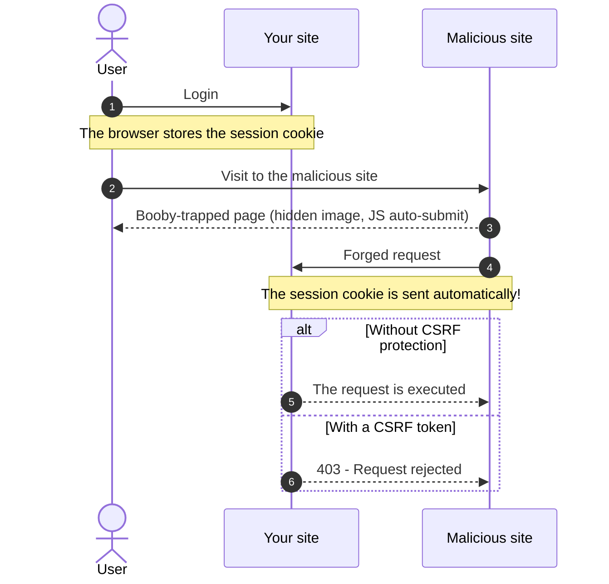

# How to protect a form with a CSRF token?

A CSRF (Cross-Site Request Forgery) attack exploits the trust that a site places in the browser of the logged-in user.

## What is a CSRF attack?

The user of your application is logged in and therefore has an active session on your site.
A malicious site visited during the same session can trigger, without the user knowing,
an HTTP request to your site (Example: a hidden image, a form submitted automatically in JavaScript).

Since the browser automatically sends the session cookie with this request,
the server believes it recognizes the legitimate user and performs the requested action
(Example: changing their email, deleting data, making a bank transfer ...).



## The protection principle: the Synchronizer Token

The framework provides the `Studoo\EduFramework\Core\Security\CsrfService` service, based on three principles:

- **Generation**: the server generates an unpredictable random token (`random_bytes`) and stores it in the session
- **Transmission**: the form sends this token in a hidden `_csrf_token` field
- **Validation**: the server compares the received token with the session token (`hash_equals`, protected against timing attacks)

A malicious site cannot read the token (it has no access to the content of your site's pages),
so its forged request is rejected with an **HTTP 403** error.

The service adds two reinforcements:

- **Per-route isolation**: each route name has its own token.
  The token of the `/medecin/import` form is not accepted on the `/user/{id}/update` route
- **Rotation**: the token is renewed after each successful validation,
  which limits the replay window of an intercepted token

## Protecting a form in 2 steps

### Step 1: the token in the twig file

Add the twig function `csrf_token()` to your form with **the route name**
defined in the `app/Config/routes.yaml` file:

```diff



    <form action="{{ getNameToPath('ville') }}" method="post">
+       {{ csrf_token('ville') | raw }}
        <label for="nom_ville">City</label>
        <input type="text" id="nom_ville" name="nom_ville">
        <input type="submit" value="Send">
    </form>

```

The function generates the hidden token field:

```html
<input type="hidden" name="_csrf_token" value="6734a87fa57df870bb485735ceca7fd17e9fc114decc80cc358562003724080f">
```

### Step 2: validation in the controller

When processing the form, validate the token with the `isCsrfTokenValid()` method
of the [Request](resquet.md) class, using **the same route name**:

```diff
 public function execute(Request $request): string|null
 {
+    if ($request->getHttpMethod() === "POST"
+        && $request->isCsrfTokenValid('ville') === false) {
+        throw new ErrorHttpStatusException("Invalid or expired CSRF token", 403);
+    }
+
     if ($request->get('nom_ville') !== null) {
         // Process the form ...
     }
```

!!! warning "Warning"

    The route name passed to `csrf_token()` in the template and to `isCsrfTokenValid()`
    in the controller must be **identical**, otherwise the submission is always rejected (403).

If the token is invalid, the `ErrorHttpStatusException` class triggers the
[HTTP 403 error](http-error.md) page through the framework's error pipeline.
If the token is valid, it is immediately **renewed** for the next submission.

!!! tip "Tip"

    After a successful submission, redirect to a GET page (POST/Redirect/GET pattern)
    rather than displaying the form again: the user will not be able to submit
    an outdated form by refreshing the page.

## Complete example

You can test the protection on the `/medecin/import` route of the demo application.
The `MedecinController::import()` controller validates the token before processing the file upload:

```php
if ($request->getHttpMethod() === "POST") {
    // Security: the form's CSRF token must be valid
    if ($request->isCsrfTokenValid('medecin_import') === false) {
        throw new ErrorHttpStatusException("Invalid or expired CSRF token", 403);
    }
    // Process the form ...
}
```

The `app/Template/medecin/import.html.twig` form contains the hidden token field:

```twig
<form action="{{ getNameToPath('medecin_import') }}" method="post" enctype="multipart/form-data">
    {{ csrf_token('medecin_import') | raw }}
    <input type="file" name="fichier">
    <input type="submit" value="Import">
</form>
```

## AJAX calls

For a JavaScript request that does not go through a form,
send the token in the `X-CSRF-TOKEN` HTTP header:

```javascript
const token = document.querySelector('input[name="_csrf_token"]').value;

fetch('/medecin/import', {
    method: 'POST',
    headers: {
        'X-CSRF-TOKEN': token
    },
    body: formData
});
```

## The CsrfService class

The service can be used directly (without going through the Request class):

| Method | Role |
|---|---|
| `CsrfService::getToken(string $routeName)` | Generates (on the first call) and returns the token of the route |
| `CsrfService::validate(string $routeName, ?string $token)` | Validates the received token, returns `true`/`false` (rotation on success) |
| `CsrfService::getTokenField(string $routeName)` | Returns the hidden HTML field with the route's token |

The tokens are stored in the session in `$_SESSION['_csrf_tokens'][nomDeRoute]`.

!!! info "Limits of rotation"

    Since the token is renewed after each successful validation:

    - the same form open in two tabs: submitting the first tab
      invalidates the token of the second one (403 error)
    - using the browser's back button and then submitting again is rejected

    This is the expected behavior: the user must display the form again
    to get a fresh token. Two forms of **different routes** open
    at the same time remain valid (per-route isolation limits the impact of rotation).
