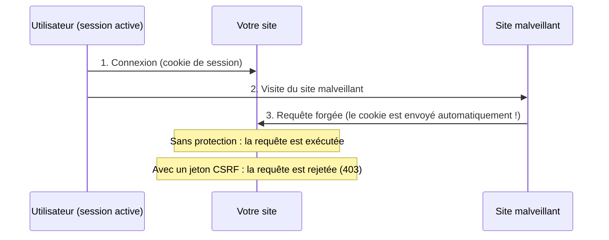

# Comment protéger un formulaire avec un jeton CSRF ?

Une attaque CSRF (Cross-Site Request Forgery) exploite la confiance qu'un site accorde au navigateur de l'utilisateur connecté.

## C'est quoi une attaque CSRF ?

L'utilisateur de votre application est connecté et possède donc une session active sur votre site.
Un site malveillant visited pendant la même session peut déclencher, à l'insu de l'utilisateur,
une requête HTTP vers votre site (Exemple : une image cachée, un formulaire soumis automatiquement en JavaScript).

Comme le navigateur envoie automatiquement le cookie de session avec cette requête,
le serveur croit reconnaître l'utilisateur légitime et exécute l'action demandée
(Exemple : changer son email, supprimer des données, faire un virement ...).



## Le principe de protection : le Synchronizer Token

Le framework fournit le service `Studoo\EduFramework\Core\Security\CsrfService` basé sur trois principes :

- **Génération** : le serveur génère un jeton aléatoire imprévisible (`random_bytes`) et le stocke en session
- **Transmission** : le formulaire envoie ce jeton dans un champ caché `_csrf_token`
- **Validation** : le serveur compare le jeton reçu avec le jeton de la session (`hash_equals`, protégé contre les attaques temporelles)

Un site malveillant ne peut pas lire le jeton (il n'a pas accès au contenu de la page de votre site),
sa requête forgée est donc rejetée avec une erreur **HTTP 403**.

Le service applique deux renforcements :

- **Cloisonnement par route** : chaque nom de route possède son propre jeton.
  Le jeton du formulaire `/medecin/import` n'est pas accepté sur la route `/user/{id}/update`
- **Rotation** : le jeton est renouvelé après chaque validation réussie,
  ce qui limite la fenêtre de rejeu d'un jeton intercepté

## Protéger un formulaire en 2 étapes

### Étape 1 : le jeton dans le fichier twig

Ajoutez la fonction twig `csrf_token()` dans votre formulaire avec **le nom de la route**
défini dans le fichier `app/Config/routes.yaml` :

```diff



    <form action="{{ getNameToPath('ville') }}" method="post">
+       {{ csrf_token('ville') | raw }}
        <label for="nom_ville">Ville</label>
        <input type="text" id="nom_ville" name="nom_ville">
        <input type="submit" value="Envoyer">
    </form>

```

La fonction génère le champ caché du jeton :

```html
<input type="hidden" name="_csrf_token" value="6734a87fa57df870bb485735ceca7fd17e9fc114decc80cc358562003724080f">
```

### Étape 2 : la validation dans le controller

Dans le traitement du formulaire, validez le jeton avec la méthode `isCsrfTokenValid()`
de la classe [Request](../boost/resquet.md) en utilisant **le même nom de route** :

```diff
 public function execute(Request $request): string|null
 {
+    if ($request->getHttpMethod() === "POST"
+        && $request->isCsrfTokenValid('ville') === false) {
+        throw new ErrorHttpStatusException("Jeton CSRF invalide ou expiré", 403);
+    }
+
     if ($request->get('nom_ville') !== null) {
         // Traitement du formulaire ...
     }
```

!!! warning "Attention"

    Le nom de route passé à `csrf_token()` dans le template et à `isCsrfTokenValid()`
    dans le controller doit être **identique**, sinon la soumission est toujours rejetée (403).

Si le jeton est invalide, la classe `ErrorHttpStatusException` déclenche la page
[d'erreur HTTP 403](../boost/http-error.md) via le pipeline d'erreurs du framework.
Si le jeton est valide, il est immédiatement **renouvelé** pour la prochaine soumission.

!!! tip "Astuce"

    Après une soumission réussie, redirigez vers une page GET (pattern POST/Redirect/GET)
    plutôt que de re-afficher le formulaire : l'utilisateur ne pourra pas soumettre
    un formulaire périmé en rafraîchissant la page.

## Exemple complet

Vous pouvez tester la protection sur la route `/medecin/import` de l'application de démonstration.
Le controller `MedecinController::import()` valide le jeton avant de traiter le téléversement du fichier :

```php
if ($request->getHttpMethod() === "POST") {
    // Sécurité : le jeton CSRF du formulaire doit être valide
    if ($request->isCsrfTokenValid('medecin_import') === false) {
        throw new ErrorHttpStatusException("Jeton CSRF invalide ou expiré", 403);
    }
    // Traitement du formulaire ...
}
```

Le formulaire `app/Template/medecin/import.html.twig` contient le champ caché du jeton :

```twig
<form action="{{ getNameToPath('medecin_import') }}" method="post" enctype="multipart/form-data">
    {{ csrf_token('medecin_import') | raw }}
    <input type="file" name="fichier">
    <input type="submit" value="Importer">
</form>
```

## Les appels AJAX

Pour une requête JavaScript qui ne passe pas par un formulaire,
transmettez le jeton dans l'en-tête HTTP `X-CSRF-TOKEN` :

```javascript
const token = document.querySelector('input[name="_csrf_token"]').value;

fetch('/medecin/import', {
    method: 'POST',
    headers: {
        'X-CSRF-TOKEN': token
    },
    body: formData
});
```

## La classe CsrfService

Le service est utilisable directement (sans passer par la classe Request) :

| Méthode | Rôle |
|---|---|
| `CsrfService::getToken(string $routeName)` | Génère (au premier appel) et renvoie le jeton de la route |
| `CsrfService::validate(string $routeName, ?string $token)` | Valide le jeton reçu, renvoie `true`/`false` (rotation en cas de succès) |
| `CsrfService::getTokenField(string $routeName)` | Renvoie le champ HTML caché du jeton de la route |

Les jetons sont stockés en session dans `$_SESSION['_csrf_tokens'][nomDeRoute]`.

!!! info "Limites de la rotation"

    Comme le jeton est renouvelé après chaque validation réussie :

    - le même formulaire ouvert dans deux onglets : la soumission du premier onglet
      invalide le jeton du second (erreur 403)
    - le bouton retour du navigateur suivi d'une nouvelle soumission est rejeté

    C'est le comportement attendu : l'utilisateur doit re-afficher le formulaire
    pour obtenir un jeton frais. Deux formulaires de **routes différentes** ouverts
    simultanément restent valides (le cloisonnement par route limite l'impact de la rotation).
