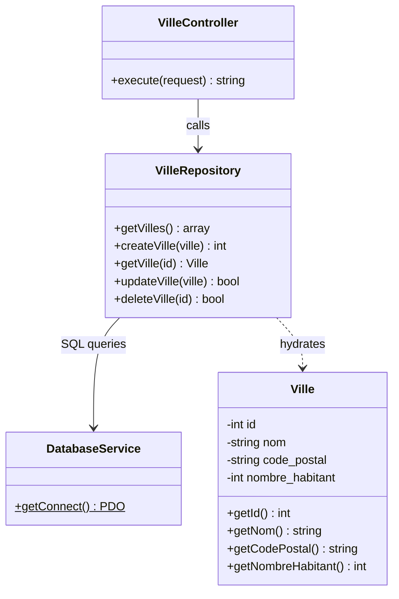

# Building the CRUD

## Introduction

In the previous documentation, we saw how to handle a page with a controller and a form using the POST method.
The logical next step is to build the [CRUD](../annexes/glossaire.md#crud){:target="_blank"} (Create, Read, Update, Delete) of an entity: creating, reading, updating and deleting records in a database.

!!! Prérequis "PHP Data Objects (PDO)"

    PDO is a way to communicate efficiently with a database in PHP, while keeping the flexibility to switch to another type of database if needed, without having to rewrite your code.

    For more information about the PDO object, you can read the [official documentation](https://www.php.net/manual/en/book.pdo.php){:target="_blank"}.

Here are the four operations we are going to build for the `ville` (city) entity:

| Letter | Operation             | SQL query   | What we are going to build                   |
|--------|-----------------------|-------------|----------------------------------------------|
| **C**  | Create                | `INSERT`    | The creation form (`POST /ville`)            |
| **R**  | Read                  | `SELECT`    | The list of cities (`GET /ville`)            |
| **U**  | Update                | `UPDATE`    | The edit form (`/ville/{id}/update`)         |
| **D**  | Delete                | `DELETE`    | The delete link (`/ville/{id}/delete`)       |

## Prerequisites

You must enable the DatabaseService service to use a MySQL, MariaDB or SQLite database.

!!! info "Required reading"

    You must have read the documentation on [DatabaseService: Data management](../boost/dataservice.md)

    The DatabaseService service is enabled in the .env file of your project.
    ```diff
    -- DB_HOST_STATUS=false
    ++ DB_HOST_STATUS=true
    ```

## Database schema

For this example, we are going to use a database with a `ville` table that contains the following fields:


=== "MYSQL/MARIADB"

    ```sql
    CREATE TABLE ville (
        id INT AUTO_INCREMENT PRIMARY KEY,
        nom VARCHAR(255) NOT NULL,
        code_postal VARCHAR(10) NULL,
        nombre_habitant INT NULL
    );
    ```

=== "SQLITE"

    ```sql
    CREATE TABLE ville (
        id integer not null constraint ville_pk primary key autoincrement,
        code_postal     TEXT,
        nombre_habitant integer,
        nom             TEXT
    );
    ```


Dataset for MySQL/SQLite databases

```sql
INSERT INTO ville (nom, code_postal, nombre_habitant) VALUES ('Paris', '75000', 2200000);
INSERT INTO ville (nom, code_postal, nombre_habitant) VALUES ('Marseille', '13000', 800000);
INSERT INTO ville (nom, code_postal, nombre_habitant) VALUES ('Lyon', '69000', 500000);
```

## Step 1: Read with the entity and the repository

We are going to pick up from the page [Building a form](controller-edu-post.md)

Here is the current tree of our project:

``` hl_lines="5 8 9"
├── app
│   ├── Config
│   │   └── routes.yaml
│   ├── Controller
│   │   └── VilleController.php
│   └── Template
│       ├── base.html.twig
│       └── ville
│           └── ville.html.twig
```

We are going to add two folders to the `app` folder to manage data:

- `Entity`: for entities (classes that represent the data of the database)
- `Repository`: for the classes that retrieve data from the database

``` hl_lines="6 7 8 9"
├── app
│   ├── Config
│   │   └── routes.yaml
│   ├── Controller
│   │   └── VilleController.php
│   ├── Entity
│   │   └── Ville.php
│   ├── Repository
│   │   └── VilleRepository.php
│   └── Template
│       ├── base.html.twig
│       └── ville
│           └── ville.html.twig
```

Based on the database schema, we are going to create a `Ville` entity and a `VilleRepository` repository.

The class diagram below shows the relationships between the classes we are going to build:



!!! tip "Generating both files with the make:entity command"

    Starting from version v2.5.0, both files can be generated automatically:

    ```Shell
    php bin/edu make:entity Ville --fields "nom:string,code_postal:string,nombre_habitant:int"
    ```

    The command creates `app/Entity/Ville.php` and `app/Repository/VilleRepository.php` with the getters, the setters and the hydration.
    You can then adapt the generated code. For more details, see the documentation of the [make:entity](../installation/command-edu.md#the-makeentity-command) command.

### Creating the Ville entity

We are going to create a `Ville` entity in the `app/Entity` folder.

```php
<?php

namespace Entity;

class Ville
{
    private int $id;
    private string $nom;
    private string $code_postal;
    private int $nombre_habitant;

    public function __construct($id, $nom, $code_postal, $nombre_habitant)
    {
        $this->id = $id;
        $this->nom = $nom;
        $this->code_postal = $code_postal;
        $this->nombre_habitant = $nombre_habitant;
    }

    public function getId()
    {
        return $this->id;
    }

    public function getNom()
    {
        return $this->nom;
    }

    public function getCodePostal()
    {
        return $this->code_postal;
    }

    public function getNombreHabitant()
    {
        return $this->nombre_habitant;
    }
}
```

### Creating the VilleRepository repository

We are going to create a `VilleRepository` repository in the `app/Repository` folder.

```php
<?php

namespace Repository;

use Entity\Ville;
use Studoo\EduFramework\Core\Service\DatabaseService;

class VilleRepository
{
    public function getVilles(): array
    {
        $villes = [];

        $DataService = DatabaseService::getConnect();
        $stmt = $DataService->query('SELECT * FROM ville');

        while ($row = $stmt->fetch()) {
            $villes[] = new Ville($row['id'], $row['nom'], $row['code_postal'], $row['nombre_habitant']);
        }

        return $villes;
    }
}
```

### Updating the VilleController controller

We are going to update the `VilleController` controller to retrieve data from the database.

```diff
<?php

namespace Controller;

+ use Repository\VilleRepository;
use Studoo\EduFramework\Core\Controller\ControllerInterface;
use Studoo\EduFramework\Core\Controller\Request;
use Studoo\EduFramework\Core\View\TwigCore;
use Twig\Error\LoaderError;
use Twig\Error\RuntimeError;
use Twig\Error\SyntaxError;

class VilleController implements ControllerInterface
{
	public function execute(Request $request): string|null
	{
		return TwigCore::getEnvironment()->render('ville/ville.html.twig',
		    [
		        "titre"   => 'VilleController',
		        "request" => $request,
		        "add_ville" => $request->get('nom_ville'),
+ 		        "villes" => (new VilleRepository())->getVilles()
		    ]
		);
	}
}
```

### Updating the ville.html.twig view

We are going to update the `ville.html.twig` view to display the data from the database.

```diff


{{ titre }}


    <h1>{{ titre }}</h1>
        
            <div class="alert alert-success" role="alert">
                    The city is {{ add_ville }}
                </div>
        

        <p>Create a new city</p>
        <form action="{{ getNameToPath('ville') }}" method="post">
            <label for="nom_ville">City</label>
            <input type="text" id="nom_ville" name="nom_ville">
            <input type="submit" value="Send">
        </form>

+        <h2>List of cities</h2>
+        <ul>
+            
+                <li>{{ ville.getNom() }} ({{ ville.getCodePostal() }}) - {{ ville.getNombreHabitant() }} inhabitants</li>
+            
+        </ul>

```

The **Read** (the list of cities) is in place. For now, the form does not save anything to the database: that is the purpose of the next step.

## Step 2: Create with the creation form

!!! info "Goal"

    - Complete the form so that all the information of a city can be entered
    - Add the `createVille()` method to the repository
    - Save the city to the database when the form is submitted with POST

### Completing the form in the ville.html.twig view

The current form only contains the name of the city. We are going to complete it with the postal code and the number of inhabitants:

```diff

    <h1>{{ titre }}</h1>
-        
-            <div class="alert alert-success" role="alert">
-                    The city is {{ add_ville }}
-                </div>
-        
-
-        <p>Create a new city</p>
+        <h2>Create a new city</h2>
        <form action="{{ getNameToPath('ville') }}" method="post">
-            <label for="nom_ville">City</label>
-            <input type="text" id="nom_ville" name="nom_ville">
+            <label for="nom">City</label>
+            <input type="text" id="nom" name="nom">
+
+            <label for="code_postal">Postal code</label>
+            <input type="text" id="code_postal" name="code_postal">
+
+            <label for="nombre_habitant">Number of inhabitants</label>
+            <input type="text" id="nombre_habitant" name="nombre_habitant">
+
             <input type="submit" value="Send">
        </form>

        <h2>List of cities</h2>
        <ul>
            
                <li>{{ ville.getNom() }} ({{ ville.getCodePostal() }}) - {{ ville.getNombreHabitant() }} inhabitants</li>
            
        </ul>

```

The confirmation message (`add_ville`) is removed: after saving, we are going to redirect the user to the list of cities (see the PRG pattern below).

### Adding the createVille() method to the repository

We are going to add the `createVille()` method to the "app/Repository/VilleRepository.php" file.

```diff
 class VilleRepository
 {
     public function getVilles(): array
     {
         $villes = [];

         $DataService = DatabaseService::getConnect();
         $stmt = $DataService->query('SELECT * FROM ville');

         while ($row = $stmt->fetch()) {
             $villes[] = new Ville($row['id'], $row['nom'], $row['code_postal'], $row['nombre_habitant']);
         }

         return $villes;
     }
+
+    public function createVille(Ville $ville): int
+    {
+        $comBase = DatabaseService::getConnect();
+        $statementPDO = $comBase->prepare(
+            "INSERT INTO ville (nom, code_postal, nombre_habitant) VALUES (:nom, :code_postal, :nombre_habitant)"
+        );
+        $statementPDO->execute([
+            'nom' => $ville->getNom(),
+            'code_postal' => $ville->getCodePostal(),
+            'nombre_habitant' => $ville->getNombreHabitant()
+        ]);
+
+        return (int) $comBase->lastInsertId();
+    }
 }
```

The method uses a **prepared statement** with the `:nom`, `:code_postal` and `:nombre_habitant` parameters.

!!! warning "Cybersecurity topic"

    Why use a prepared statement?

    - To prevent SQL injection attacks
    - To improve the performance of SQL queries
    - To make the query parameters easier to manage

    The `lastInsertId()` method returns the identifier of the created city: useful if you want to redirect the user to the city's page.

### Handling the form in the controller

We are going to update the `VilleController` controller to save the city when the request uses POST.

```diff
<?php

namespace Controller;

+use Entity\Ville;
use Repository\VilleRepository;
use Studoo\EduFramework\Core\Controller\ControllerInterface;
use Studoo\EduFramework\Core\Controller\Request;
+use Studoo\EduFramework\Core\Controller\Route;
use Studoo\EduFramework\Core\View\TwigCore;
use Twig\Error\LoaderError;
use Twig\Error\RuntimeError;
use Twig\Error\SyntaxError;

class VilleController implements ControllerInterface
{
	public function execute(Request $request): string|null
	{
+		if ($request->getHttpMethod() === "POST") {
+			$ville = new Ville(
+				0,
+				$request->get('nom'),
+				$request->get('code_postal'),
+				(int) $request->get('nombre_habitant')
+			);
+
+			(new VilleRepository())->createVille($ville);
+
+			header('Location: ' . (new Route())->getNameToPath('ville'));
+			return null;
+		}
+
		return TwigCore::getEnvironment()->render('ville/ville.html.twig',
		    [
		        "titre"   => 'VilleController',
		        "request" => $request,
-		        "add_ville" => $request->get('nom_ville'),
		        "villes" => (new VilleRepository())->getVilles()
		    ]
		);
	}
}
```

Explanations:

- The `getHttpMethod()` method of the [Request](../boost/resquet.md) class makes it possible to tell displaying the page (`GET`) apart from submitting the form (`POST`).
- The form data is retrieved with the `get()` method of the [Request](../boost/resquet.md) class.
- The identifier is initialized to `0`: the database will assign the real identifier during the `INSERT`.
- The [Route](../boost/route.md) class generates the URL of the `ville` route from its name: if you change the route's URI, the redirection will follow automatically.

!!! info "The PRG (Post/Redirect/Get) pattern"

    After handling the form, the controller **redirects** the user to the list of cities with `header('Location: ...')` then `return null`.

    - `header('Location: ...')` sends an HTTP redirect (code `302`)
    - `return null`: the controller does not display any view, the response is only the redirect

    This pattern prevents the form from being **resubmitted** if the user refreshes the page (F5 key) after a creation. Without a redirect, the city would be saved twice!

!!! warning "Warning"

    Check that the `ville` route accepts the `POST` method in the "app/Config/routes.yaml" file (`httpMethod: [GET,POST]`), otherwise an `HTTP 405 Method Not Allowed` error will be returned.

## Step 3: Update with the edit form

!!! info "Goal"

    - Generate a controller dedicated to editing a city
    - Retrieve a city by its identifier to pre-fill the form
    - Save the changes to the database

### Generating the update controller

Create the controller with the following command:

```Shell
php bin/edu make:controller villeUpdate
```

This command generates the "VilleUpdateController.php" controller, the "villeupdate/villeupdate.html.twig" view and the `villeupdate` route in the "app/Config/routes.yaml" file.

### Updating the route

The generated route is `/villeupdate`. To edit a specific city, the URI must contain its identifier. Update the route in the "app/Config/routes.yaml" file:

```diff
villeupdate:
-   uri: /villeupdate
+   uri: /ville/{id}/update
    controller: Controller\VilleUpdateController
-   httpMethod: [GET]
+   httpMethod: [GET,POST]
```

- The dynamic `{id}` parameter makes it possible to target a specific city
- The `POST` method is required to save the edit form

### Adding the getVille() and updateVille() methods to the repository

Add two methods to the "app/Repository/VilleRepository.php" file:

```diff
     public function createVille(Ville $ville): int
     {
         $comBase = DatabaseService::getConnect();
         $statementPDO = $comBase->prepare(
             "INSERT INTO ville (nom, code_postal, nombre_habitant) VALUES (:nom, :code_postal, :nombre_habitant)"
         );
         $statementPDO->execute([
             'nom' => $ville->getNom(),
             'code_postal' => $ville->getCodePostal(),
             'nombre_habitant' => $ville->getNombreHabitant()
         ]);

         return (int) $comBase->lastInsertId();
     }
+
+    public function getVille(int $id): Ville|false
+    {
+        $comBase = DatabaseService::getConnect();
+        $statementPDO = $comBase->prepare("SELECT * FROM ville WHERE id = :id");
+        $statementPDO->execute(['id' => $id]);
+
+        $row = $statementPDO->fetch();
+
+        if ($row === false) {
+            return false;
+        }
+
+        return new Ville($row['id'], $row['nom'], $row['code_postal'], $row['nombre_habitant']);
+    }
+
+    public function updateVille(Ville $ville): bool
+    {
+        $comBase = DatabaseService::getConnect();
+        $statementPDO = $comBase->prepare(
+            "UPDATE ville SET nom = :nom, code_postal = :code_postal, nombre_habitant = :nombre_habitant WHERE id = :id"
+        );
+        return $statementPDO->execute([
+            'nom' => $ville->getNom(),
+            'code_postal' => $ville->getCodePostal(),
+            'nombre_habitant' => $ville->getNombreHabitant(),
+            'id' => $ville->getId()
+        ]);
+    }
 }
```

- `getVille()` completes the **Read**: it returns the `Ville` entity matching the identifier, or `false` if the city does not exist
- `updateVille()` updates the row matching the entity's identifier

### Updating the VilleUpdateController controller

Update the "app/Controller/VilleUpdateController.php" file generated by the command:

```diff
<?php

namespace Controller;

+use Entity\Ville;
+use Repository\VilleRepository;
use Studoo\EduFramework\Core\Controller\ControllerInterface;
use Studoo\EduFramework\Core\Controller\Request;
+use Studoo\EduFramework\Core\Controller\Route;
use Studoo\EduFramework\Core\View\TwigCore;
use Twig\Error\LoaderError;
use Twig\Error\RuntimeError;
use Twig\Error\SyntaxError;

class VilleUpdateController implements ControllerInterface
{
	public function execute(Request $request): string|null
	{
+		$villeRepository = new VilleRepository();
+		$id = (int) $request->get("id");
+
+		if ($request->getHttpMethod() === "POST") {
+			$ville = new Ville(
+				$id,
+				$request->get('nom'),
+				$request->get('code_postal'),
+				(int) $request->get('nombre_habitant')
+			);
+
+			$villeRepository->updateVille($ville);
+
+			header('Location: ' . (new Route())->getNameToPath('ville'));
+			return null;
+		}
+
+		$ville = $villeRepository->getVille($id);
+
+		if ($ville === false) {
+			header('Location: ' . (new Route())->getNameToPath('ville'));
+			return null;
+		}
+
		return TwigCore::getEnvironment()->render('villeupdate/villeupdate.html.twig',
		    [
		        "titre"   => 'VilleUpdateController',
-		        "request" => $request
+		        "request" => $request,
+		        "ville"   => $ville
		    ]
		);
	}
}
```

Explanations:

- The identifier is retrieved from the URI with `$request->get("id")`: the route's `{id}` parameter is available like a request parameter
- With `POST`: the city is updated, then the user is redirected to the list (PRG pattern)
- With `GET`: the city is retrieved from the database to pre-fill the form; if it does not exist (`false`), the user is redirected to the list

### Updating the villeupdate.html.twig view

The edit form is pre-filled with the city's values. Update the "app/Template/villeupdate/villeupdate.html.twig" file:

```diff


{{ titre }}


<h1>{{ titre }}</h1>
+
+<form method="post" action="{{ getNameToPath('villeupdate', {'id': ville.getId()}) }}">
+    <label for="nom">City</label>
+    <input type="text" id="nom" name="nom" value="{{ ville.getNom() }}">
+
+    <label for="code_postal">Postal code</label>
+    <input type="text" id="code_postal" name="code_postal" value="{{ ville.getCodePostal() }}">
+
+    <label for="nombre_habitant">Number of inhabitants</label>
+    <input type="text" id="nombre_habitant" name="nombre_habitant" value="{{ ville.getNombreHabitant() }}">
+
+    <input type="submit" value="Save">
+</form>

```

The Twig function `getNameToPath()` accepts route parameters as its second argument: `getNameToPath('villeupdate', {'id': ville.getId()})` generates the URL `/ville/42/update` for city no. 42. You can read the documentation of the [Route](../boost/route.md) class for more details.

### Adding the "Edit" link to the list

Turn the bulleted list of the "ville.html.twig" view into a table to add an actions column:

```diff
-        <h2>List of cities</h2>
-        <ul>
-            
-                <li>{{ ville.getNom() }} ({{ ville.getCodePostal() }}) - {{ ville.getNombreHabitant() }} inhabitants</li>
-            
-        </ul>
+        <h2>List of cities</h2>
+        <table>
+            <thead>
+                <tr>
+                    <th>ID</th>
+                    <th>Name</th>
+                    <th>Postal code</th>
+                    <th>Number of inhabitants</th>
+                    <th>Actions</th>
+                </tr>
+            </thead>
+            <tbody>
+            
+                <tr>
+                    <td>{{ ville.getId() }}</td>
+                    <td>{{ ville.getNom() }}</td>
+                    <td>{{ ville.getCodePostal() }}</td>
+                    <td>{{ ville.getNombreHabitant() }}</td>
+                    <td>
+                        <a href="{{ getNameToPath('villeupdate', {'id': ville.getId()}) }}">Edit</a>
+                    </td>
+                </tr>
+            
+            </tbody>
+        </table>
```

The **Update** is in place: the list of cities offers an "Edit" link for each city.

## Step 4: Delete with the delete link

!!! info "Goal"

    - Generate a controller dedicated to deleting a city
    - Delete the city from the database and redirect to the list

### Generating the delete controller

Create the controller with the following command:

```Shell
php bin/edu make:controller villeDelete
```

This command generates the "VilleDeleteController.php" controller, the "villedelete/villedelete.html.twig" view and the `villedelete` route in the "app/Config/routes.yaml" file.

### Updating the route

As for editing, the URI must contain the identifier of the city to delete:

```diff
villedelete:
-   uri: /villedelete
+   uri: /ville/{id}/delete
    controller: Controller\VilleDeleteController
    httpMethod: [GET]
```

### Adding the deleteVille() method to the repository

Add the method to the "app/Repository/VilleRepository.php" file:

```diff
     public function updateVille(Ville $ville): bool
     {
         $comBase = DatabaseService::getConnect();
         $statementPDO = $comBase->prepare(
             "UPDATE ville SET nom = :nom, code_postal = :code_postal, nombre_habitant = :nombre_habitant WHERE id = :id"
         );
         return $statementPDO->execute([
             'nom' => $ville->getNom(),
             'code_postal' => $ville->getCodePostal(),
             'nombre_habitant' => $ville->getNombreHabitant(),
             'id' => $ville->getId()
         ]);
     }
+
+    public function deleteVille(int $id): bool
+    {
+        $comBase = DatabaseService::getConnect();
+        $statementPDO = $comBase->prepare("DELETE FROM ville WHERE id = :id");
+        return $statementPDO->execute(['id' => $id]);
+    }
 }
```

### Updating the VilleDeleteController controller

Update the "app/Controller/VilleDeleteController.php" file generated by the command:

```diff
<?php

namespace Controller;

+use Repository\VilleRepository;
use Studoo\EduFramework\Core\Controller\ControllerInterface;
use Studoo\EduFramework\Core\Controller\Request;
+use Studoo\EduFramework\Core\Controller\Route;
use Studoo\EduFramework\Core\View\TwigCore;
use Twig\Error\LoaderError;
use Twig\Error\RuntimeError;
use Twig\Error\SyntaxError;

class VilleDeleteController implements ControllerInterface
{
	public function execute(Request $request): string|null
	{
-		return TwigCore::getEnvironment()->render('villedelete/villedelete.html.twig',
-		    [
-		        "titre"   => 'VilleDeleteController',
-		        "request" => $request
-		    ]
-		);
+		if ($request->get("id") !== null) {
+			(new VilleRepository())->deleteVille((int) $request->get("id"));
+		}
+
+		header('Location: ' . (new Route())->getNameToPath('ville'));
+		return null;
	}
}
```

Deleting does not require a view: the controller deletes the city, then redirects to the list (PRG pattern).
The "villedelete.html.twig" view generated by the command is not used, you can delete it.

### Adding the "Delete" link to the list

Add the delete link to the actions column of the "ville.html.twig" view:

```diff
                    <td>
                        <a href="{{ getNameToPath('villeupdate', {'id': ville.getId()}) }}">Edit</a>
+                       <a href="{{ getNameToPath('villedelete', {'id': ville.getId()}) }}">Delete</a>
                    </td>
```

!!! tip "Confirming the deletion"

    Deleting with a single click can be dangerous. You can ask the user for confirmation with JavaScript:

    ```html
    <a href="{{ getNameToPath('villedelete', {'id': ville.getId()}) }}"
       onclick="return confirm('Do you really want to delete this city?');">Delete</a>
    ```

    To go further in terms of security, the good practice is to perform the deletion with a `POST` request (using a form) rather than a simple `GET` link.

## CRUD summary

### The route configuration file

Here are the three CRUD routes in the "app/Config/routes.yaml" file:

```yaml
ville:
    uri: /ville
    controller: Controller\VilleController
    httpMethod: [GET,POST]
villeupdate:
    uri: /ville/{id}/update
    controller: Controller\VilleUpdateController
    httpMethod: [GET,POST]
villedelete:
    uri: /ville/{id}/delete
    controller: Controller\VilleDeleteController
    httpMethod: [GET]
```

### The final project tree

``` hl_lines="6 7 8 9 11 12 13 14"
├── app
│   ├── Config
│   │   └── routes.yaml
│   ├── Controller
│   │   ├── VilleController.php
│   │   ├── VilleDeleteController.php
│   │   └── VilleUpdateController.php
│   ├── Entity
│   │   └── Ville.php
│   ├── Repository
│   │   └── VilleRepository.php
│   └── Template
│       ├── base.html.twig
│       ├── ville
│       │   └── ville.html.twig
│       └── villeupdate
│           └── villeupdate.html.twig
```

### The CRUD mapping

| Operation | Route                 | HTTP method  | SQL query   | View                 |
|-----------|-----------------------|--------------|-------------|----------------------|
| Create    | `/ville`              | `POST`       | `INSERT`    | Creation form        |
| Read      | `/ville`              | `GET`        | `SELECT`    | List of cities       |
| Update    | `/ville/{id}/update`  | `GET`, `POST`| `SELECT` + `UPDATE` | Edit form    |
| Delete    | `/ville/{id}/delete`  | `GET`        | `DELETE`    | None (redirect)      |

The CRUD of the `ville` entity is complete: you can create, read, update and delete cities from your application. :smile:

## Going further

- [Building an API](controller-edu-api.md): exposing the city CRUD as a REST API (JSON)
- [DatabaseService - Data management](../boost/dataservice.md)
- [Route - Generating a URL from its name](../boost/route.md)
- [Request - Handling HTTP requests](../boost/resquet.md)
