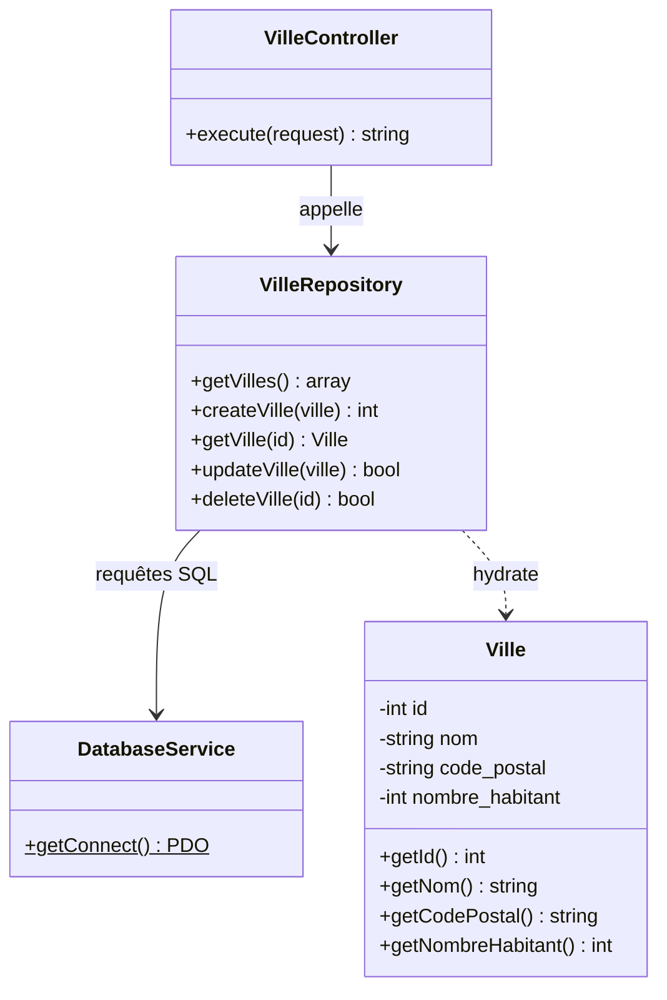

# Construire le CRUD

## Introduction

Nous avons vu dans la documentation précédente comment gérer une page avec un controller et un formulaire en méthode POST.
La suite logique est de construire le [CRUD](../annexes/glossaire.md#crud){:target="_blank"} (Create, Read, Update, Delete) d'une entité : créer, lire, modifier et supprimer des enregistrements dans une base de données.

!!! Prérequis "PHP Data Objects (PDO)"

    PDO est un moyen de communiquer de manière efficace avec une base de données en PHP, tout en gardant la flexibilité de changer de type de base de données si nécessaire, sans avoir à réécrire votre code.

    Pour plus d'informations sur l'objet PDO, vous pouvez consulter la [documentation officielle](https://www.php.net/manual/fr/book.pdo.php){:target="_blank"}.

Voici les quatre opérations que nous allons construire pour l'entité `ville` :

| Lettre | Opération             | Requête SQL | Ce que nous allons construire                |
|--------|-----------------------|-------------|----------------------------------------------|
| **C**  | Create (créer)        | `INSERT`    | Le formulaire de création (`POST /ville`)    |
| **R**  | Read (lire)           | `SELECT`    | La liste des villes (`GET /ville`)            |
| **U**  | Update (modifier)     | `UPDATE`    | Le formulaire de modification (`/ville/{id}/update`) |
| **D**  | Delete (supprimer)    | `DELETE`    | Le lien de suppression (`/ville/{id}/delete`) |

## Prérequis

Vous devez activer le service DatabaseService pour utiliser une base de données MySQL, MariaDB ou SQLite.

!!! info "Lecture obligatoire"

    Vous devez avoir lu la documentation sur la [DatabaseService : La gestion des données](../boost/dataservice.md)

    L'activation du service DatabaseService s'opère dans le fichier .env de votre projet.
    ```diff
    -- DB_HOST_STATUS=false
    ++ DB_HOST_STATUS=true
    ```

## Schéma de la base de données

Pour cet exemple, nous allons utiliser une base de données avec une table `ville` qui contient les champs suivants :


=== "MYSQL/MARIADB"

    ```sql
    CREATE TABLE ville (
        id INT AUTO_INCREMENT PRIMARY KEY,
        nom VARCHAR(255) NOT NULL,
        code_postal VARCHAR(10) NULL,
        nombre_habitant INT NULL
    );
    ```

=== "SQLITE"

    ```sql
    CREATE TABLE ville (
        id integer not null constraint ville_pk primary key autoincrement,
        code_postal     TEXT,
        nombre_habitant integer,
        nom             TEXT
    );
    ```


Jeu de donnée pour les bases Mysql/Sqlite

```sql
INSERT INTO ville (nom, code_postal, nombre_habitant) VALUES ('Paris', '75000', 2200000);
INSERT INTO ville (nom, code_postal, nombre_habitant) VALUES ('Marseille', '13000', 800000);
INSERT INTO ville (nom, code_postal, nombre_habitant) VALUES ('Lyon', '69000', 500000);
```

## Étape 1 : le Read avec l'entité et le repository

Nous allons reprendre la page sur [Construire un formulaire](controller-edu-post.md)

Voici l'arborecence actuelle de notre projet :

``` hl_lines="5 8 9"
├── app
│   ├── Config
│   │   └── routes.yaml
│   ├── Controller
│   │   └── VilleController.php
│   └── Template
│       ├── base.html.twig
│       └── ville
│           └── ville.html.twig
```

Nous allons ajouter deux dossiers dans le dossier `app` pour gérer les données :

- `Entity` : pour les entités (classes qui représentent les données de la base de données)
- `Repository` : pour les classes qui permettent de récupérer les données de la base de données

``` hl_lines="6 7 8 9"
├── app
│   ├── Config
│   │   └── routes.yaml
│   ├── Controller
│   │   └── VilleController.php
│   ├── Entity
│   │   └── Ville.php
│   ├── Repository
│   │   └── VilleRepository.php
│   └── Template
│       ├── base.html.twig
│       └── ville
│           └── ville.html.twig
```

Selon le schéma de la base de données, nous allons créer une entité `Ville` et un repository `VilleRepository`.

Le diagramme de classes ci-dessous présente les relations entre les classes que nous allons construire :



!!! tip "Générer les deux fichiers avec la commande make:entity"

    À partir de la version v2.5.0, les deux fichiers peuvent être générés automatiquement :

    ```Shell
    php bin/edu make:entity Ville --fields "nom:string,code_postal:string,nombre_habitant:int"
    ```

    La commande crée `app/Entity/Ville.php` et `app/Repository/VilleRepository.php` avec les getters, les setters et l'hydratation.
    Vous pouvez ensuite adapter le code généré. Pour plus de détails, consultez la documentation de la commande [make:entity](../installation/command-edu.md#la-commande-makeentity).

### Création de l'entité Ville

Nous allons créer une entité `Ville` dans le dossier `app/Entity`.

```php
<?php

namespace Entity;

class Ville
{
    private int $id;
    private string $nom;
    private string $code_postal;
    private int $nombre_habitant;

    public function __construct($id, $nom, $code_postal, $nombre_habitant)
    {
        $this->id = $id;
        $this->nom = $nom;
        $this->code_postal = $code_postal;
        $this->nombre_habitant = $nombre_habitant;
    }

    public function getId()
    {
        return $this->id;
    }

    public function getNom()
    {
        return $this->nom;
    }

    public function getCodePostal()
    {
        return $this->code_postal;
    }

    public function getNombreHabitant()
    {
        return $this->nombre_habitant;
    }
}
```

### Création du repository VilleRepository

Nous allons créer un repository `VilleRepository` dans le dossier `app/Repository`.

```php
<?php

namespace Repository;

use Entity\Ville;
use Studoo\EduFramework\Core\Service\DatabaseService;

class VilleRepository
{
    public function getVilles(): array
    {
        $villes = [];

        $DataService = DatabaseService::getConnect();
        $stmt = $DataService->query('SELECT * FROM ville');

        while ($row = $stmt->fetch()) {
            $villes[] = new Ville($row['id'], $row['nom'], $row['code_postal'], $row['nombre_habitant']);
        }

        return $villes;
    }
}
```

### Modification du controller VilleController

Nous allons modifier le controller `VilleController` pour récupérer les données de la base de données.

```diff
<?php

namespace Controller;

+ use Repository\VilleRepository;
use Studoo\EduFramework\Core\Controller\ControllerInterface;
use Studoo\EduFramework\Core\Controller\Request;
use Studoo\EduFramework\Core\View\TwigCore;
use Twig\Error\LoaderError;
use Twig\Error\RuntimeError;
use Twig\Error\SyntaxError;

class VilleController implements ControllerInterface
{
	public function execute(Request $request): string|null
	{
		return TwigCore::getEnvironment()->render('ville/ville.html.twig',
		    [
		        "titre"   => 'VilleController',
		        "request" => $request,
		        "add_ville" => $request->get('nom_ville'),
+ 		        "villes" => (new VilleRepository())->getVilles()
		    ]
		);
	}
}
```

### Modification de la vue ville.html.twig

Nous allons modifier la vue `ville.html.twig` pour afficher les données de la base de données.

```diff


{{ titre }}


    <h1>{{ titre }}</h1>
        
            <div class="alert alert-success" role="alert">
                    La ville est {{ add_ville }}
                </div>
        

        <p>Créer une nouvelle ville</p>
        <form action="{{ getNameToPath('ville') }}" method="post">
            <label for="nom_ville">Ville</label>
            <input type="text" id="nom_ville" name="nom_ville">
            <input type="submit" value="Envoyer">
        </form>

+        <h2>Liste des villes</h2>
+        <ul>
+            
+                <li>{{ ville.getNom() }} ({{ ville.getCodePostal() }}) - {{ ville.getNombreHabitant() }} habitants</li>
+            
+        </ul>

```

Le **Read** (la liste des villes) est en place. Pour l'instant, le formulaire n'enregistre rien en base de données : c'est l'objet de l'étape suivante.

## Étape 2 : le Create avec le formulaire de création

!!! info "Objectif"

    - Compléter le formulaire pour saisir toutes les informations d'une ville
    - Ajouter la méthode `createVille()` au repository
    - Enregistrer la ville en base de données lors de l'envoi du formulaire en POST

### Compléter le formulaire dans la vue ville.html.twig

Le formulaire actuel ne contient que le nom de la ville. Nous allons le compléter avec le code postal et le nombre d'habitants :

```diff

    <h1>{{ titre }}</h1>
-        
-            <div class="alert alert-success" role="alert">
-                    La ville est {{ add_ville }}
-                </div>
-        
-
-        <p>Créer une nouvelle ville</p>
+        <h2>Créer une nouvelle ville</h2>
        <form action="{{ getNameToPath('ville') }}" method="post">
-            <label for="nom_ville">Ville</label>
-            <input type="text" id="nom_ville" name="nom_ville">
+            <label for="nom">Ville</label>
+            <input type="text" id="nom" name="nom">
+
+            <label for="code_postal">Code postal</label>
+            <input type="text" id="code_postal" name="code_postal">
+
+            <label for="nombre_habitant">Nombre d'habitants</label>
+            <input type="text" id="nombre_habitant" name="nombre_habitant">
+
             <input type="submit" value="Envoyer">
        </form>

        <h2>Liste des villes</h2>
        <ul>
            
                <li>{{ ville.getNom() }} ({{ ville.getCodePostal() }}) - {{ ville.getNombreHabitant() }} habitants</li>
            
        </ul>

```

L'affichage du message de confirmation (`add_ville`) est supprimé : après l'enregistrement, nous allons rediriger l'utilisateur vers la liste des villes (voir le pattern PRG ci-dessous).

### Ajouter la méthode createVille() au repository

Nous allons ajouter la méthode `createVille()` dans le fichier "app/Repository/VilleRepository.php".

```diff
 class VilleRepository
 {
     public function getVilles(): array
     {
         $villes = [];

         $DataService = DatabaseService::getConnect();
         $stmt = $DataService->query('SELECT * FROM ville');

         while ($row = $stmt->fetch()) {
             $villes[] = new Ville($row['id'], $row['nom'], $row['code_postal'], $row['nombre_habitant']);
         }

         return $villes;
     }
+
+    public function createVille(Ville $ville): int
+    {
+        $comBase = DatabaseService::getConnect();
+        $statementPDO = $comBase->prepare(
+            "INSERT INTO ville (nom, code_postal, nombre_habitant) VALUES (:nom, :code_postal, :nombre_habitant)"
+        );
+        $statementPDO->execute([
+            'nom' => $ville->getNom(),
+            'code_postal' => $ville->getCodePostal(),
+            'nombre_habitant' => $ville->getNombreHabitant()
+        ]);
+
+        return (int) $comBase->lastInsertId();
+    }
 }
```

La méthode utilise une **requête préparée** avec les paramètres `:nom`, `:code_postal` et `:nombre_habitant`.

!!! warning "Sujet cybersécurité"

    Pourquoi utiliser une requête préparée ?

    - Pour éviter les attaques par injection SQL
    - Pour améliorer les performances des requêtes SQL
    - Pour faciliter la gestion des paramètres de la requête

    La méthode `lastInsertId()` renvoie l'identifiant de la ville créée : utile si vous souhaitez rediriger l'utilisateur vers la fiche de la ville.

### Traiter le formulaire dans le controller

Nous allons modifier le controller `VilleController` pour enregistrer la ville lorsque la requête est en POST.

```diff
<?php

namespace Controller;

+use Entity\Ville;
use Repository\VilleRepository;
use Studoo\EduFramework\Core\Controller\ControllerInterface;
use Studoo\EduFramework\Core\Controller\Request;
+use Studoo\EduFramework\Core\Controller\Route;
use Studoo\EduFramework\Core\View\TwigCore;
use Twig\Error\LoaderError;
use Twig\Error\RuntimeError;
use Twig\Error\SyntaxError;

class VilleController implements ControllerInterface
{
	public function execute(Request $request): string|null
	{
+		if ($request->getHttpMethod() === "POST") {
+			$ville = new Ville(
+				0,
+				$request->get('nom'),
+				$request->get('code_postal'),
+				(int) $request->get('nombre_habitant')
+			);
+
+			(new VilleRepository())->createVille($ville);
+
+			header('Location: ' . (new Route())->getNameToPath('ville'));
+			return null;
+		}
+
		return TwigCore::getEnvironment()->render('ville/ville.html.twig',
		    [
		        "titre"   => 'VilleController',
		        "request" => $request,
-		        "add_ville" => $request->get('nom_ville'),
		        "villes" => (new VilleRepository())->getVilles()
		    ]
		);
	}
}
```

Explications :

- La méthode `getHttpMethod()` de la classe [Request](../boost/resquet.md) permet de distinguer l'affichage de la page (`GET`) de l'envoi du formulaire (`POST`).
- Les données du formulaire sont récupérées avec la méthode `get()` de la classe [Request](../boost/resquet.md).
- L'identifiant est initialisé à `0` : c'est la base de données qui attribuera le vrai identifiant lors de l'`INSERT`.
- La classe [Route](../boost/route.md) génère l'URL de la route `ville` par son nom : si vous changez l'URI de la route, la redirection suivra automatiquement.

!!! info "Le pattern PRG (Post/Redirect/Get)"

    Après le traitement du formulaire, le controller **redirige** l'utilisateur vers la liste des villes avec `header('Location: ...')` puis `return null`.

    - `header('Location: ...')` envoie une redirection HTTP (code `302`)
    - `return null` : le controller n'affiche aucune vue, la réponse est uniquement la redirection

    Ce pattern évite que le formulaire soit **renvoyé** si l'utilisateur actualise la page (touche F5) après une création. Sans redirection, la ville serait enregistrée deux fois !

!!! warning "Attention"

    Vérifiez que la route `ville` accepte bien la méthode `POST` dans le fichier "app/Config/routes.yaml" (`httpMethod: [GET,POST]`), sinon une erreur `HTTP 405 Method Not Allowed` sera renvoyée.

## Étape 3 : le Update avec le formulaire de modification

!!! info "Objectif"

    - Générer un controller dédié à la modification d'une ville
    - Récupérer une ville par son identifiant pour pré-remplir le formulaire
    - Enregistrer les modifications en base de données

### Générer le controller de mise à jour

Créez le controller avec la commande suivante :

```Shell
php bin/edu make:controller villeUpdate
```

Cette commande génère le controller "VilleUpdateController.php", la vue "villeupdate/villeupdate.html.twig" et la route `villeupdate` dans le fichier "app/Config/routes.yaml".

### Modifier la route

La route générée est `/villeupdate`. Pour modifier une ville précise, l'URI doit contenir son identifiant. Modifiez la route dans le fichier "app/Config/routes.yaml" :

```diff
villeupdate:
-   uri: /villeupdate
+   uri: /ville/{id}/update
    controller: Controller\VilleUpdateController
-   httpMethod: [GET]
+   httpMethod: [GET,POST]
```

- Le paramètre dynamique `{id}` permet de cibler une ville, comme dans la [version directe du CRUD](#variante-le-crud-direct-sans-repository)
- La méthode `POST` est nécessaire pour l'enregistrement du formulaire de modification

### Ajouter les méthodes getVille() et updateVille() au repository

Ajoutez deux méthodes dans le fichier "app/Repository/VilleRepository.php" :

```diff
     public function createVille(Ville $ville): int
     {
         $comBase = DatabaseService::getConnect();
         $statementPDO = $comBase->prepare(
             "INSERT INTO ville (nom, code_postal, nombre_habitant) VALUES (:nom, :code_postal, :nombre_habitant)"
         );
         $statementPDO->execute([
             'nom' => $ville->getNom(),
             'code_postal' => $ville->getCodePostal(),
             'nombre_habitant' => $ville->getNombreHabitant()
         ]);

         return (int) $comBase->lastInsertId();
     }
+
+    public function getVille(int $id): Ville|false
+    {
+        $comBase = DatabaseService::getConnect();
+        $statementPDO = $comBase->prepare("SELECT * FROM ville WHERE id = :id");
+        $statementPDO->execute(['id' => $id]);
+
+        $row = $statementPDO->fetch();
+
+        if ($row === false) {
+            return false;
+        }
+
+        return new Ville($row['id'], $row['nom'], $row['code_postal'], $row['nombre_habitant']);
+    }
+
+    public function updateVille(Ville $ville): bool
+    {
+        $comBase = DatabaseService::getConnect();
+        $statementPDO = $comBase->prepare(
+            "UPDATE ville SET nom = :nom, code_postal = :code_postal, nombre_habitant = :nombre_habitant WHERE id = :id"
+        );
+        return $statementPDO->execute([
+            'nom' => $ville->getNom(),
+            'code_postal' => $ville->getCodePostal(),
+            'nombre_habitant' => $ville->getNombreHabitant(),
+            'id' => $ville->getId()
+        ]);
+    }
 }
```

- `getVille()` complète le **Read** : elle renvoie l'entité `Ville` correspondant à l'identifiant, ou `false` si la ville n'existe pas
- `updateVille()` met à jour la ligne correspondant à l'identifiant de l'entité

### Modifier le controller VilleUpdateController

Modifiez le fichier "app/Controller/VilleUpdateController.php" généré par la commande :

```diff
<?php

namespace Controller;

+use Entity\Ville;
+use Repository\VilleRepository;
use Studoo\EduFramework\Core\Controller\ControllerInterface;
use Studoo\EduFramework\Core\Controller\Request;
+use Studoo\EduFramework\Core\Controller\Route;
use Studoo\EduFramework\Core\View\TwigCore;
use Twig\Error\LoaderError;
use Twig\Error\RuntimeError;
use Twig\Error\SyntaxError;

class VilleUpdateController implements ControllerInterface
{
	public function execute(Request $request): string|null
	{
+		$villeRepository = new VilleRepository();
+		$id = (int) $request->get("id");
+
+		if ($request->getHttpMethod() === "POST") {
+			$ville = new Ville(
+				$id,
+				$request->get('nom'),
+				$request->get('code_postal'),
+				(int) $request->get('nombre_habitant')
+			);
+
+			$villeRepository->updateVille($ville);
+
+			header('Location: ' . (new Route())->getNameToPath('ville'));
+			return null;
+		}
+
+		$ville = $villeRepository->getVille($id);
+
+		if ($ville === false) {
+			header('Location: ' . (new Route())->getNameToPath('ville'));
+			return null;
+		}
+
		return TwigCore::getEnvironment()->render('villeupdate/villeupdate.html.twig',
		    [
		        "titre"   => 'VilleUpdateController',
-		        "request" => $request
+		        "request" => $request,
+		        "ville"   => $ville
		    ]
		);
	}
}
```

Explications :

- L'identifiant est récupéré depuis l'URI avec `$request->get("id")` : le paramètre `{id}` de la route est accessible comme un paramètre de requête
- En `POST` : la ville est mise à jour puis l'utilisateur est redirigé vers la liste (pattern PRG)
- En `GET` : la ville est récupérée en base de données pour pré-remplir le formulaire ; si elle n'existe pas (`false`), l'utilisateur est redirigé vers la liste

### Modifier la vue villeupdate.html.twig

Le formulaire de modification est pré-rempli avec les valeurs de la ville. Modifiez le fichier "app/Template/villeupdate/villeupdate.html.twig" :

```diff


{{ titre }}


<h1>{{ titre }}</h1>
+
+<form method="post" action="{{ getNameToPath('villeupdate', {'id': ville.getId()}) }}">
+    <label for="nom">Ville</label>
+    <input type="text" id="nom" name="nom" value="{{ ville.getNom() }}">
+
+    <label for="code_postal">Code postal</label>
+    <input type="text" id="code_postal" name="code_postal" value="{{ ville.getCodePostal() }}">
+
+    <label for="nombre_habitant">Nombre d'habitants</label>
+    <input type="text" id="nombre_habitant" name="nombre_habitant" value="{{ ville.getNombreHabitant() }}">
+
+    <input type="submit" value="Enregistrer">
+</form>

```

La fonction Twig `getNameToPath()` accepte les paramètres de route en second argument : `getNameToPath('villeupdate', {'id': ville.getId()})` génère l'URL `/ville/42/update` pour la ville n°42. Vous pouvez consulter la documentation de la classe [Route](../boost/route.md) pour plus de détails.

### Ajouter le lien "Modifier" dans la liste

Transformez la liste à puces de la vue "ville.html.twig" en tableau pour ajouter une colonne d'actions :

```diff
-        <h2>Liste des villes</h2>
-        <ul>
-            
-                <li>{{ ville.getNom() }} ({{ ville.getCodePostal() }}) - {{ ville.getNombreHabitant() }} habitants</li>
-            
-        </ul>
+        <h2>Liste des villes</h2>
+        <table>
+            <thead>
+                <tr>
+                    <th>ID</th>
+                    <th>Nom</th>
+                    <th>Code postal</th>
+                    <th>Nombre d'habitants</th>
+                    <th>Actions</th>
+                </tr>
+            </thead>
+            <tbody>
+            
+                <tr>
+                    <td>{{ ville.getId() }}</td>
+                    <td>{{ ville.getNom() }}</td>
+                    <td>{{ ville.getCodePostal() }}</td>
+                    <td>{{ ville.getNombreHabitant() }}</td>
+                    <td>
+                        <a href="{{ getNameToPath('villeupdate', {'id': ville.getId()}) }}">Modifier</a>
+                    </td>
+                </tr>
+            
+            </tbody>
+        </table>
```

Le **Update** est en place : la liste des villes propose un lien "Modifier" pour chaque ville.

## Étape 4 : le Delete avec le lien de suppression

!!! info "Objectif"

    - Générer un controller dédié à la suppression d'une ville
    - Supprimer la ville en base de données et rediriger vers la liste

### Générer le controller de suppression

Créez le controller avec la commande suivante :

```Shell
php bin/edu make:controller villeDelete
```

Cette commande génère le controller "VilleDeleteController.php", la vue "villedelete/villedelete.html.twig" et la route `villedelete` dans le fichier "app/Config/routes.yaml".

### Modifier la route

Comme pour la modification, l'URI doit contenir l'identifiant de la ville à supprimer :

```diff
villedelete:
-   uri: /villedelete
+   uri: /ville/{id}/delete
    controller: Controller\VilleDeleteController
    httpMethod: [GET]
```

### Ajouter la méthode deleteVille() au repository

Ajoutez la méthode dans le fichier "app/Repository/VilleRepository.php" :

```diff
     public function updateVille(Ville $ville): bool
     {
         $comBase = DatabaseService::getConnect();
         $statementPDO = $comBase->prepare(
             "UPDATE ville SET nom = :nom, code_postal = :code_postal, nombre_habitant = :nombre_habitant WHERE id = :id"
         );
         return $statementPDO->execute([
             'nom' => $ville->getNom(),
             'code_postal' => $ville->getCodePostal(),
             'nombre_habitant' => $ville->getNombreHabitant(),
             'id' => $ville->getId()
         ]);
     }
+
+    public function deleteVille(int $id): bool
+    {
+        $comBase = DatabaseService::getConnect();
+        $statementPDO = $comBase->prepare("DELETE FROM ville WHERE id = :id");
+        return $statementPDO->execute(['id' => $id]);
+    }
 }
```

### Modifier le controller VilleDeleteController

Modifiez le fichier "app/Controller/VilleDeleteController.php" généré par la commande :

```diff
<?php

namespace Controller;

+use Repository\VilleRepository;
use Studoo\EduFramework\Core\Controller\ControllerInterface;
use Studoo\EduFramework\Core\Controller\Request;
+use Studoo\EduFramework\Core\Controller\Route;
use Studoo\EduFramework\Core\View\TwigCore;
use Twig\Error\LoaderError;
use Twig\Error\RuntimeError;
use Twig\Error\SyntaxError;

class VilleDeleteController implements ControllerInterface
{
	public function execute(Request $request): string|null
	{
-		return TwigCore::getEnvironment()->render('villedelete/villedelete.html.twig',
-		    [
-		        "titre"   => 'VilleDeleteController',
-		        "request" => $request
-		    ]
-		);
+		if ($request->get("id") !== null) {
+			(new VilleRepository())->deleteVille((int) $request->get("id"));
+		}
+
+		header('Location: ' . (new Route())->getNameToPath('ville'));
+		return null;
	}
}
```

La suppression ne nécessite pas de vue : le controller supprime la ville puis redirige vers la liste (pattern PRG).
La vue "villedelete.html.twig" générée par la commande n'est pas utilisée, vous pouvez la supprimer.

### Ajouter le lien "Supprimer" dans la liste

Ajoutez le lien de suppression dans la colonne des actions de la vue "ville.html.twig" :

```diff
                    <td>
                        <a href="{{ getNameToPath('villeupdate', {'id': ville.getId()}) }}">Modifier</a>
+                       <a href="{{ getNameToPath('villedelete', {'id': ville.getId()}) }}">Supprimer</a>
                    </td>
```

!!! tip "Confirmer la suppression"

    Une suppression par simple clic peut être dangereuse. Vous pouvez demander une confirmation à l'utilisateur avec JavaScript :

    ```html
    <a href="{{ getNameToPath('villedelete', {'id': ville.getId()}) }}"
       onclick="return confirm('Voulez-vous vraiment supprimer cette ville ?');">Supprimer</a>
    ```

    Pour aller plus loin en sécurité, la bonne pratique est d'effectuer la suppression par une requête `POST` (avec un formulaire) plutôt qu'un simple lien `GET`.

## Récapitulatif du CRUD

### Le fichier de configuration des routes

Voici les trois routes du CRUD dans le fichier "app/Config/routes.yaml" :

```yaml
ville:
    uri: /ville
    controller: Controller\VilleController
    httpMethod: [GET,POST]
villeupdate:
    uri: /ville/{id}/update
    controller: Controller\VilleUpdateController
    httpMethod: [GET,POST]
villedelete:
    uri: /ville/{id}/delete
    controller: Controller\VilleDeleteController
    httpMethod: [GET]
```

### L'arborescence finale du projet

``` hl_lines="6 7 8 9 11 12 13 14"
├── app
│   ├── Config
│   │   └── routes.yaml
│   ├── Controller
│   │   ├── VilleController.php
│   │   ├── VilleDeleteController.php
│   │   └── VilleUpdateController.php
│   ├── Entity
│   │   └── Ville.php
│   ├── Repository
│   │   └── VilleRepository.php
│   └── Template
│       ├── base.html.twig
│       ├── ville
│       │   └── ville.html.twig
│       └── villeupdate
│           └── villeupdate.html.twig
```

### Le mapping du CRUD

| Opération | Route                 | Méthode HTTP | Requête SQL | Vue                  |
|-----------|-----------------------|--------------|-------------|----------------------|
| Create    | `/ville`              | `POST`       | `INSERT`    | Formulaire de création |
| Read      | `/ville`              | `GET`        | `SELECT`    | Liste des villes      |
| Update    | `/ville/{id}/update`  | `GET`, `POST`| `SELECT` + `UPDATE` | Formulaire de modification |
| Delete    | `/ville/{id}/delete`  | `GET`        | `DELETE`    | Aucune (redirection)  |

Le CRUD de l'entité `ville` est terminé : vous pouvez créer, lire, modifier et supprimer des villes depuis votre application. :smile:

## Variante : le CRUD direct sans repository

Le CRUD de l'entité `ville` peut aussi se construire **sans entité ni repository** : les requêtes SQL sont alors écrites directement dans les controllers (c'est le use case "VILLE", étape 1). C'est la façon la plus rapide d'obtenir un résultat fonctionnel, mais la logique d'accès aux données se retrouve mélangée à la logique d'affichage — la version avec entité et repository présentée ci-dessus montre la structure recommandée.

Cette variante réutilise la même table `ville` et le même jeu de données que le [schéma de la base de données](#schema-de-la-base-de-donnees).

### Liste des Villes (Read)

!!! info "Objectif"

    Les étapes sont :
    
    - Création des fichiers de base via la commande `make:controller`
    - Récupération des données via l'objet [Databaseservice](../boost/dataservice.md)
    - Affichage d'un tableau HTML des données récupérées en base de donnée

La commande `make:crontroller` :

```shell
php bin/edu make:controller villeRead
```

Cette commande va créer un fichier `VilleReadController.php` dans le dossier `app/Controller`, ajouter des lignes dans le fichier `app/Config/routes.yaml` et créer un fichier `villeread.html.twig` dans le dossier `app/Template/villeread`.
    
    Voici l'arborecence du projet :
    
    ``` hl_lines="5 8 9"
    ├── app
    │   ├── Config
    │   │   └── routes.yaml
    │   ├── Controller
    │   │   └── VilleReadController.php
    │   └── Template
    │       ├── base.html.twig
    │       └── villeread
    │           └── villeread.html.twig
    ```

Dans le fichier VilleReadController.php, vous devez ajouter :

```diff
<?php

namespace Controller;

use Studoo\EduFramework\Core\Controller\ControllerInterface;
use Studoo\EduFramework\Core\Controller\Request;
use Studoo\EduFramework\Core\Service\DatabaseService;
use Studoo\EduFramework\Core\View\TwigCore;

class VilleReadController implements ControllerInterface
{
	public function execute(Request $request): string|null
	{
++        $comBase = DatabaseService::getConnect();
++        $statementPDO = $comBase->query("SELECT * FROM ville");
++        $villes = $statementPDO->fetchAll();

		return TwigCore::getEnvironment()->render('villeread/villeread.html.twig',
		    [
		         "titre"   => 'VilleReadController',
		         "request" => $request,
 ++               "villes" => $villes
		    ]
		);
	}
}
```

Ce code va récupérer la liste des villes dans la base de données et les afficher dans la vue `villeread.html.twig`.


Dans le fichier `villeread.html.twig`, vous devez ajouter :

```diff


{{ titre }}


    <h1>{{ titre }}</h1>
++    <table class="table">
++        <thead>
++            <tr>
++                <th scope="col">ID</th>
++                <th scope="col">Nom</th>
++                <th scope="col">Code Postal</th>
++                <th scope="col">Nombre d'habitants</th>
++            </tr>
++        </thead>
++        <tbody>
++            
++                <tr>
++                    <td>{{ ville.id }}</td>
++                    <td>{{ ville.nom }}</td>
++                    <td>{{ ville.code_postal }}</td>
++                    <td>{{ ville.nombre_habitant }}</td>
++                </tr>
++            
++        </tbody>
++    </table>

```

Ce code va afficher la liste des villes dans un tableau HTML. La syntaxe twig `{{ ville.id }}` permet d'afficher l'identifiant de la ville.
Une boucle `for` permet de parcourir la liste des villes et d'afficher les informations de chaque ville.

!!! info "Syntaxe twig"

    Plus d'informations sur la syntaxe twig : [https://twig.symfony.com/doc/3.x/tags/for.html](https://twig.symfony.com/doc/3.x/tags/for.html){:target="_blank"}


### Ajouter des Villes (Create)

!!! info "Objectif"

    Les étapes sont :
    
    - Création des fichiers de base via la commande `make:controller`
    - Mettre les droits sur la route du controller
    - Création d'un formulaire pour envoyer les données en méthode POST dans le controller
    - Récupération des données dans le controller et les inserer en base de donnée

La commmande `make:controller` :

```shell
php bin/edu make:controller villeCreate
```

Cette commande va créer un fichier `VilleCreateController.php` dans le dossier `app/Controller`, ajouter des lignes dans le fichier `app/Config/routes.yaml` et créer un fichier `villecreate.html.twig` dans le dossier `app/Template/villecreate`.

Voici l'arborecence du projet :

``` hl_lines="5 9 10"
├── app
│   ├── Config
│   │   └── routes.yaml
│   ├── Controller
│   │   ├── VilleCreateController.php
│   │   └── VilleReadController.php
│   └── Template
│       ├── base.html.twig
│       ├── villecreate
│       │   └── villecreate.html.twig
│       └── villeread
│           └── villeread.html.twig
```

Dans le fichier VilleCreateController.php, vous devez ajouter :

```diff
<?php

namespace Controller;

use Studoo\EduFramework\Core\Controller\ControllerInterface;
use Studoo\EduFramework\Core\Controller\Request;
use Studoo\EduFramework\Core\Service\DatabaseService;
use Studoo\EduFramework\Core\View\TwigCore;
use Twig\Error\LoaderError;
use Twig\Error\RuntimeError;
use Twig\Error\SyntaxError;

class VilleCreateController implements ControllerInterface
{
	public function execute(Request $request): string|null
	{   
++        if ($request->getHttpMethod() === 'POST') {
++            $comBase = DatabaseService::getConnect();
++            $statementPDO = $comBase->prepare("INSERT INTO ville (nom, code_postal, nombre_habitant) VALUES (:nom, :code_postal, :nb_habitant)");
++            $statementPDO->execute([
++                'nom' => $request->get('nom'),
++                'code_postal' => $request->get('code_postal'),
++                'nb_habitant' => (int) $request->get('nombre_habitant')
++            ]);
++
++            header('Location: /villeread');
++        }

		return TwigCore::getEnvironment()->render('villecreate/villecreate.html.twig',
		    [
		        "titre"   => 'VilleCreateController',
		        "request" => $request
		    ]
		);
	}
}
```
Ce code va ajouter une ville dans la base de données si la méthode HTTP est POST. 

Il récupère les données du formulaire via l'objet [Request](../boost/resquet.md) et les insère dans la table `ville` via une requête préparée.
Une fois l'ajout effectué, l'utilisateur est redirigé vers la liste des villes via la fonction header('Location: /villeread').

!!! info "Information"

    Plus d'informations sur la fonction header : [https://www.php.net/manual/fr/function.header.php](https://www.php.net/manual/fr/function.header.php){:target="_blank"}


Dans le fichier `villecreate.html.twig`, vous devez ajouter :

```diff


{{ titre }}


<h1>{{ titre }}</h1>

++ <form method="post" action="/villecreate">
++    <div class="form-group">
++        <label for="nom">Ville</label>
++        <input type="text" class="form-control" id="nom" name="nom">
++    </div>
++    <div class="form-group">
++        <label for="code_postal">Code postal</label>
++        <input type="text" class="form-control" id="code_postal" name="code_postal">
++    </div>
++        <div class="form-group">
++        <label for="nombre_habitant">Nombre d'habitant</label>
++        <input type="text" class="form-control" id="nombre_habitant" name="nombre_habitant">
++    </div>
++    <button type="submit" class="btn btn-primary">Enregistrer</button>
++ </form>


```
Ce code va afficher un formulaire pour ajouter une ville. 

Il récupère les données du formulaire via la méthode POST et les envoie au controller pour les insérer dans la base de données.

!!! info "Information"

    Plus d'informations sur les formulaires HTML : [https://developer.mozilla.org/fr/docs/Web/HTML/Element/Form](https://developer.mozilla.org/fr/docs/Web/HTML/Element/Form){:target="_blank"}

Une erreur http 405 peut apparaitre si la méthode HTTP est en methode POST. 

Pour résoudre cette erreur de droit au POST, vous devez ajouter la méthode POST dans le fichier de configuration des routes.

```diff
villecreate:
  uri: /villecreate
  controller: Controller\VilleCreateController
--  httpMethod: [GET]
++  httpMethod: [GET,POST]
```

Vous pouvez maintenant ajouter un lien dans la page `villeread.html.twig` pour accéder à la page `villecreate.html.twig`.

```Twig
<a href="/villecreate">Ajouter une ville</a>
```

### Modifier des Villes (Update)

!!! info "Objectif"

    Les étapes sont :
    
    - Création des fichiers de base via la commande `make:controller`
    - Ajouter la route dans la liste des villes
    - Mettre les droits sur la route du controller
    - Récuperer les données dans le controller
    - Création d'un formulaire pour modifier les données en méthode POST dans le controller
    - Récupération des données dans le controller et les inserer en base de donnée

La commmande `make:controller` :

```shell
php bin/edu make:controller villeUpdate
```

Voici l'arborescence du projet :

``` hl_lines="7 12 13"
        ├── app
        │   ├── Config
        │   │   └── routes.yaml
        │   ├── Controller
        │   │   ├── VilleCreateController.php
        │   │   ├── VilleReadController.php
        │   │   └── VilleUpdateController.php
        │   └── Template
        │       ├── base.html.twig
        │       ├── villecreate
        │       │   └── villecreate.html.twig
        │       ├── villeupdate
        │       │   └── villeupdate.html.twig
        │       └── villeread
        │           └── villeread.html.twig
```

Pour modifier une ville, nous devons gérer sa modification via son idenfifiant (clé primaire). 

Dans notre use case, l'identifiant est ville.id. 

Notre action est de mettre la route `villeupdate` dans la liste avec comme argument `ville.id`

Aller dans le fichier `template/villeread/villeread.html.twig`

```diff


{{ titre }}


<h1>{{ titre }}</h1>
    <table class="table">
        <thead>
        <tr>
            <th scope="col">ID</th>
            <th scope="col">Nom</th>
            <th scope="col">Code Postal</th>
            <th scope="col">Nombre d'habitants</th>
++          <th scope="col">Action</th>
        </tr>
        </thead>
        <tbody>
        
            <tr>
                <td>{{ ville.id }}</td>
                <td>{{ ville.nom }}</td>
                <td>{{ ville.code_postal }}</td>
                <td>{{ ville.nombre_habitant }}</td>
++              <td><a href="/villeupdate/{{ ville.id }}">UPDATE</a></td>
            </tr>
        
        </tbody>
    </table>

```

Dans ce code, on ajoute une colonne `Action` à notre tableau et un lien avec URL `/villeupdate/` en passant `ville.id` en argument GET.
Un nouveau format de route se crée dans le fichier `app/Config/routes.yaml` pour la route `villeupdate`.
`{id}` est un paramètre dynamique inclut dans la route qui permet de récupérer l'identifiant de la ville à modifier.

Vous devez ajouter la route `villeupdate` dans le fichier `app/Config/routes.yaml`.

```diff
villeupdate:
--  uri: /villeupdate  
++  uri: /villeupdate/{id}
    controller: Controller\VilleUpdateController
--  httpMethod: [GET]    
++  httpMethod: [GET,POST]
```
!!! info "Information"

    Ce nouveau format de route est documenté dans la documentation la librairie [FastRoute](https://github.com/nikic/FastRoute){:target="_blank"}.


Nous allons maintenant créer le controller `VilleUpdateController.php` dans le dossier `app/Controller`.

```diff
<?php

namespace Controller;

use Studoo\EduFramework\Core\Controller\ControllerInterface;
use Studoo\EduFramework\Core\Controller\Request;
use Studoo\EduFramework\Core\View\TwigCore;
use Twig\Error\LoaderError;
use Twig\Error\RuntimeError;
use Twig\Error\SyntaxError;
++ use Studoo\EduFramework\Core\Service\DatabaseService;

class VilleUpdateController implements ControllerInterface
{
	public function execute(Request $request): string|null
	{
++		$comBase = DatabaseService::getConnect();
++
++		if ($request->getHttpMethod() === 'GET' && $request->get("id") !== null) {
++			$statementPDO = $comBase->prepare("SELECT * FROM ville WHERE id = :id");
++			$statementPDO->execute(['id' => (int) $request->get("id")]);
++			$ville = $statementPDO->fetch();
++		}

		return TwigCore::getEnvironment()->render('villeupdate/villeupdate.html.twig',
		    [
		        "titre"   => 'VilleUpdateController',
--              "request" => $request		        
++		        "ville" => $ville
		    ]
		);
	}
}
```

Ce code va récupérer les informations de la ville à modifier via son identifiant. 

Il va afficher ces informations dans le formulaire de modification via la variable `$ville`.

Nous allons maintenant créer la vue `villeupdate.html.twig` dans le dossier `app/Template/villeupdate`.

```diff


{{ titre }}


<h1>{{ titre }}</h1>

++    
++         <form method="post" action="/villeupdate/{{ ville.id }}">
++            <div class="form-group">
++                <label for="nom">Ville</label>
++                <input type="text" class="form-control" id="nom" name="nom" value="{{ ville.nom }}">
++            </div>
++            <div class="form-group">
++                <label for="code_postal">Code postal</label>
++                <input type="text" class="form-control" id="code_postal" name="code_postal" value="{{ ville.code_postal }}">
++            </div>
++                <div class="form-group">
++                <label for="nombre_habitant">Nombre d'habitant</label>
++                <input type="text" class="form-control" id="nombre_habitant" name="nombre_habitant" value="{{ ville.nombre_habitant }}">
++            </div>
++            <button type="submit" class="btn btn-primary">Enregistrer</button>
++        </form>
++    
++        <p>La ville n'existe pas.</p>
++    

```

Ce code va afficher un formulaire pré-rempli avec les informations de la ville à modifier. 

Il récupère les données du formulaire via la méthode POST et les envoie au controller pour les mettre à jour dans la base de données.
Dans le formulaire, on observe que l'attribut `action` est `/villeupdate/{{ ville.id }}`. Ce qui s'initialise avec l'identifiant de la ville à modifier.
Si la ville n'existe pas, un message d'erreur est affiché.

Nous allons maintenant persister les données dans la base de données via le controller `VilleUpdateController.php`.

```diff
<?php

namespace Controller;

use Studoo\EduFramework\Core\Controller\ControllerInterface;
use Studoo\EduFramework\Core\Controller\Request;
use Studoo\EduFramework\Core\Service\DatabaseService;
use Studoo\EduFramework\Core\View\TwigCore;
use Twig\Error\LoaderError;
use Twig\Error\RuntimeError;
use Twig\Error\SyntaxError;

class VilleUpdateController implements ControllerInterface
{
	public function execute(Request $request): string|null
	{
		$comBase = DatabaseService::getConnect();

		if ($request->getHttpMethod() === 'GET' && $request->get("id") !== null) {
			$statementPDO = $comBase->prepare("SELECT * FROM ville WHERE id = :id");
			$statementPDO->execute(['id' => (int) $request->get("id")]);
			$ville = $statementPDO->fetch();
		}

++		if ($request->getHttpMethod() === 'POST') {
++			$statementPDO = $comBase->prepare("UPDATE ville SET nom = :nom, code_postal = :code_postal, nombre_habitant = :nb_habitant WHERE id = :id");
++			$statementPDO->execute([
++				'id' => (int) $request->get('id'),
++              'nom' => $request->get('nom'),
++              'code_postal' => $request->get('code_postal'),
++              'nb_habitant' => (int) $request->get('nombre_habitant')
++			]);
++			header('Location: /villeread');
++		}

		return TwigCore::getEnvironment()->render('villeupdate/villeupdate.html.twig',
		    [
		        "titre"   => 'VilleUpdateController',
		        "ville" => $ville
		    ]
		);
	}
}
```

Ce code va mettre à jour les informations de la ville dans la base de données si la méthode HTTP est POST.

### Supprimer des Villes (Delete)

!!! info "Objectif"

    Les étapes sont :
    - Création des fichiers de base via la commande `make:controller`
    - Ajouter la route dans la liste des villes
    - Faire la requête de suppression dans le controller
    - Rediriger l'utilisateur vers la liste des villes


La commmande `make:controller` :

```shell
php bin/edu make:controller villeDelete
```

Pour supprimer une ville, nous devons gérer sa suppression via son idenfifiant (clé primaire). 

Dans notre use case, l'identifiant est ville.id. 

Notre action est de mettre la route `villedelete` dans la liste avec comme argument `ville.id`

Aller dans le fichier `template/villeread/villeread.html.twig`

```diff 


{{ titre }}


<h1>{{ titre }}</h1>
<a href="/villecreate">Ajouter une ville</a>
    <table class="table">
        <thead>
        <tr>
            <th scope="col">ID</th>
            <th scope="col">Nom</th>
            <th scope="col">Code Postal</th>
            <th scope="col">Nombre d'habitants</th>
            <th scope="col">Action</th>
        </tr>
        </thead>
        <tbody>
        
            <tr>
                <td>{{ ville.id }}</td>
                <td>{{ ville.nom }}</td>
                <td>{{ ville.code_postal }}</td>
                <td>{{ ville.nombre_habitant }}</td>
                <td>
                    <a href="/villeupdate/{{ ville.id }}">UPDATE</a>
++                  <a href="/villedelete/{{ ville.id }}">DELETE</a>
                </td>
            </tr>
        
        </tbody>
    </table>

```

Dans ce code, on ajoute une colonne `Action` à notre tableau et un lien avec URL `/villedelete/` en passant `ville.id` en argument GET.

Vous devez ajouter la route `villedelete` dans le fichier `app/Config/routes.yaml`.

```diff
villedelete:
--  uri: /villedelete
++  uri: /villedelete/{id}
    controller: Controller\VilleDeleteController
    httpMethod: [GET]
```

Nous allons maintenant créer le controller `VilleDeleteController.php` dans le dossier `app/Controller`.

```diff
<?php

namespace Controller;

use Studoo\EduFramework\Core\Controller\ControllerInterface;
use Studoo\EduFramework\Core\Controller\Request;
use Studoo\EduFramework\Core\View\TwigCore;
use Twig\Error\LoaderError;
use Twig\Error\RuntimeError;
use Twig\Error\SyntaxError;
++ use Studoo\EduFramework\Core\Service\DatabaseService;

class VilleDeleteController implements ControllerInterface
{
	public function execute(Request $request): string|null
	{
++		if ($request->getHttpMethod() === 'GET' && $request->get("id") !== null) {
++			$comBase = DatabaseService::getConnect();
++			$statementPDO = $comBase->prepare("DELETE FROM ville WHERE id = :id");
++			$statementPDO->execute(['id' => (int) $request->get('id')]);
++		}
++      header('Location: /villeread');
++      return null;

--		return TwigCore::getEnvironment()->render('villedelete/villedelete.html.twig',
--		    [
--		        "titre"   => 'VilleDeleteController',
-- 		        "request" => $request
--		    ]
--		);
	}
}
```

Ce code va supprimer la ville de la base de données via son identifiant. 

Une fois la suppression effectuée, l'utilisateur est redirigé vers la liste des villes via la fonction header('Location: /villeread').
La fonction `return null` permet de ne pas afficher de vue.

Comme il n'y a pas de vue à afficher, vous pouvez supprimer le code de la vue `villedelete.html.twig`.

### Conclusion de la version directe

Le CRUD est un ensemble d'opérations de base pour la gestion des données dans une base de données. Nous pouvons créer, lire, mettre à jour et supprimer des enregistrements.

Nous l'avons implémenté sans nous soucier des bonnes pratiques de développement.

- Nous avons utilisé des requêtes SQL directes dans la couche controller.
- Les routes ne sont pas organisées pour une meilleure lisibilité.
- Les vues ne sont pas structurées pour une meilleure maintenabilité.

La STEP 2 va nous permettre de refactorer notre code pour améliorer la lisibilité et la maintenabilité du code. :smile:


## Refactoring du CRUD direct

La phase de refactoring est une étape pour améliorer la lisibilité et la maintenabilité du code.

!!! danger "Attention"

    Le refactoring est une étape délicate qui peut casser le code. Il est important de tester le code après chaque modification.

### Harmonisation des routes

Pour une meilleure organisation des routes, vous pouvez regrouper les routes par entité.

```diff
++ # Ville routes
villeread:
--  uri: /villeread  
++  uri: /ville
    controller: Controller\VilleReadController
    httpMethod: [GET]
villecreate:
--  uri: /villecreate  
++  uri: /ville/new
    controller: Controller\VilleCreateController
    httpMethod: [GET, POST]
villeupdate:
--  uri: /villeupdate/{id}  
++  uri: '/ville/{id}/update'
    controller: Controller\VilleUpdateController
    httpMethod: [GET, POST]
villedelete:
    uri: '/ville/{id}/delete'
    controller: Controller\VilleDeleteController
    httpMethod: [GET]
```

Et... aussi les appeler par leur nom ! En effet, vous pouvez dynamiquement les appeler par leur nom plutôt
que par leur uri. 

Le nom est affiché dans le fichier `app/Config/routes.yaml`

!!! info "Pour aller plus loin"

    La génération d'URL par le nom de la route est détaillée dans la documentation de la classe
    [Route](../boost/route.md) (routes avec paramètres, gestion des erreurs, ...).

Dans le fichier VilleCreateController.php, vous devez ajouter :

```diff
<?php

namespace Controller;

use Studoo\EduFramework\Core\Controller\ControllerInterface;
use Studoo\EduFramework\Core\Controller\Request;
use Studoo\EduFramework\Core\Service\DatabaseService;
use Studoo\EduFramework\Core\View\TwigCore;
use Twig\Error\LoaderError;
use Twig\Error\RuntimeError;
use Twig\Error\SyntaxError;
++ use Studoo\EduFramework\Core\Controller\Route;

class VilleCreateController implements ControllerInterface
{
	public function execute(Request $request): string|null
	{   
        if ($request->getHttpMethod() === 'POST') {
            $comBase = DatabaseService::getConnect();
            $statementPDO = $comBase->prepare("INSERT INTO ville (nom, code_postal, nombre_habitant) VALUES (:nom, :code_postal, :nb_habitant)");
            $statementPDO->execute([
                'nom' => $request->get('nom'),
                'code_postal' => $request->get('code_postal'),
                'nb_habitant' => (int) $request->get('nombre_habitant')
            ]);

--            header('Location: /villeread');
++            header('Location: ' . (new Route())->getNameToPath('villeread'));
        }

		return TwigCore::getEnvironment()->render('villecreate/villecreate.html.twig',
		    [
		        "titre"   => 'VilleCreateController',
		        "request" => $request
		    ]
		);
	}
}
```

Dans le fichier `villecreate.html.twig`, vous devez ajouter :

```diff


{{ titre }}


<h1>{{ titre }}</h1>

-- <form method="post" action="/villecreate">
++ <form method="post" action="{{ getNameToPath('villecreate') }}">
    <div class="form-group">
        <label for="nom">Ville</label>
        <input type="text" class="form-control" id="nom" name="nom">
    </div>
    <div class="form-group">
        <label for="code_postal">Code postal</label>
        <input type="text" class="form-control" id="code_postal" name="code_postal">
    </div>
        <div class="form-group">
        <label for="nombre_habitant">Nombre d'habitant</label>
        <input type="text" class="form-control" id="nombre_habitant" name="nombre_habitant">
    </div>
    <button type="submit" class="btn btn-primary">Enregistrer</button>
 </form>


```

Vous devez maintenant changer les noms dans les fichiers de controller et de vue. A vous de jouer !

> Vérifier en rejouant le CRUD de ville si les routes sont bien configurées.
> {style="warning"}

### Regrouper les controllers

Pour une meilleure organisation des controllers, vous pouvez regrouper les controllers par entité.

```shell
mkdir app/Controller/Ville
```

Voici l'arborecence du projet :

```
├── app
│   ├── Config
│   │   └── routes.yaml
│   ├── Controller
│   │   ├── Ville
│   │   │   ├── VilleReadController.php
│   │   │   ├── VilleCreateController.php
│   │   │   ├── VilleUpdateController.php
│   │   │   └── VilleDeleteController.php
```

Dans ce dossier, vous pouvez déplacer les controllers `VilleReadController.php`, `VilleCreateController.php`, `VilleUpdateController.php` et `VilleDeleteController.php`.

Puis vous devez modifier les namespaces dans les fichiers de controller.

```php
namespace Controller\Ville;
```

!!! warning "Attention"

    Vérifier en rejouant le CRUD de ville si les controllers sont bien organisés.


## Pour aller plus loin

- [Le CRUD direct sans repository](#variante-le-crud-direct-sans-repository) : la version directe (requêtes SQL dans les controllers)
- [Refactoring du CRUD direct](#refactoring-du-crud-direct) : harmoniser les routes et regrouper les controllers
- [Construire une API](controller-edu-api.md) : exposer le CRUD de ville en API REST (JSON)
- [DatabaseService - La gestion des données](../boost/dataservice.md)
- [Route - Générer une URL par le nom](../boost/route.md)
- [Request - La gestion des requêtes HTTP](../boost/resquet.md)
