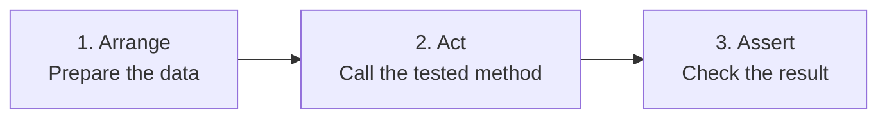

# How to set up unit tests?

## Introduction

A **unit test** is a small program that automatically checks that a part of your code (a method, a class) does what is expected.

Instead of opening the browser and clicking around to check that "it still works", you run a command and PHPUnit checks everything for you, in a few milliseconds.

!!! info "Why write tests?"

    - **Detect regressions**: a change that breaks an existing feature is reported immediately
    - **Document the code**: a test shows how a class should be used
    - **Change code without fear**: you can improve your code (refactor) knowing that the tests protect you
    - **Validate a skill**: tests are expected in exams and in the professional world

In this page, we are going to test the "ville" (city) application built in the [Building the CRUD](dataservice-select.md) chapter:

| What we test                 | Tested class              | Type of test                                  |
|------------------------------|---------------------------|-----------------------------------------------|
| A business rule              | `Entity\Ville`            | Pure unit test (without a database)           |
| SQL queries                  | `Repository\VilleRepository` | Test with a test SQLite database           |
| Displaying a page            | `Controller\UserController` | Test of a controller's HTML output          |

## Prerequisites

- Have an Edu Framework project installed ([Installation](../installation/installation.md))
- Understand the [MVC architecture](concept-mvc.md) and the [tree](arborescence.md) of the project
- For the repository test: the PHP `pdo_sqlite` extension must be enabled (`php -m | grep sqlite`)

## The approach

### Vocabulary

| Term             | Definition                                                                                 |
|------------------|--------------------------------------------------------------------------------------------|
| **PHPUnit**      | The reference PHP library for writing and running tests                                    |
| **Test class**   | A class that extends `TestCase` and groups the tests of one class of the application       |
| **Test method**  | A public method whose name starts with `test`: it is **one** test                          |
| **Assertion**    | A check: `assertSame()`, `assertTrue()`, `assertCount()`...                                |
| **Fixture**      | The data prepared before a test (Example: cities inserted into the test database)          |

### The AAA pattern: Arrange, Act, Assert

Every test always follows the same three steps:



```php
public function testUneVilleDeMoinsDe100000HabitantsNestPasUneGrandeVille(): void
{
    // 1. Arrange: prepare
    $ville = new Ville(1, 'Créteil', '94000', 92000);

    // 2. Act: act
    $resultat = $ville->estGrandeVille();

    // 3. Assert: check
    $this->assertFalse($resultat);
}
```

### The rules of a good test

- [ ] **One test = one behavior**: a test checks a single thing, and its name describes it (`testCreateVilleAjouteUneVilleEnBase`)
- [ ] **Independent**: a test never depends on the result of another test (the execution order must not change anything)
- [ ] **Reproducible**: it gives the same result on every run (we start again from a clean test database)
- [ ] **Fast**: you should be able to run all the tests in a few seconds, very often
- [ ] **It fails when the code is wrong**: check this by deliberately breaking your code once!

!!! tip "What should be tested first?"

    Test first what contains **logic**: business rules (calculations, conditions, validations) in your entities or services,
    then your SQL queries in the repositories. A getter alone does not bring much value, an `if` condition does.

    Think about **edge cases**: the value just below, exactly equal to and just above a limit, an empty string, an empty list...

## Step 1: checking that PHPUnit is installed

A project created with `composer create-project studoo/edu-framework-skeleton` **already** contains PHPUnit: it is declared in the `require-dev` section of the `composer.json` file, as a **development dependency**. It is therefore not installed on the production server.

Check the installation at the root of your project:

```Bash
php vendor/bin/phpunit --version
```

!!! note "Example output"

    ```Bash
    PHPUnit 13.4.6 by Sebastian Bergmann and contributors.
    ```

??? failure "The command cannot be found (`Could not open input file`)"

    The dependencies are not installed: run `composer install`.

    If the `composer.json` file does not contain `phpunit/phpunit` in `require-dev` (older project, or a project created without the skeleton), install PHPUnit:

    ```Bash
    composer require --dev phpunit/phpunit
    ```

!!! info "PHPUnit version"

    The skeleton provides PHPUnit 13 since its v2.11.1 version; older projects have PHPUnit 11. The examples on this page work with PHPUnit 11, 12 and 13. They use **PHP attributes** (`#[DataProvider]`):
    the old annotations in comments (`@dataProvider`) are no longer recognized since PHPUnit 12.

## Step 2: configuring the project

The skeleton provides the `tests` folder and the `phpunit.xml` and `tests/bootstrap.php` files. Depending on the version of the skeleton used to create your project, their configuration is **already complete** or **minimal**.

Open the `phpunit.xml` file at the root of your project:

- it contains `bootstrap="tests/bootstrap.php"`: your project is **already configured**; read this step to understand the files, then go to [step 3](#step-3-writing-your-first-test);
- it contains `bootstrap="vendor/autoload.php"`: the configuration is **minimal**; complete it as shown below.

| File | Minimal configuration (older skeleton) | To do |
|---|---|---|
| `composer.json` | without the `autoload-dev` section | add `autoload-dev` |
| `phpunit.xml` | only loads `vendor/autoload.php`, old `<coverage>` format | replace the content |
| `tests/bootstrap.php` | only loads `vendor/autoload.php` | replace the content |

### The tests tree

The `tests` folder mirrors the tree of the `app` folder: the `app/Entity/Ville.php` class is tested by `tests/Entity/VilleTest.php`.

``` hl_lines="10-17"
├── app
│   ├── Config
│   ├── Controller
│   │   └── UserController.php
│   ├── Entity
│   │   └── Ville.php
│   ├── Repository
│   │   └── VilleRepository.php
│   └── Template
├── tests
│   ├── bootstrap.php
│   ├── Controller
│   │   └── UserControllerTest.php
│   ├── Entity
│   │   └── VilleTest.php
│   └── Repository
│       └── VilleRepositoryTest.php
├── phpunit.xml
└── composer.json
```

!!! warning "Naming convention"

    - The test file and class end with **Test**: `VilleTest.php` contains the `VilleTest` class
    - Each test method is **public**, returns nothing (`: void`) and its name starts with **test**

### The composer.json file

Add the `autoload-dev` section so that Composer automatically loads the classes of the `tests` folder (`Tests\` namespace):

```diff
  "autoload": {
    "psr-4": {
      "": "app/"
    }
  },
+ "autoload-dev": {
+   "psr-4": {
+     "Tests\\": "tests/"
+   }
+ },
```

Then regenerate the autoload:

```Bash
composer dump-autoload
```

### The phpunit.xml file

Replace the content of the `phpunit.xml` file at the root of the project (create it if it does not exist). It tells PHPUnit where the tests are and which file to run before running them.

```xml
<?xml version="1.0" encoding="UTF-8"?>
<phpunit xmlns:xsi="http://www.w3.org/2001/XMLSchema-instance"
         xsi:noNamespaceSchemaLocation="vendor/phpunit/phpunit/phpunit.xsd"
         bootstrap="tests/bootstrap.php"
         colors="true">
    <testsuites>
        <testsuite name="Application">
            <directory>tests</directory>
        </testsuite>
    </testsuites>
    <source>
        <include>
            <directory>app</directory>
        </include>
    </source>
</phpunit>
```

The two changes compared to the minimal configuration:

- `bootstrap="tests/bootstrap.php"` instead of `vendor/autoload.php`: PHPUnit runs the file that configures the framework (see below)
- the `<source>` section replaces the old `<coverage>` section, which triggers the `PHPUnit Deprecations: 1` warning since PHPUnit 11

### The tests/bootstrap.php file

During a test, the `public/index.php` file is **not** executed: there is no web server and no browser.
The `tests/bootstrap.php` file replaces `public/index.php`: it loads the libraries and configures the framework (paths to the templates, the routes, the SQLite database).

Replace the content of the `tests/bootstrap.php` file:

```php
<?php

use Studoo\EduFramework\Core\ConfigCore;
use Studoo\EduFramework\Core\View\TwigCore;

require __DIR__ . '/../vendor/autoload.php';

// Framework configuration for the tests (same as public/index.php)
new ConfigCore([
    'base_path'         => __DIR__ . '/../',
    'twig_path'         => __DIR__ . '/../app/Template',
    'route_config_path' => __DIR__ . '/../app/Config/',
    'cache_path'        => __DIR__ . '/../var/cache/',
    'sqlite_path'       => __DIR__ . '/../var/sqlite/',
]);

// Twig template engine, used by the controllers
TwigCore::setEnvironment();
```

!!! info "The .env file is not loaded"

    The bootstrap deliberately does not load the `.env` file: tests must **never** use the development database.
    Each test that needs a database sets up its own test database (see step 6).

## Step 3: writing your first test

### The business rule to test

We add a business rule to the `Ville` entity: a city is a "big city" from 100,000 inhabitants upwards.

```diff
 class Ville
 {
     [...]

     public function getNombreHabitant()
     {
         return $this->nombre_habitant;
     }
+
+    public function estGrandeVille(): bool
+    {
+        return $this->nombre_habitant >= 100000;
+    }
 }
```

### The test class

Create the `tests/Entity/VilleTest.php` file:

```php
<?php

namespace Tests\Entity;

use Entity\Ville;
use PHPUnit\Framework\TestCase;

class VilleTest extends TestCase
{
    public function testLesGettersRenvoientLesValeursDuConstructeur(): void
    {
        // Arrange
        $ville = new Ville(1, 'Paris', '75000', 2200000);

        // Act + Assert
        $this->assertSame(1, $ville->getId());
        $this->assertSame('Paris', $ville->getNom());
        $this->assertSame('75000', $ville->getCodePostal());
        $this->assertSame(2200000, $ville->getNombreHabitant());
    }

    public function testUneVilleDeMoinsDe100000HabitantsNestPasUneGrandeVille(): void
    {
        // Arrange
        $ville = new Ville(1, 'Créteil', '94000', 92000);

        // Act
        $resultat = $ville->estGrandeVille();

        // Assert
        $this->assertFalse($resultat);
    }
}
```

Explanations:

- The class extends `TestCase`: it is this class that provides all the `assert...()` methods.
- `assertSame($expected, $actual)` compares the value **and the type**: `assertSame(1, '1')` fails. Prefer it to `assertEquals()`.
- **The expected value is always the first parameter**, the actual value the second: the error message will be clearer.

### The most useful assertions

| Assertion                                      | Checks that...                                       |
|------------------------------------------------|------------------------------------------------------|
| `assertSame($expected, $actual)`               | both values are identical (value and type)           |
| `assertTrue($value)` / `assertFalse($value)`   | the value is `true` / `false`                        |
| `assertNull($value)`                           | the value is `null`                                  |
| `assertCount(3, $array)`                       | the array contains 3 elements                        |
| `assertEmpty($array)`                          | the array (or the string) is empty                   |
| `assertInstanceOf(Ville::class, $object)`      | the object is an instance of the `Ville` class       |
| `assertContainsOnlyInstancesOf(Ville::class, $array)` | the array only contains `Ville` objects       |
| `assertStringContainsString('Paris', $html)`   | the string contains the text `Paris`                 |
| `expectException(MyException::class)`          | the code that follows throws the exception (to be called **before** the code) |

## Step 4: running the tests

Type this command at the root of your project:

```Bash
php vendor/bin/phpunit
```

!!! success "All tests pass"

    ```Bash
    PHPUnit 13.4.6 by Sebastian Bergmann and contributors.

    ..                                                                  2 / 2 (100%)

    OK (2 tests, 5 assertions)
    ```

    Each dot `.` represents a successful test.

!!! failure "A test fails"

    Deliberately change the business rule (`> 1000` instead of `>= 100000`) and run the tests again:

    ```Bash
    .F                                                                  2 / 2 (100%)

    There was 1 failure:

    1) Tests\Entity\VilleTest::testUneVilleDeMoinsDe100000HabitantsNestPasUneGrandeVille
    Failed asserting that true is false.

    tests/Entity/VilleTest.php:31

    FAILURES!
    Tests: 2, Assertions: 5, Failures: 1.
    ```

    PHPUnit tells you **which test** fails, **why** (the actual value) and **on which line**. Put the correct code back afterwards!

Useful options:

| Command                                                 | Effect                                                     |
|---------------------------------------------------------|------------------------------------------------------------|
| `php vendor/bin/phpunit --testdox`                      | Displays the name of each test as a sentence               |
| `php vendor/bin/phpunit tests/Entity`                   | Runs only the tests of a folder                            |
| `php vendor/bin/phpunit tests/Entity/VilleTest.php`     | Runs only the tests of a file                              |
| `php vendor/bin/phpunit --filter testEstGrandeVille`    | Runs only the tests whose name matches                     |

!!! tip "In Docker"

    If your application runs in Docker ([The application in Docker](../installation/docker.md)), run the tests in the PHP container:
    `docker compose exec frankenphp php vendor/bin/phpunit`.

## Step 5: testing several cases with a DataProvider

To test a limit, you need several cases: below, exactly at the limit, above.
Rather than copy-pasting the same test, a **DataProvider** supplies a list of datasets: the test is run once per dataset.

Add to `tests/Entity/VilleTest.php`:

```diff
 namespace Tests\Entity;

 use Entity\Ville;
+use PHPUnit\Framework\Attributes\DataProvider;
 use PHPUnit\Framework\TestCase;

 class VilleTest extends TestCase
 {
     [...]
+
+    #[DataProvider('fournirNombresHabitants')]
+    public function testEstGrandeVille(int $nombreHabitant, bool $attendu): void
+    {
+        $ville = new Ville(1, 'Test city', '00000', $nombreHabitant);
+
+        $this->assertSame($attendu, $ville->estGrandeVille());
+    }
+
+    public static function fournirNombresHabitants(): array
+    {
+        return [
+            'village'              => [500, false],
+            'just below the limit' => [99999, false],
+            'exactly the limit'    => [100000, true],
+            'big city'             => [2200000, true],
+        ];
+    }
 }
```

Explanations:

- The `#[DataProvider('fournirNombresHabitants')]` attribute links the test to the method that provides the data.
- The DataProvider method is **public and static**, it returns an array of datasets.
- Each dataset matches the test's parameters, in order: `[$nombreHabitant, $attendu]`.
- The key (`'just below the limit'`) gives the case a name: if it fails, PHPUnit displays this name.

## Step 6: testing a repository with a test database

The repository runs SQL queries: to test it, you need a database.
You **never** use the development database: a test could delete your data, and since the data changes, the test would no longer be reproducible.

The solution: a **test SQLite** database, recreated **before each test** in the `setUp()` method.

Create the `tests/Repository/VilleRepositoryTest.php` file:

```php
<?php

namespace Tests\Repository;

use Entity\Ville;
use PHPUnit\Framework\TestCase;
use Repository\VilleRepository;
use Studoo\EduFramework\Core\Service\DatabaseService;

class VilleRepositoryTest extends TestCase
{
    /**
     * Run BEFORE each test: we start again from a clean test database
     */
    protected function setUp(): void
    {
        // SQLite database dedicated to the tests: var/sqlite/test.sqlite
        $_ENV['DB_TYPE'] = 'sqlite';
        $_ENV['DB_NAME'] = 'test';
        new DatabaseService();

        // Fixtures: the table and a known dataset
        $pdo = DatabaseService::getConnect();
        $pdo->exec('DROP TABLE IF EXISTS ville');
        $pdo->exec('CREATE TABLE ville (
            id integer not null constraint ville_pk primary key autoincrement,
            code_postal     TEXT,
            nombre_habitant integer,
            nom             TEXT
        )');
        $pdo->exec("INSERT INTO ville (nom, code_postal, nombre_habitant) VALUES ('Paris', '75000', 2200000)");
        $pdo->exec("INSERT INTO ville (nom, code_postal, nombre_habitant) VALUES ('Lyon', '69000', 500000)");
    }

    public function testGetVillesRenvoieToutesLesVilles(): void
    {
        $villes = (new VilleRepository())->getVilles();

        $this->assertCount(2, $villes);
        $this->assertContainsOnlyInstancesOf(Ville::class, $villes);
        $this->assertSame('Paris', $villes[0]->getNom());
    }

    public function testCreateVilleAjouteUneVilleEnBase(): void
    {
        $repository = new VilleRepository();

        $id = $repository->createVille(new Ville(0, 'Marseille', '13000', 800000));

        $this->assertSame(3, $id);
        $this->assertCount(3, $repository->getVilles());
    }
}
```

Explanations:

- `setUp()` is run by PHPUnit **before each test**: the table is dropped and then recreated with exactly 2 cities.
  The `testCreateVilleAjouteUneVilleEnBase` test adds a city, but the next test will still start again from 2 cities: the tests are **independent**.
- `$_ENV['DB_TYPE']` and `$_ENV['DB_NAME']` replace the `.env` file: the [DatabaseService](dataservice.md) service connects to `var/sqlite/test.sqlite`.
- There is also `tearDown()`, run **after each test** (Example: deleting a file created by the test).

!!! warning "Test database and .gitignore"

    Add the test database to the `.gitignore` file so that it is not versioned:

    ```
    /var/sqlite/test.sqlite
    ```

!!! info "What if my project uses MySQL?"

    Simple queries (`SELECT`, `INSERT`, `UPDATE`, `DELETE`) work the same way in SQLite.
    Only the fixture's `CREATE TABLE` has to be written in SQLite syntax (see the [SQLite schema](dataservice-select.md#database-schema)).

## Step 7: testing a controller

A controller returns the HTML code of the page. To test it, you **simulate the HTTP request** with a [Request](resquet.md) object, call the controller, then check the resulting HTML.

Example with the `UserController` controller of the `/user/{id}` route:

```php
<?php

namespace Tests\Controller;

use Controller\UserController;
use PHPUnit\Framework\TestCase;
use Studoo\EduFramework\Core\Controller\Request;

class UserControllerTest extends TestCase
{
    public function testLaPageAfficheLIdentifiantDeLUtilisateur(): void
    {
        // Simulate the GET /user/42 request: the {id} route variable is 42
        $request = new Request('/user/42', 'GET');
        $request->setVars(['id' => '42']);

        $html = (new UserController())->execute($request);

        $this->assertStringContainsString('<h1>UserController</h1>', $html);
        $this->assertStringContainsString('<b>42</b>', $html);
    }
}
```

Explanations:

- `new Request('/user/42', 'GET')` creates the request: the route and the HTTP method.
- `setVars()` fills in the request's variables: the route variables (`{id}`) and the fields of a `POST` form.
- To simulate submitting a form, use the `POST` method: `new Request('/ville', 'POST')` then `setVars(['nom' => 'Paris', ...])`.
- The Twig engine was initialized in `tests/bootstrap.php`: the controller can generate the page.

!!! warning "Controllers that redirect"

    A controller that calls `header('Location: ...')` or `exit` is hard to test. Put the logic (calculations, validations, SQL queries)
    in the entity or the repository and test it there: the controller stays simple and no longer needs to be tested in detail.

## Common errors

| Error message                                                      | Cause and solution                                                                                        |
|--------------------------------------------------------------------|-----------------------------------------------------------------------------------------------------------|
| `No tests executed!`                                               | The file name does not end with `Test.php`, or the methods do not start with `test`                       |
| `Class "Tests\Entity\VilleTest" not found` / `Class "Entity\Ville" not found` | `autoload-dev` is missing from `composer.json`, or you forgot `composer dump-autoload` |
| `Too few arguments to function ...Test::testEstGrandeVille()`      | The DataProvider is not linked: check the `#[DataProvider(...)]` attribute and its `use`                   |
| `Typed static property ...DatabaseService::$dbConnect must not be accessed before initialization` | `new DatabaseService()` was not called in `setUp()` before using the repository |
| `could not find driver`                                            | The `pdo_sqlite` extension is not enabled in your `php.ini`                                               |
| `Unable to find template "..."`                                    | The `twig_path` in the `tests/bootstrap.php` file does not point to `app/Template`                        |

## Your turn

- [ ] Check that PHPUnit is installed, add `autoload-dev` and complete the `phpunit.xml` and `tests/bootstrap.php` files
- [ ] Write the `VilleTest` test and make it pass
- [ ] Deliberately break `estGrandeVille()` and check that the test fails
- [ ] Write a test for the repository's `getVille(int $id)` method: an existing city, then a non-existent identifier (the expected result is `false`)
- [ ] Write a test for the `updateVille()` method: change the name of a city, then check by reading the city back from the database
- [ ] Write a test for the `deleteVille()` method: after deletion, the database only contains one city
- [ ] Add a business rule of your choice (Example: a valid postal code contains exactly 5 digits) and test it with a DataProvider

!!! tip "Going further: writing the test before the code (TDD)"

    **Test Driven Development** consists in writing the test **before** the code: you write a test that fails (red),
    then the minimum code to make it pass (green), then you improve the code without breaking the test (refactor).
    Try it with the postal code rule from the previous exercise!
