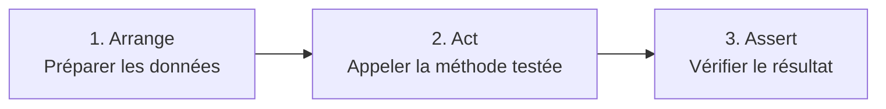

# Comment mettre en place des tests unitaires ?

## Introduction

Un **test unitaire** est un petit programme qui vérifie automatiquement qu'une partie de votre code (une méthode, une classe) fait bien ce qui est attendu.

Au lieu d'ouvrir le navigateur et de cliquer pour vérifier que « ça marche encore », vous lancez une commande et PHPUnit vérifie tout pour vous, en quelques millisecondes.

!!! info "Pourquoi écrire des tests ?"

    - **Détecter les régressions** : une modification qui casse une fonctionnalité existante est signalée immédiatement
    - **Documenter le code** : un test montre comment une classe doit être utilisée
    - **Modifier sans peur** : vous pouvez améliorer votre code (refactoriser) en sachant que les tests vous protègent
    - **Valider une compétence** : les tests sont attendus dans les épreuves et dans le monde professionnel

Dans cette page, nous allons tester l'application « ville » construite dans le chapitre [Construire le CRUD](dataservice-select.md) :

| Ce que l'on teste            | Classe testée             | Type de test                                  |
|------------------------------|---------------------------|-----------------------------------------------|
| Une règle métier             | `Entity\Ville`            | Test unitaire pur (sans base de données)      |
| Les requêtes SQL             | `Repository\VilleRepository` | Test avec une base SQLite de test          |
| L'affichage d'une page       | `Controller\UserController` | Test du rendu HTML d'un controller          |

## Prérequis

- Avoir un projet Edu Framework installé ([Installation](../installation/installation.md))
- Avoir compris l'[architecture MVC](concept-mvc.md) et l'[arborescence](arborescence.md) du projet
- Pour le test du repository : l'extension PHP `pdo_sqlite` doit être activée (`php -m | grep sqlite`)

## La démarche

### Le vocabulaire

| Terme            | Définition                                                                                 |
|------------------|--------------------------------------------------------------------------------------------|
| **PHPUnit**      | La librairie PHP de référence pour écrire et lancer des tests                              |
| **Classe de test** | Une classe qui hérite de `TestCase` et qui regroupe les tests d'une classe de l'application |
| **Méthode de test** | Une méthode publique dont le nom commence par `test` : c'est **un** test                 |
| **Assertion**    | Une vérification : `assertSame()`, `assertTrue()`, `assertCount()`...                      |
| **Fixture**      | Les données préparées avant un test (Exemple : des villes insérées dans la base de test)   |

### Le schéma AAA : Arrange, Act, Assert

Chaque test suit toujours les trois mêmes étapes :



```php
public function testUneVilleDeMoinsDe100000HabitantsNestPasUneGrandeVille(): void
{
    // 1. Arrange : préparer
    $ville = new Ville(1, 'Créteil', '94000', 92000);

    // 2. Act : agir
    $resultat = $ville->estGrandeVille();

    // 3. Assert : vérifier
    $this->assertFalse($resultat);
}
```

### Les règles d'un bon test

- [ ] **Un test = un comportement** : un test vérifie une seule chose, son nom le décrit (`testCreateVilleAjouteUneVilleEnBase`)
- [ ] **Indépendant** : un test ne dépend jamais du résultat d'un autre test (l'ordre d'exécution ne doit rien changer)
- [ ] **Reproductible** : il donne le même résultat à chaque exécution (on repart d'une base de test propre)
- [ ] **Rapide** : on doit pouvoir lancer tous les tests en quelques secondes, très souvent
- [ ] **Il échoue quand le code est faux** : vérifiez-le en cassant volontairement votre code une fois !

!!! tip "Quoi tester en priorité ?"

    Testez d'abord ce qui contient de la **logique** : les règles métier (calculs, conditions, validations) dans vos entités ou services,
    puis vos requêtes SQL dans les repositories. Un getter seul n'apporte pas beaucoup de valeur, une condition `if` oui.

    Pensez aux **cas limites** : la valeur juste en dessous, exactement égale et juste au-dessus d'une limite, une chaîne vide, une liste vide...

## Étape 1 : vérifier que PHPUnit est installé

Un projet créé avec `composer create-project studoo/edu-framework-skeleton` contient **déjà** PHPUnit : il est déclaré dans la section `require-dev` du fichier `composer.json`, comme **dépendance de développement**. Il n'est donc pas installé sur le serveur de production.

Vérifier l'installation à la racine de votre projet :

```Bash
php vendor/bin/phpunit --version
```

!!! note "Exemple d'affichage"

    ```Bash
    PHPUnit 11.5.57 by Sebastian Bergmann and contributors.
    ```

??? failure "La commande est introuvable (`Could not open input file`)"

    Les dépendances ne sont pas installées : lancez `composer install`.

    Si le fichier `composer.json` ne contient pas `phpunit/phpunit` dans `require-dev` (projet ancien ou créé sans le skeleton), installez PHPUnit :

    ```Bash
    composer require --dev phpunit/phpunit
    ```

!!! info "Version de PHPUnit"

    Les exemples de cette page fonctionnent avec PHPUnit 11 (fourni par le skeleton) comme avec PHPUnit 12 et 13. Ils utilisent les **attributs PHP** (`#[DataProvider]`) :
    les anciennes annotations dans les commentaires (`@dataProvider`) ne sont plus reconnues depuis PHPUnit 12.

## Étape 2 : configurer le projet

Le skeleton fournit déjà le dossier `tests` et les fichiers `phpunit.xml` et `tests/bootstrap.php`, mais leur configuration est **minimale** : il faut les compléter pour pouvoir tester des controllers et des repositories.

| Fichier | Fourni par le skeleton | À faire |
|---|---|---|
| `composer.json` | sans la section `autoload-dev` | ajouter `autoload-dev` |
| `phpunit.xml` | charge seulement `vendor/autoload.php`, ancien format `<coverage>` | remplacer le contenu |
| `tests/bootstrap.php` | charge seulement `vendor/autoload.php` | remplacer le contenu |

### L'arborescence des tests

Le dossier `tests` reproduit l'arborescence du dossier `app` : la classe `app/Entity/Ville.php` est testée par `tests/Entity/VilleTest.php`.

``` hl_lines="10-17"
├── app
│   ├── Config
│   ├── Controller
│   │   └── UserController.php
│   ├── Entity
│   │   └── Ville.php
│   ├── Repository
│   │   └── VilleRepository.php
│   └── Template
├── tests
│   ├── bootstrap.php
│   ├── Controller
│   │   └── UserControllerTest.php
│   ├── Entity
│   │   └── VilleTest.php
│   └── Repository
│       └── VilleRepositoryTest.php
├── phpunit.xml
└── composer.json
```

!!! warning "Convention de nommage"

    - Le fichier et la classe de test se terminent par **Test** : `VilleTest.php` contient la classe `VilleTest`
    - Chaque méthode de test est **publique**, ne renvoie rien (`: void`) et son nom commence par **test**

### Le fichier composer.json

Ajouter la section `autoload-dev` pour que Composer charge automatiquement les classes du dossier `tests` (espace de noms `Tests\`) :

```diff
  "autoload": {
    "psr-4": {
      "": "app/"
    }
  },
+ "autoload-dev": {
+   "psr-4": {
+     "Tests\\": "tests/"
+   }
+ },
```

Puis régénérer l'autoload :

```Bash
composer dump-autoload
```

### Le fichier phpunit.xml

Remplacer le contenu du fichier `phpunit.xml`, à la racine du projet (créez-le s'il n'existe pas). Il indique à PHPUnit où se trouvent les tests et quel fichier exécuter avant de les lancer.

```xml
<?xml version="1.0" encoding="UTF-8"?>
<phpunit xmlns:xsi="http://www.w3.org/2001/XMLSchema-instance"
         xsi:noNamespaceSchemaLocation="vendor/phpunit/phpunit/phpunit.xsd"
         bootstrap="tests/bootstrap.php"
         colors="true">
    <testsuites>
        <testsuite name="Application">
            <directory>tests</directory>
        </testsuite>
    </testsuites>
    <source>
        <include>
            <directory>app</directory>
        </include>
    </source>
</phpunit>
```

Les deux changements par rapport au fichier du skeleton :

- `bootstrap="tests/bootstrap.php"` au lieu de `vendor/autoload.php` : PHPUnit exécute le fichier qui configure le framework (voir ci-dessous)
- la section `<source>` remplace l'ancienne section `<coverage>`, qui provoque l'avertissement `PHPUnit Deprecations: 1` depuis PHPUnit 11

### Le fichier tests/bootstrap.php

Lors d'un test, le fichier `public/index.php` n'est **pas** exécuté : il n'y a pas de serveur web ni de navigateur.
Le fichier `tests/bootstrap.php` remplace `public/index.php` : il charge les librairies et configure le framework (chemins des templates, des routes, de la base SQLite).

Remplacer le contenu du fichier `tests/bootstrap.php` :

```php
<?php

use Studoo\EduFramework\Core\ConfigCore;
use Studoo\EduFramework\Core\View\TwigCore;

require __DIR__ . '/../vendor/autoload.php';

// Configuration du framework pour les tests (même chose que public/index.php)
new ConfigCore([
    'base_path'         => __DIR__ . '/../',
    'twig_path'         => __DIR__ . '/../app/Template',
    'route_config_path' => __DIR__ . '/../app/Config/',
    'cache_path'        => __DIR__ . '/../var/cache/',
    'sqlite_path'       => __DIR__ . '/../var/sqlite/',
]);

// Moteur de template Twig, utilisé par les controllers
TwigCore::setEnvironment();
```

!!! info "Le fichier .env n'est pas chargé"

    Le bootstrap ne charge volontairement pas le fichier `.env` : les tests ne doivent **jamais** utiliser la base de données de développement.
    Chaque test qui a besoin d'une base configure lui-même une base de test (voir l'étape 6).

## Étape 3 : écrire son premier test

### La règle métier à tester

Nous ajoutons une règle métier à l'entité `Ville` : une ville est une « grande ville » à partir de 100 000 habitants.

```diff
 class Ville
 {
     [...]

     public function getNombreHabitant()
     {
         return $this->nombre_habitant;
     }
+
+    public function estGrandeVille(): bool
+    {
+        return $this->nombre_habitant >= 100000;
+    }
 }
```

### La classe de test

Créer le fichier `tests/Entity/VilleTest.php` :

```php
<?php

namespace Tests\Entity;

use Entity\Ville;
use PHPUnit\Framework\TestCase;

class VilleTest extends TestCase
{
    public function testLesGettersRenvoientLesValeursDuConstructeur(): void
    {
        // Arrange
        $ville = new Ville(1, 'Paris', '75000', 2200000);

        // Act + Assert
        $this->assertSame(1, $ville->getId());
        $this->assertSame('Paris', $ville->getNom());
        $this->assertSame('75000', $ville->getCodePostal());
        $this->assertSame(2200000, $ville->getNombreHabitant());
    }

    public function testUneVilleDeMoinsDe100000HabitantsNestPasUneGrandeVille(): void
    {
        // Arrange
        $ville = new Ville(1, 'Créteil', '94000', 92000);

        // Act
        $resultat = $ville->estGrandeVille();

        // Assert
        $this->assertFalse($resultat);
    }
}
```

Explications :

- La classe hérite de `TestCase` : c'est elle qui fournit toutes les méthodes `assert...()`.
- `assertSame($attendu, $obtenu)` compare la valeur **et le type** : `assertSame(1, '1')` échoue. Préférez-la à `assertEquals()`.
- **La valeur attendue est toujours le premier paramètre**, la valeur obtenue le second : le message d'erreur sera plus clair.

### Les assertions les plus utiles

| Assertion                                      | Vérifie que...                                       |
|------------------------------------------------|------------------------------------------------------|
| `assertSame($attendu, $obtenu)`                | les deux valeurs sont identiques (valeur et type)    |
| `assertTrue($valeur)` / `assertFalse($valeur)` | la valeur vaut `true` / `false`                      |
| `assertNull($valeur)`                          | la valeur vaut `null`                                |
| `assertCount(3, $tableau)`                     | le tableau contient 3 éléments                       |
| `assertEmpty($tableau)`                        | le tableau (ou la chaîne) est vide                   |
| `assertInstanceOf(Ville::class, $objet)`       | l'objet est une instance de la classe `Ville`        |
| `assertContainsOnlyInstancesOf(Ville::class, $tableau)` | le tableau ne contient que des objets `Ville` |
| `assertStringContainsString('Paris', $html)`   | la chaîne contient le texte `Paris`                  |
| `expectException(MonException::class)`         | le code qui suit lève l'exception (à appeler **avant** le code) |

## Étape 4 : lancer les tests

Saisir cette commande à la racine de votre projet :

```Bash
php vendor/bin/phpunit
```

!!! success "Tous les tests passent"

    ```Bash
    PHPUnit 11.5.57 by Sebastian Bergmann and contributors.

    ..                                                                  2 / 2 (100%)

    OK (2 tests, 5 assertions)
    ```

    Chaque point `.` représente un test réussi.

!!! failure "Un test échoue"

    Modifiez volontairement la règle métier (`> 1000` au lieu de `>= 100000`) et relancez les tests :

    ```Bash
    .F                                                                  2 / 2 (100%)

    There was 1 failure:

    1) Tests\Entity\VilleTest::testUneVilleDeMoinsDe100000HabitantsNestPasUneGrandeVille
    Failed asserting that true is false.

    tests/Entity/VilleTest.php:31

    FAILURES!
    Tests: 2, Assertions: 5, Failures: 1.
    ```

    PHPUnit indique **quel test** échoue, **pourquoi** (la valeur obtenue) et **à quelle ligne**. Remettez le code correct ensuite !

Les options utiles :

| Commande                                                | Effet                                                      |
|---------------------------------------------------------|------------------------------------------------------------|
| `php vendor/bin/phpunit --testdox`                      | Affiche le nom de chaque test sous forme de phrase          |
| `php vendor/bin/phpunit tests/Entity`                   | Lance uniquement les tests d'un dossier                     |
| `php vendor/bin/phpunit tests/Entity/VilleTest.php`     | Lance uniquement les tests d'un fichier                     |
| `php vendor/bin/phpunit --filter testEstGrandeVille`    | Lance uniquement les tests dont le nom correspond           |

!!! tip "Dans Docker"

    Si votre application tourne dans Docker ([L'application dans Docker](../installation/docker.md)), lancez les tests dans le conteneur PHP :
    `docker compose exec frankenphp php vendor/bin/phpunit`.

## Étape 5 : tester plusieurs cas avec un DataProvider

Pour tester une limite, il faut plusieurs cas : en dessous, exactement à la limite, au-dessus.
Plutôt que de copier-coller le même test, un **DataProvider** fournit une liste de jeux de données : le test est exécuté une fois par jeu.

Ajouter dans `tests/Entity/VilleTest.php` :

```diff
 namespace Tests\Entity;

 use Entity\Ville;
+use PHPUnit\Framework\Attributes\DataProvider;
 use PHPUnit\Framework\TestCase;

 class VilleTest extends TestCase
 {
     [...]
+
+    #[DataProvider('fournirNombresHabitants')]
+    public function testEstGrandeVille(int $nombreHabitant, bool $attendu): void
+    {
+        $ville = new Ville(1, 'Ville test', '00000', $nombreHabitant);
+
+        $this->assertSame($attendu, $ville->estGrandeVille());
+    }
+
+    public static function fournirNombresHabitants(): array
+    {
+        return [
+            'village'              => [500, false],
+            'juste sous la limite' => [99999, false],
+            'exactement la limite' => [100000, true],
+            'grande ville'         => [2200000, true],
+        ];
+    }
 }
```

Explications :

- L'attribut `#[DataProvider('fournirNombresHabitants')]` relie le test à la méthode qui fournit les données.
- La méthode du DataProvider est **publique et statique**, elle renvoie un tableau de jeux de données.
- Chaque jeu de données correspond aux paramètres du test, dans l'ordre : `[$nombreHabitant, $attendu]`.
- La clé (`'juste sous la limite'`) donne un nom au cas : en cas d'échec, PHPUnit affiche ce nom.

## Étape 6 : tester un repository avec une base de test

Le repository exécute des requêtes SQL : pour le tester, il faut une base de données.
On n'utilise **jamais** la base de développement : un test pourrait supprimer vos données, et les données changeant, le test ne serait plus reproductible.

La solution : une base **SQLite de test**, recréée **avant chaque test** dans la méthode `setUp()`.

Créer le fichier `tests/Repository/VilleRepositoryTest.php` :

```php
<?php

namespace Tests\Repository;

use Entity\Ville;
use PHPUnit\Framework\TestCase;
use Repository\VilleRepository;
use Studoo\EduFramework\Core\Service\DatabaseService;

class VilleRepositoryTest extends TestCase
{
    /**
     * Exécutée AVANT chaque test : on repart d'une base de test propre
     */
    protected function setUp(): void
    {
        // Base SQLite dédiée aux tests : var/sqlite/test.sqlite
        $_ENV['DB_TYPE'] = 'sqlite';
        $_ENV['DB_NAME'] = 'test';
        new DatabaseService();

        // Fixtures : la table et un jeu de données connu
        $pdo = DatabaseService::getConnect();
        $pdo->exec('DROP TABLE IF EXISTS ville');
        $pdo->exec('CREATE TABLE ville (
            id integer not null constraint ville_pk primary key autoincrement,
            code_postal     TEXT,
            nombre_habitant integer,
            nom             TEXT
        )');
        $pdo->exec("INSERT INTO ville (nom, code_postal, nombre_habitant) VALUES ('Paris', '75000', 2200000)");
        $pdo->exec("INSERT INTO ville (nom, code_postal, nombre_habitant) VALUES ('Lyon', '69000', 500000)");
    }

    public function testGetVillesRenvoieToutesLesVilles(): void
    {
        $villes = (new VilleRepository())->getVilles();

        $this->assertCount(2, $villes);
        $this->assertContainsOnlyInstancesOf(Ville::class, $villes);
        $this->assertSame('Paris', $villes[0]->getNom());
    }

    public function testCreateVilleAjouteUneVilleEnBase(): void
    {
        $repository = new VilleRepository();

        $id = $repository->createVille(new Ville(0, 'Marseille', '13000', 800000));

        $this->assertSame(3, $id);
        $this->assertCount(3, $repository->getVilles());
    }
}
```

Explications :

- `setUp()` est exécutée par PHPUnit **avant chaque test** : la table est supprimée puis recréée avec exactement 2 villes.
  Le test `testCreateVilleAjouteUneVilleEnBase` ajoute une ville, mais le test suivant repartira quand même de 2 villes : les tests sont **indépendants**.
- `$_ENV['DB_TYPE']` et `$_ENV['DB_NAME']` remplacent le fichier `.env` : le service [DatabaseService](dataservice.md) se connecte à `var/sqlite/test.sqlite`.
- Il existe aussi `tearDown()`, exécutée **après chaque test** (Exemple : supprimer un fichier créé par le test).

!!! warning "Base de test et .gitignore"

    Ajoutez la base de test au fichier `.gitignore` pour ne pas la versionner :

    ```
    /var/sqlite/test.sqlite
    ```

!!! info "Et si mon projet utilise MySQL ?"

    Les requêtes simples (`SELECT`, `INSERT`, `UPDATE`, `DELETE`) fonctionnent de la même façon en SQLite.
    Seul le `CREATE TABLE` de la fixture est à écrire dans la syntaxe SQLite (voir le [schéma SQLite](dataservice-select.md#schema-de-la-base-de-donnees)).

## Étape 7 : tester un controller

Un controller renvoie le code HTML de la page. Pour le tester, on **simule la requête HTTP** avec un objet [Request](resquet.md), on appelle le controller, puis on vérifie le HTML obtenu.

Exemple avec le controller `UserController` de la route `/user/{id}` :

```php
<?php

namespace Tests\Controller;

use Controller\UserController;
use PHPUnit\Framework\TestCase;
use Studoo\EduFramework\Core\Controller\Request;

class UserControllerTest extends TestCase
{
    public function testLaPageAfficheLIdentifiantDeLUtilisateur(): void
    {
        // On simule la requête GET /user/42 : la variable de route {id} vaut 42
        $request = new Request('/user/42', 'GET');
        $request->setVars(['id' => '42']);

        $html = (new UserController())->execute($request);

        $this->assertStringContainsString('<h1>UserController</h1>', $html);
        $this->assertStringContainsString('<b>42</b>', $html);
    }
}
```

Explications :

- `new Request('/user/42', 'GET')` crée la requête : la route et la méthode HTTP.
- `setVars()` renseigne les variables de la requête : les variables de route (`{id}`) et les champs d'un formulaire `POST`.
- Pour simuler l'envoi d'un formulaire, utilisez la méthode `POST` : `new Request('/ville', 'POST')` puis `setVars(['nom' => 'Paris', ...])`.
- Le moteur Twig a été initialisé dans `tests/bootstrap.php` : le controller peut générer la page.

!!! warning "Controllers qui redirigent"

    Un controller qui appelle `header('Location: ...')` ou `exit` est difficile à tester. Placez la logique (calculs, validations, requêtes SQL)
    dans l'entité ou le repository et testez-la à cet endroit : le controller reste simple et n'a plus besoin d'être testé en détail.

## Les erreurs fréquentes

| Message d'erreur                                                   | Cause et solution                                                                                         |
|--------------------------------------------------------------------|-----------------------------------------------------------------------------------------------------------|
| `No tests executed!`                                               | Le nom du fichier ne se termine pas par `Test.php`, ou les méthodes ne commencent pas par `test`           |
| `Class "Tests\Entity\VilleTest" not found` / `Class "Entity\Ville" not found` | L'`autoload-dev` est absent du `composer.json`, ou vous avez oublié `composer dump-autoload` |
| `Too few arguments to function ...Test::testEstGrandeVille()`      | Le DataProvider n'est pas relié : vérifiez l'attribut `#[DataProvider(...)]` et son `use`                   |
| `Typed static property ...DatabaseService::$dbConnect must not be accessed before initialization` | `new DatabaseService()` n'a pas été appelé dans `setUp()` avant d'utiliser le repository |
| `could not find driver`                                            | L'extension `pdo_sqlite` n'est pas activée dans votre `php.ini`                                           |
| `Unable to find template "..."`                                    | Le `twig_path` du fichier `tests/bootstrap.php` ne pointe pas vers `app/Template`                          |

## À vous de jouer

- [ ] Vérifier que PHPUnit est installé, ajouter `autoload-dev` et compléter les fichiers `phpunit.xml` et `tests/bootstrap.php`
- [ ] Écrire le test `VilleTest` et le faire passer
- [ ] Casser volontairement `estGrandeVille()` et vérifier que le test échoue
- [ ] Écrire un test pour la méthode `getVille(int $id)` du repository : une ville existante, puis un identifiant inexistant (le résultat attendu est `false`)
- [ ] Écrire un test pour la méthode `updateVille()` : modifier le nom d'une ville puis vérifier en relisant la ville en base
- [ ] Écrire un test pour la méthode `deleteVille()` : après suppression, la base ne contient plus qu'une ville
- [ ] Ajouter une règle métier de votre choix (Exemple : un code postal valide contient exactement 5 chiffres) et la tester avec un DataProvider

!!! tip "Aller plus loin : écrire le test avant le code (TDD)"

    Le **Test Driven Development** consiste à écrire le test **avant** le code : on écrit un test qui échoue (rouge),
    puis le code minimum pour le faire passer (vert), puis on améliore le code sans casser le test (refactoriser).
    Essayez avec la règle du code postal de l'exercice précédent !
