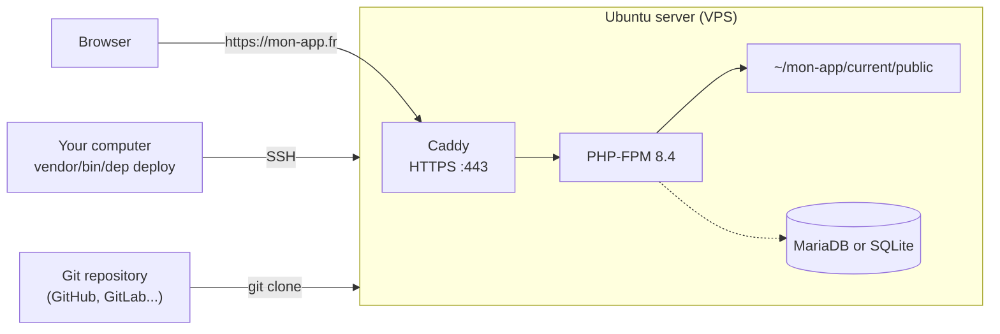

# Deploying with Deployer (without Docker)

[Deployer](https://deployer.org){:target="_blank"} is a deployment tool written in PHP. From your computer, it connects to the server over **SSH**, fetches the code from your Git repository, installs the Composer dependencies and switches the site over to the new version **with no downtime**.

Unlike [FrankenDeploy](index.md), Deployer does **not use Docker**: the server runs PHP-FPM and the [Caddy](https://caddyserver.com){:target="_blank"} web server, which obtains the HTTPS certificate automatically.

| | FrankenDeploy | Deployer |
|---|---|---|
| Docker | on your computer and on the server | no |
| Installing the tool | a binary to install | a Composer dependency of the project |
| Preparing the server | `frankendeploy server setup` | `dep provision` (Ubuntu only) |
| What is sent to the server | a Docker image | the code from your Git repository |
| Going back to the previous version | `frankendeploy rollback prod` | `dep rollback` |

!!! info "Version used"

    This page was written with **Deployer 8.0** (PHP 8.3 minimum). See the [Deployer documentation](https://deployer.org/docs/8.x/getting-started){:target="_blank"} for details on each command.

## How does it work?



On each deployment, Deployer creates a **new version** (*release*) in a new folder, then moves the `current` link to it. Here is the directory tree on the server:

```
~/mon-app                         (deploy_path)
├── current -> releases/3         link to the live version
├── releases                      the latest deployed versions
│   ├── 2
│   └── 3
│       ├── app
│       ├── public
│       ├── vendor
│       ├── .env -> shared/.env   link to the shared file
│       └── var
│           ├── cache             Twig cache, specific to each version
│           ├── logs -> shared/var/logs
│           └── sqlite -> shared/var/sqlite
├── shared                        files kept between two versions
│   ├── .env
│   ├── public/upload
│   └── var
│       ├── logs
│       └── sqlite
└── .dep                          Deployer's internal files
```

1. Deployer creates the `releases/3` folder and copies the code from your Git repository into it
2. It links the **shared** files (`.env`, SQLite databases, uploaded files...) to the `shared` folder
3. It runs `composer install` (without the development dependencies)
4. It points `current` to `releases/3`: the site displays the new version
5. If an error occurs before this last step, `current` does not move: your users see nothing

## Before you start

- [ ] A **server** (VPS) running **Ubuntu** 22.04 or 24.04, with **root SSH access using a key** (server preparation only supports Ubuntu)
- [ ] A **domain name** whose DNS `A` record points to the server's IP address
- [ ] Your project **versioned on GitHub** or GitLab ([How to version your project](../installation/versionning.md)): the server fetches the code from the repository, **not** from your computer
- [ ] PHP 8.4 and Composer on your computer ([Before you start](../installation/prerequis.md))

!!! warning "What is not in the repository is not deployed"

    The server only receives what has been **committed and pushed** to the repository. Remember to `git push` before each deployment.

## Step 1: install Deployer

Deployer is installed in your project as a **development dependency**. Enter this command at the root of your project:

```bash
composer require --dev deployer/deployer
```

Check the installation:

```bash
vendor/bin/dep --version
```

!!! tip "Shortcut"

    To type `dep` instead of `vendor/bin/dep`, create an alias in your terminal: `alias dep='vendor/bin/dep'`.

## Step 2: describe the deployment

Create the `deploy.php` file at the root of the project:

```php
<?php

namespace Deployer;

require 'recipe/composer.php';

// Config

set('repository', 'git@github.com:mon-compte/mon-app.git');
set('keep_releases', 5);

// Files and folders kept from one version to the next
add('shared_files', ['.env']);
add('shared_dirs', ['var/sqlite', 'var/logs', 'public/upload']);

// Folders PHP must be able to write to
add('writable_dirs', ['var/cache', 'var/sqlite', 'var/logs', 'public/upload']);

// Hosts

host('mon-app.fr')
    ->set('remote_user', 'deployer')
    ->set('deploy_path', '~/mon-app');

// Hooks

after('deploy:failed', 'deploy:unlock');
```

Explanations:

| Line | Purpose |
|---|---|
| `require 'recipe/composer.php'` | Deployer recipe for a Composer project: it adds `composer install` to the deployment |
| `repository` | The address of your Git repository, the one from GitHub's **Code** button |
| `keep_releases` | Number of versions kept on the server (10 by default): these are what make rolling back possible |
| `shared_files` / `shared_dirs` | Files and folders **shared** between versions: they are not overwritten on each deployment |
| `writable_dirs` | Folders PHP can write to (Twig cache, SQLite databases, logs, uploaded files) |
| `host('mon-app.fr')` | The server: its domain name or IP address |
| `remote_user` | The SSH user used to deploy (`deployer`, created in step 3) |
| `deploy_path` | The application folder on the server |
| `after('deploy:failed', 'deploy:unlock')` | If a deployment fails, the lock is removed so you can run it again |

The shared files and folders for an Edu-Framework application:

| Path | Contents | Why share it? |
|---|---|---|
| `.env` | production environment variables | It contains your passwords: it is not in the Git repository |
| `var/sqlite` | the application's SQLite databases | Otherwise your data starts from scratch on each deployment |
| `var/logs` | SQLite database of the server logs | To keep the request history |
| `public/upload` | files uploaded by users | Otherwise uploaded files disappear on each deployment |

!!! danger "Anything written elsewhere is lost"

    Each version is a **new folder**. If your application saves files in another folder, add it to `shared_dirs` and to `writable_dirs`.

Commit the `deploy.php` file (along with `composer.json` and `composer.lock`) and push it to the repository:

```bash
git add deploy.php composer.json composer.lock
git commit -m "Deployment configuration with Deployer"
git push
```

## Step 3: prepare the server

The `dep provision` command installs everything needed on a fresh Ubuntu server: PHP, Composer, Git, Caddy, the database, the firewall and the `deployer` user. It connects as `root` and takes about 5 minutes.

```bash
vendor/bin/dep provision
```

!!! warning "Root login with an SSH key"

    Preparation connects as `root` with your SSH key. Some Ubuntu images disable this login: enable it for the duration of the preparation (your hosting provider explains how), or use another `sudo` account with `vendor/bin/dep provision -o provision_user=mon-utilisateur`.

Deployer asks several questions:

| Question | Recommended answer |
|---|---|
| `Domain` | your domain name: `mon-app.fr` |
| `Public path` | `public` (the folder containing `index.php`) |
| `What PHP version to install?` | `8.4` |
| `What DB to install?` | `mariadb` if your application uses MySQL / MariaDB, `none` if it uses SQLite |
| `DB name`, `DB user`, `DB password` | the database name, the user and a strong password: write them down for step 4 |
| `Password for sudo` | the password of the `deployer` user on the server: write it down too |

!!! warning "SSH password login disabled"

    For the server's security, `dep provision` **disables SSH password login** and enables a firewall (ports 22, 80 and 443). Afterwards, only SSH keys can be used to log in: check that yours works before running the command.

At the end, Caddy is configured to serve the `~/mon-app/current/public` folder on `https://mon-app.fr`, with a Let's Encrypt HTTPS certificate obtained automatically.

!!! info "Only one `provision` per server"

    This step is done only **once**. For subsequent deployments, only the `dep deploy` command is needed.

## Step 4: first deployment

Run the deployment:

```bash
vendor/bin/dep deploy
```

!!! note "Example output"

    ```bash
    task deploy:info
    [mon-app.fr] info deploying mon-app to mon-app.fr (release 1)
    task deploy:setup
    task deploy:lock
    task deploy:release
    task deploy:update_code
    task deploy:env
    task deploy:shared
    task deploy:writable
    task deploy:vendors
    task deploy:symlink
    task deploy:unlock
    task deploy:cleanup
    task deploy:success
    [mon-app.fr] info successfully deployed!
    ```

### Configuring the production .env file

On the **first** deployment, Deployer copies your project's `.env.example` file to `~/mon-app/shared/.env`. This file contains the development values: you need to adapt it **only once**, directly on the server.

Open a terminal on the server, then edit the file:

```bash
vendor/bin/dep ssh
nano ~/mon-app/shared/.env
```

=== "MariaDB / MySQL"

    With the credentials chosen in step 3:

    ```bash
    APP_ENV=prod
    DB_HOST_STATUS=true
    DB_TYPE=mariadb
    DB_HOST=127.0.0.1
    DB_SOCKET=3306
    DB_USER=deployer
    DB_PASSWORD=the-chosen-password
    DB_NAME=prod
    ```

=== "SQLite"

    The `DB_NAME.sqlite` database is read from the shared folder `shared/var/sqlite`:

    ```bash
    APP_ENV=prod
    DB_HOST_STATUS=true
    DB_TYPE=sqlite
    DB_NAME=app
    ```

=== "Without a database"

    ```bash
    APP_ENV=prod
    DB_HOST_STATUS=false
    ```

!!! danger "APP_ENV=prod in production"

    **Never** leave `APP_ENV=dev` on the server: the [debug bar](../boost/debug-bar.md) and detailed error messages would be visible to everyone.

Since the `.env` file is **shared**, your changes are kept across subsequent deployments. Your application is live at `https://mon-app.fr` :tada:

## Importing your database

=== "MariaDB / MySQL"

    Export your development database (phpMyAdmin or dbgate) to an `app_db.sql` file, send it to the server, then import it into the database created in step 3:

    ```bash
    scp app_db.sql deployer@mon-app.fr:
    vendor/bin/dep ssh
    mysql -u deployer -p prod < ~/app_db.sql
    ```

=== "SQLite"

    Send the database file to the shared folder:

    ```bash
    scp var/sqlite/app.sqlite deployer@mon-app.fr:~/mon-app/shared/var/sqlite/
    ```

!!! warning "Backups"

    Deployer does not back up your database. Remember to schedule backups yourself (`mariadb-dump` or a copy of the SQLite file) on the server.

## Day to day

To publish a new version: commit, push, then deploy.

```bash
git push
vendor/bin/dep deploy
```

| Need | Command |
|---|---|
| Deploy a new version | `vendor/bin/dep deploy` |
| List deployed versions | `vendor/bin/dep releases` |
| Go back to the previous version | `vendor/bin/dep rollback` |
| Open a terminal on the server | `vendor/bin/dep ssh` |
| Run a `bin/edu` command on the server | `vendor/bin/dep run 'cd {{current_path}} && php bin/edu cache:clear'` |
| View the requests received by Caddy | `vendor/bin/dep logs:access` |
| View PHP errors | `vendor/bin/dep logs:php-fpm` |
| Unlock an interrupted deployment | `vendor/bin/dep deploy:unlock` |

!!! note "Example: the dep releases command"

    ```bash
    +---------------------+-------------+-------- mon-app.fr -+------------------------------------------+
    | Date (UTC)          | Release     | Author   | Target | Commit                                   |
    +---------------------+-------------+----------+--------+------------------------------------------+
    | 2026-11-07 10:58:03 | 1           | etudiant | HEAD   | 40354c7a55ef752c623978409d0683d651920053 |
    | 2026-11-07 10:58:34 | 2 (current) | etudiant | HEAD   | 8c1e0b2f4d9a7e3c5b6a1f0e9d8c7b6a5f4e3d2c |
    +---------------------+-------------+----------+--------+------------------------------------------+
    ```

## If you run into an error

### Deploy locked

```bash
Deploy locked by etudiant.
Execute "deploy:unlock" task to unlock.
```

A previous deployment was interrupted (<kbd>Ctrl</kbd>+<kbd>C</kbd>, network outage). Check that nobody else is deploying, then run `vendor/bin/dep deploy:unlock`.

### Permission denied (publickey) during `deploy:update_code`

The **server** cannot clone your Git repository. Deployer passes your SSH key on to the server (*agent forwarding*), provided it is loaded in your computer's SSH agent:

```bash
ssh-add ~/.ssh/id_ed25519
```

If your repository is **public**, you can also use its HTTPS address: `set('repository', 'https://github.com/mon-compte/mon-app.git');`.

### Missing 'repository' configuration

The `repository` setting is missing from the `deploy.php` file.

### The site shows a blank page or a 500 error

Check the PHP errors with `vendor/bin/dep logs:php-fpm`. In particular, check the `~/mon-app/shared/.env` file (database credentials) and that the `composer.lock` file has been committed.

### The HTTPS certificate is not issued

The domain name must point to the server's IP address (DNS `A` record) **before** step 3, and ports 80 and 443 must be open. Check Caddy's logs with `vendor/bin/dep logs:caddy`.
