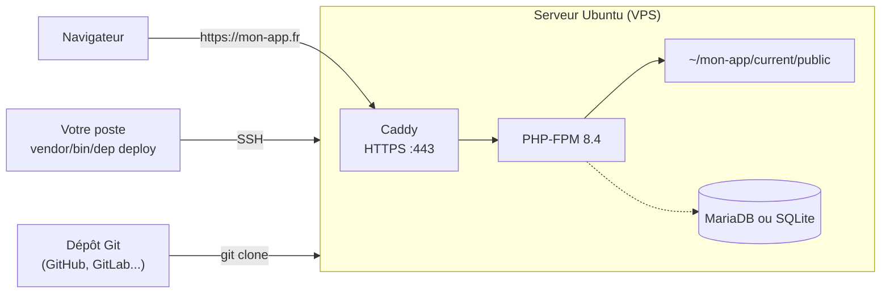

# Déployer avec Deployer (sans Docker)

[Deployer](https://deployer.org){:target="_blank"} est un outil de déploiement écrit en PHP. Depuis votre poste, il se connecte au serveur en **SSH**, récupère le code de votre dépôt Git, installe les dépendances Composer et bascule le site sur la nouvelle version **sans coupure de service**.

Contrairement à [FrankenDeploy](index.md), Deployer n'utilise **pas Docker** : le serveur exécute PHP-FPM et le serveur web [Caddy](https://caddyserver.com){:target="_blank"}, qui obtient automatiquement le certificat HTTPS.

| | FrankenDeploy | Deployer |
|---|---|---|
| Docker | sur votre poste et sur le serveur | non |
| Installation de l'outil | binaire à installer | une dépendance Composer du projet |
| Préparation du serveur | `frankendeploy server setup` | `dep provision` (Ubuntu uniquement) |
| Ce qui est envoyé sur le serveur | une image Docker | le code de votre dépôt Git |
| Retour à la version précédente | `frankendeploy rollback prod` | `dep rollback` |

!!! info "Version utilisée"

    Cette page a été rédigée avec **Deployer 8.0** (PHP 8.3 minimum). Consultez la [documentation de Deployer](https://deployer.org/docs/8.x/getting-started){:target="_blank"} pour le détail de chaque commande.

## Comment ça marche ?



À chaque déploiement, Deployer crée une **nouvelle version** (*release*) dans un nouveau dossier, puis déplace le lien `current` vers elle. Voici l'arborescence sur le serveur :

```
~/mon-app                         (deploy_path)
├── current -> releases/3         lien vers la version en ligne
├── releases                      les dernières versions déployées
│   ├── 2
│   └── 3
│       ├── app
│       ├── public
│       ├── vendor
│       ├── .env -> shared/.env   lien vers le fichier partagé
│       └── var
│           ├── cache             cache Twig, propre à chaque version
│           ├── logs -> shared/var/logs
│           └── sqlite -> shared/var/sqlite
├── shared                        fichiers conservés entre deux versions
│   ├── .env
│   ├── public/upload
│   └── var
│       ├── logs
│       └── sqlite
└── .dep                          fichiers internes de Deployer
```

1. Deployer crée le dossier `releases/3` et y copie le code de votre dépôt Git
2. Il relie les fichiers **partagés** (`.env`, bases SQLite, fichiers envoyés...) au dossier `shared`
3. Il lance `composer install` (sans les dépendances de développement)
4. Il fait pointer `current` vers `releases/3` : le site affiche la nouvelle version
5. En cas d'erreur avant cette dernière étape, `current` ne bouge pas : vos utilisateurs ne voient rien

## Avant de démarrer

- [ ] Un **serveur** (VPS) sous **Ubuntu** 22.04 ou 24.04, avec un accès SSH **root par clé** (la préparation du serveur ne prend en charge qu'Ubuntu)
- [ ] Un **nom de domaine** dont l'enregistrement DNS `A` pointe vers l'adresse IP du serveur
- [ ] Votre projet **versionné sur GitHub** ou GitLab ([Comment versionner son projet](../installation/versionning.md)) : le serveur récupère le code depuis le dépôt, **pas** depuis votre poste
- [ ] PHP 8.4 et Composer sur votre poste ([Avant de démarrer](../installation/prerequis.md))

!!! warning "Ce qui n'est pas dans le dépôt n'est pas déployé"

    Le serveur reçoit uniquement ce qui est **commité et poussé** sur le dépôt. Pensez à `git push` avant chaque déploiement.

## Étape 1 : installer Deployer

Deployer s'installe dans votre projet comme **dépendance de développement**. Saisir cette commande à la racine de votre projet :

```bash
composer require --dev deployer/deployer
```

Vérifier l'installation :

```bash
vendor/bin/dep --version
```

!!! tip "Raccourci"

    Pour taper `dep` au lieu de `vendor/bin/dep`, créez un alias dans votre terminal : `alias dep='vendor/bin/dep'`.

## Étape 2 : décrire le déploiement

Créer le fichier `deploy.php` à la racine du projet :

```php
<?php

namespace Deployer;

require 'recipe/composer.php';

// Config

set('repository', 'git@github.com:mon-compte/mon-app.git');
set('keep_releases', 5);

// Fichiers et dossiers conservés d'une version à l'autre
add('shared_files', ['.env']);
add('shared_dirs', ['var/sqlite', 'var/logs', 'public/upload']);

// Dossiers dans lesquels PHP doit pouvoir écrire
add('writable_dirs', ['var/cache', 'var/sqlite', 'var/logs', 'public/upload']);

// Hosts

host('mon-app.fr')
    ->set('remote_user', 'deployer')
    ->set('deploy_path', '~/mon-app');

// Hooks

after('deploy:failed', 'deploy:unlock');
```

Explications :

| Ligne | Rôle |
|---|---|
| `require 'recipe/composer.php'` | Recette de Deployer pour un projet Composer : elle ajoute `composer install` au déploiement |
| `repository` | Adresse de votre dépôt Git, celle du bouton **Code** de GitHub |
| `keep_releases` | Nombre de versions conservées sur le serveur (10 par défaut) : ce sont elles qui permettent le retour arrière |
| `shared_files` / `shared_dirs` | Fichiers et dossiers **partagés** entre les versions : ils ne sont pas écrasés à chaque déploiement |
| `writable_dirs` | Dossiers dans lesquels PHP peut écrire (cache Twig, bases SQLite, logs, fichiers envoyés) |
| `host('mon-app.fr')` | Le serveur : son nom de domaine ou son adresse IP |
| `remote_user` | L'utilisateur SSH utilisé pour déployer (`deployer`, créé à l'étape 3) |
| `deploy_path` | Le dossier de l'application sur le serveur |
| `after('deploy:failed', 'deploy:unlock')` | Si un déploiement échoue, le verrou est retiré pour pouvoir relancer |

Les fichiers et dossiers partagés pour une application Edu-Framework :

| Chemin | Contenu | Pourquoi le partager ? |
|---|---|---|
| `.env` | variables d'environnement de production | Il contient vos mots de passe : il n'est pas dans le dépôt Git |
| `var/sqlite` | bases SQLite de l'application | Sinon vos données repartent de zéro à chaque déploiement |
| `var/logs` | base SQLite des logs du serveur | Pour conserver l'historique des requêtes |
| `public/upload` | fichiers envoyés par les utilisateurs | Sinon les fichiers téléversés disparaissent à chaque déploiement |

!!! danger "Tout ce qui est écrit ailleurs est perdu"

    Chaque version est un **nouveau dossier**. Si votre application enregistre des fichiers dans un autre dossier, ajoutez-le à `shared_dirs` et à `writable_dirs`.

Commitez le fichier `deploy.php` (ainsi que `composer.json` et `composer.lock`) et poussez-le sur le dépôt :

```bash
git add deploy.php composer.json composer.lock
git commit -m "Configuration du déploiement avec Deployer"
git push
```

## Étape 3 : préparer le serveur

La commande `dep provision` installe tout ce qu'il faut sur un serveur Ubuntu neuf : PHP, Composer, Git, Caddy, la base de données, le pare-feu et l'utilisateur `deployer`. Elle se connecte en `root` et dure environ 5 minutes.

```bash
vendor/bin/dep provision
```

!!! warning "Connexion root par clé SSH"

    La préparation se connecte en `root` avec votre clé SSH. Certaines images Ubuntu désactivent cette connexion : activez-la le temps de la préparation (l'hébergeur indique comment), ou utilisez un autre compte `sudo` avec `vendor/bin/dep provision -o provision_user=mon-utilisateur`.

Deployer pose plusieurs questions :

| Question | Réponse conseillée |
|---|---|
| `Domain` | votre nom de domaine : `mon-app.fr` |
| `Public path` | `public` (le dossier qui contient `index.php`) |
| `What PHP version to install?` | `8.4` |
| `What DB to install?` | `mariadb` si votre application utilise MySQL / MariaDB, `none` si elle utilise SQLite |
| `DB name`, `DB user`, `DB password` | le nom de la base, l'utilisateur et un mot de passe solide : notez-les pour l'étape 4 |
| `Password for sudo` | le mot de passe de l'utilisateur `deployer` sur le serveur : notez-le aussi |

!!! warning "Connexion SSH par mot de passe désactivée"

    Pour la sécurité du serveur, `dep provision` **désactive la connexion SSH par mot de passe** et active un pare-feu (ports 22, 80 et 443). Seules les clés SSH permettent ensuite de se connecter : vérifiez que la vôtre fonctionne avant de lancer la commande.

À la fin, Caddy est configuré pour servir le dossier `~/mon-app/current/public` sur `https://mon-app.fr`, avec un certificat HTTPS Let's Encrypt obtenu automatiquement.

!!! info "Un seul `provision` par serveur"

    Cette étape ne se fait qu'**une fois**. Pour les déploiements suivants, seule la commande `dep deploy` est utile.

## Étape 4 : premier déploiement

Lancer le déploiement :

```bash
vendor/bin/dep deploy
```

!!! note "Exemple d'affichage"

    ```bash
    task deploy:info
    [mon-app.fr] info deploying mon-app to mon-app.fr (release 1)
    task deploy:setup
    task deploy:lock
    task deploy:release
    task deploy:update_code
    task deploy:env
    task deploy:shared
    task deploy:writable
    task deploy:vendors
    task deploy:symlink
    task deploy:unlock
    task deploy:cleanup
    task deploy:success
    [mon-app.fr] info successfully deployed!
    ```

### Configurer le fichier .env de production

Au **premier** déploiement, Deployer copie le fichier `.env.example` de votre projet dans `~/mon-app/shared/.env`. Ce fichier contient les valeurs de développement : il faut l'adapter **une seule fois**, directement sur le serveur.

Ouvrez un terminal sur le serveur, puis éditez le fichier :

```bash
vendor/bin/dep ssh
nano ~/mon-app/shared/.env
```

=== "MariaDB / MySQL"

    Avec les identifiants choisis à l'étape 3 :

    ```bash
    APP_ENV=prod
    DB_HOST_STATUS=true
    DB_TYPE=mariadb
    DB_HOST=127.0.0.1
    DB_SOCKET=3306
    DB_USER=deployer
    DB_PASSWORD=le-mot-de-passe-choisi
    DB_NAME=prod
    ```

=== "SQLite"

    La base `DB_NAME.sqlite` est lue dans le dossier partagé `shared/var/sqlite` :

    ```bash
    APP_ENV=prod
    DB_HOST_STATUS=true
    DB_TYPE=sqlite
    DB_NAME=app
    ```

=== "Sans base de données"

    ```bash
    APP_ENV=prod
    DB_HOST_STATUS=false
    ```

!!! danger "APP_ENV=prod en production"

    Ne laissez **jamais** `APP_ENV=dev` sur le serveur : la [barre de debug](../boost/debug-bar.md) et les messages d'erreur détaillés seraient visibles par tout le monde.

Le fichier `.env` étant **partagé**, vos modifications sont conservées lors des déploiements suivants. Votre application est en ligne sur `https://mon-app.fr` :tada:

## Importer sa base de données

=== "MariaDB / MySQL"

    Exportez votre base de développement (phpMyAdmin ou dbgate) dans un fichier `app_db.sql`, envoyez-le sur le serveur, puis importez-le dans la base créée à l'étape 3 :

    ```bash
    scp app_db.sql deployer@mon-app.fr:
    vendor/bin/dep ssh
    mysql -u deployer -p prod < ~/app_db.sql
    ```

=== "SQLite"

    Envoyez le fichier de la base dans le dossier partagé :

    ```bash
    scp var/sqlite/app.sqlite deployer@mon-app.fr:~/mon-app/shared/var/sqlite/
    ```

!!! warning "Sauvegardes"

    Deployer ne sauvegarde pas votre base de données. Pensez à planifier vous-même des sauvegardes (`mariadb-dump` ou une copie du fichier SQLite) sur le serveur.

## Au quotidien

Pour publier une nouvelle version : commitez, poussez, puis déployez.

```bash
git push
vendor/bin/dep deploy
```

| Besoin | Commande |
|---|---|
| Déployer une nouvelle version | `vendor/bin/dep deploy` |
| Lister les versions déployées | `vendor/bin/dep releases` |
| Revenir à la version précédente | `vendor/bin/dep rollback` |
| Ouvrir un terminal sur le serveur | `vendor/bin/dep ssh` |
| Lancer une commande `bin/edu` sur le serveur | `vendor/bin/dep run 'cd {{current_path}} && php bin/edu cache:clear'` |
| Consulter les requêtes reçues par Caddy | `vendor/bin/dep logs:access` |
| Consulter les erreurs PHP | `vendor/bin/dep logs:php-fpm` |
| Débloquer un déploiement interrompu | `vendor/bin/dep deploy:unlock` |

!!! note "Exemple : la commande dep releases"

    ```bash
    +---------------------+-------------+-------- mon-app.fr -+------------------------------------------+
    | Date (UTC)          | Release     | Author   | Target | Commit                                   |
    +---------------------+-------------+----------+--------+------------------------------------------+
    | 2026-11-07 10:58:03 | 1           | etudiant | HEAD   | 40354c7a55ef752c623978409d0683d651920053 |
    | 2026-11-07 10:58:34 | 2 (current) | etudiant | HEAD   | 8c1e0b2f4d9a7e3c5b6a1f0e9d8c7b6a5f4e3d2c |
    +---------------------+-------------+----------+--------+------------------------------------------+
    ```

## Si vous rencontrez une erreur

### Deploy locked

```bash
Deploy locked by etudiant.
Execute "deploy:unlock" task to unlock.
```

Un déploiement précédent a été interrompu (<kbd>Ctrl</kbd>+<kbd>C</kbd>, coupure réseau). Vérifiez que personne d'autre ne déploie, puis lancez `vendor/bin/dep deploy:unlock`.

### Permission denied (publickey) pendant `deploy:update_code`

Le **serveur** n'arrive pas à cloner votre dépôt Git. Deployer transmet votre clé SSH au serveur (*agent forwarding*), à condition qu'elle soit chargée dans l'agent SSH de votre poste :

```bash
ssh-add ~/.ssh/id_ed25519
```

Si votre dépôt est **public**, vous pouvez aussi utiliser son adresse HTTPS : `set('repository', 'https://github.com/mon-compte/mon-app.git');`.

### Missing 'repository' configuration

Le paramètre `repository` est absent du fichier `deploy.php`.

### Le site affiche une page blanche ou une erreur 500

Consultez les erreurs PHP avec `vendor/bin/dep logs:php-fpm`. Vérifiez en particulier le fichier `~/mon-app/shared/.env` (identifiants de la base de données) et que le fichier `composer.lock` est bien commité.

### Le certificat HTTPS n'est pas délivré

Le nom de domaine doit pointer vers l'adresse IP du serveur (enregistrement DNS `A`) **avant** l'étape 3, et les ports 80 et 443 doivent être ouverts. Consultez les logs de Caddy avec `vendor/bin/dep logs:caddy`.
