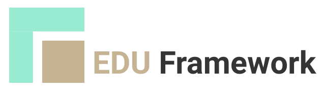

# Light Education PHP framework

<figure markdown="span">
  { width="500" }
</figure>
    
The "Edu Framework" project aims to answer a recurring question identified during our training courses: "How do you make the transition to a framework like Symfony?"

The main goal of "Edu Framework" is to provide a set of tools, guides and teaching resources that help developers, whether beginners or experienced, make the transition to a framework like Symfony easier. This project covers the fundamentals, with a focus on development best practices.

Edu Framework is also used in cybersecurity lab sessions: deliberately simple and transparent, it makes it possible to study web security vulnerabilities in a teaching context, while providing the solutions and best practices to protect against them — prepared statements against SQL injection, [CSRF](build/csrf.md) protection, error messages hidden in production.

!!! warning "Important information"

    **This framework is not suitable for production use. It is intended for educational purposes.**

    [](https://app.codacy.com/gh/studoo-app/edu-framework/dashboard?utm_source=gh&utm_medium=referral&utm_content=&utm_campaign=Badge_grade){:target="_blank"}
    [](https://app.codacy.com/gh/studoo-app/edu-framework/dashboard?utm_source=gh&utm_medium=referral&utm_content=&utm_campaign=Badge_coverage){:target="_blank"}
    [](https://www.codefactor.io/repository/github/studoo-app/edu-framework){:target="_blank"}
    [](https://packagist.org/packages/studoo/edu-framework){:target="_blank"}
    [](https://packagist.org/packages/studoo/edu-framework){:target="_blank"}
    [](https://packagist.org/packages/studoo/edu-framework){:target="_blank"}

## Quick start

To create a new Edu Framework project, you can use the following command in a terminal:

```bash
composer create-project studoo/edu-framework-skeleton my_project_name
```

Go to the project folder:
```bash
cd my_project_name
```

This command initializes the Edu Framework project:

````Bash 
composer edu:init
````

To start the development server, you can use the following command:
```bash
php bin/edu start
```

This command starts the development server at [http://localhost:8042](http://localhost:8042){:target="_blank"}.

## Development pipeline status

The status of the development pipelines is available:

| Package                     | Release | Github actions                                                                                                      |
|:----------------------------|:--------|:--------------------------------------------------------------------------------------------------------------------|
| Edu Framework stable        | main    |  |
| Edu Framework v2            | v2.x    |   |
| Edu Framework documentation | main    |                 |
