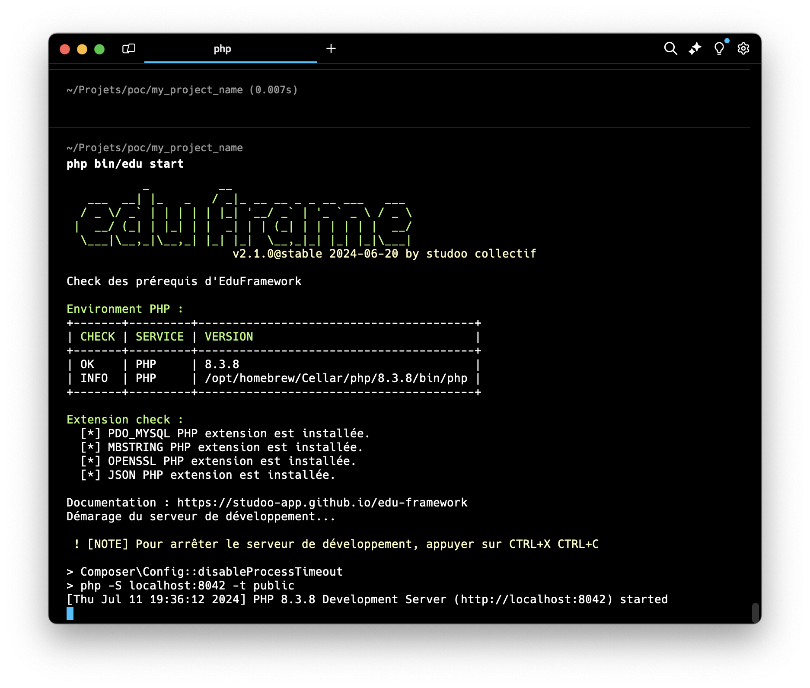

# The bin/edu command

We have set up a command to make tasks easier. This command is called "edu".
You can use it at the root of your project by typing the following command:

```Shell
php bin/edu 
```

!!! info "Command example"

    Here is an example: to start the application, you can type the following command

    ```Shell
    php bin/edu start
    ```

    This output is an example and will probably not be exactly yours.

    <figure markdown="span">
    
    </figure>

To see the available commands, you can type the following command:

```Shell
php bin/edu list
``` 

Here are the available commands by version:

| Components      | Description                                   | Since version          |
|-----------------|-----------------------------------------------|------------------------|
| start           | starts the application                        | v1.2                   |
| list            | lists the available commands                  | v1.2                   |
| check:config    | checks the configuration of your environment  | v1.2                   |
| make:controller | generates a controller                        | v1.0                   |
| make:api        | generates a JSON API controller               | v2.0                   |
| make:command    | generates a command line                      | v2.0                   |
| make:entity     | generates an entity and its repository        | v2.5.0                 |
| cache:clear     | deletes the application cache                 | v2.4.0                 |
| make:deploy     | generates the deployment configuration        | v2.9.0                 |

!!! info "Going further"

    You can read the page [Building an API](../build/controller-edu-api.md) for more details on the `make:api` command.

### The options of the start command

The `start` command accepts options to adapt the startup to your needs (since version v2.3.0):

```bash
php bin/edu start --no-start
```

| Option            | Description                                                                        |
|-------------------|-------------------------------------------------------------------------------------|
| `-p` or `--port`  | Changes the listening port of the development server (default: `8042`)             |
| `--no-start`      | Checks the prerequisites of your environment without starting the server           |

!!! info "Going further"

    You can read the page [Start/Stop the application](start-application.md) for more details on the `start` command.

### The cache:clear command

Twig templates are compiled and then cached in the `var/cache/twig` folder (since version v2.4.0).
To delete the application cache, you can type the following command:

```bash
php bin/edu cache:clear
```

| Item                   | Detail                                              |
|------------------------|-----------------------------------------------------|
| Folder concerned       | `var/cache` (configurable via the `cache_path` key) |
| Content deleted        | all the content of the folder (Example: the TWIG cache) |
| The folder itself      | kept                                                |

If the `var/cache` folder does not exist, a message tells you that there is no cache to delete.

!!! info "Automatic recompilation"

    Modified templates are automatically recompiled (Twig `auto_reload` option).
    The `cache:clear` command is still useful to start again from a clean cache, for example after a deployment.

### The make:deploy command

The `make:deploy` command generates the `frankendeploy.yaml` file, which describes how to deploy the application to a Debian or Ubuntu server with [FrankenDeploy](https://yoanbernabeu.github.io/frankendeploy/){:target="_blank"} (since version v2.9.0):

```bash
php bin/edu make:deploy --domain=mon-app.fr
```

!!! info "Going further"

    You can read the page [Deploying your application](../deploy/index.md) for the details of the deployment options and steps.

### The make:entity command

The `make:entity` command generates the **two model files** for a table in your database (since version v2.5.0):

- `app/Entity/Ville.php`: the entity, the logical representation of a table as a class
- `app/Repository/VilleRepository.php`: the repository, which groups all the operations on the table

```Shell
php bin/edu make:entity Ville
```

The command then asks for the fields of the table one by one: the field name (an empty value ends the input) and then its type (`string`, `int`, `float`, `bool`, `string` by default).

You can also pass the fields directly with the `--fields` option:

```Shell
php bin/edu make:entity Ville --fields "nom:string,code_postal:string,nombre_habitant:int"
```

#### What the command generates

The entity has an `id` identifier (integer), a constructor that hydrates all the fields, getters and fluent setters:

```php
class Ville
{
	private int $id;
	private string $nom;
	// ...

	public function __construct(int $id, string $nom, string $code_postal, int $nombre_habitant) { /* ... */ }

	public function getId(): int { /* ... */ }
	public function getNom(): string { /* ... */ }
	public function setNom(string $nom): self { /* ... */ return $this; }
	// ...
}
```

!!! info "No setId()"

    There is no setter for the identifier: it is the database that assigns it (auto-increment). To create an entity, use the identifier `0`: `new Ville(0, 'Paris', '75000', 2200000)`.

The repository has the read method `getVilles()`: the `SELECT * FROM ville` query and the hydration of the entity are already written.

!!! info "The table must exist"

    The command generates the PHP code, but does not create the table in the database.
    You must create the table beforehand (see the [database schema](../build/dataservice-select.md)).

If the entity or the repository already exists, an `EntityAlreadyExistsException` exception is thrown.

___

## If you run into an error

### Command not found

If you get an error when using the "edu" command, you can install it with the following commands:

=== ":fontawesome-brands-windows: WINDOWS"

    To install the "edu" command, follow the instructions:

    Open a git bash terminal at the root of your project
    
    ```bash
    mkdir bin && curl -o bin/edu https://raw.githubusercontent.com/studoo-app/edu-framework/main/bin/edu
    ```

    !!! bug "curl: (35)"

        If you get the error `curl: (35) schannel: next InitializeSecurityContext failed: Unknown error (0x80092012) - The revocation function was unable to check revocation for the certificate.`
    
        Type the following command:

        ```bash
        curl --ssl-no-revoke -o bin/edu https://raw.githubusercontent.com/studoo-app/edu-framework/main/bin/edu
        ```

=== ":fontawesome-brands-apple: MAC OS"

    To install the "edu" command, follow the instructions:

    Open a terminal at the root of your project

    ```bash
    mkdir bin && curl -sS https://raw.githubusercontent.com/studoo-app/edu-framework/main/bin/edu -o bin/edu
    ```

