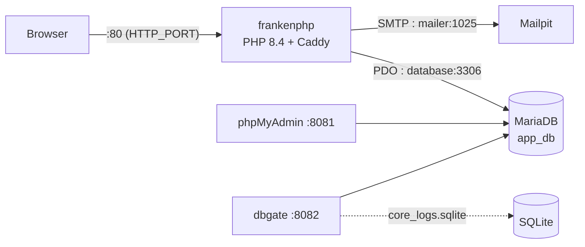

# The application in Docker

The page [Starting the services](start-services.md) describes how to emulate the services (database, mailer...) in Docker while running the application **on your computer** with `php bin/edu start`.

You can go further: run **the application itself** in Docker, served by [FrankenPHP](https://frankenphp.dev){:target="_blank"} — a PHP application server based on Caddy that ships with PHP 8.4, automatic HTTPS and the HTTP/3 protocol. In this case, you no longer need to install PHP or Composer on your machine: only [Docker Desktop](https://www.docker.com){:target="_blank"} is required.

!!! info "Two ways of working, your choice"

    - **Classic workflow** (unchanged): the services in Docker, the application on your computer via `php bin/edu start` — see [Start/Stop the application](start-application.md)
    - **100% Docker workflow** (this page): the application **and** the services in Docker

!!! tip "Putting your application online"

    The `Dockerfile` also contains a production image (`frankenphp_prod` stage), used to deploy the application to a server: see [Deploying your application](../deploy/index.md).

## Stack architecture

The `compose.yaml` file at the root of the project starts five services:



| Components                                                    | Socket (listening port)         | URL                                            | Version  |
|---------------------------------------------------------------|--------------------------------|------------------------------------------------|----------|
| :simple-apache: [FrankenPHP](https://frankenphp.dev){:target="_blank"} | 80 (HTTP)<br/>443 (HTTPS mode)          | [http://127.0.0.1](http://127.0.0.1){:target="_blank"} | PHP 8.4  |
| :simple-mariadb: [MariaDB](https://hub.docker.com/_/mariadb){:target="_blank"} | 3306 | 127.0.0.1:3306                                 | latest   |
| :simple-phpmyadmin: [PHPMyAdmin](https://www.phpmyadmin.net/){:target="_blank"} | 8081 | [http://127.0.0.1:8081](http://127.0.0.1:8081){:target="_blank"} | latest |
| :octicons-mail-24: [MailPit](https://github.com/axllent/mailpit){:target="_blank"} | 1025 (SMTP) / 8025 (UI) | [http://127.0.0.1:8025](http://127.0.0.1:8025){:target="_blank"} | latest |
| :simple-docker: [dbgate](https://dbgate.org){:target="_blank"} | 8082                           | [http://127.0.0.1:8082](http://127.0.0.1:8082){:target="_blank"} | latest |

## Starting the full stack

```bash
docker compose up -d --build
```

The first start builds the application image (installation of the PHP extensions, then of the Composer dependencies): allow a few minutes. Subsequent starts use the Docker cache and are almost instantaneous.

!!! tip "Your changes are picked up live"

    The project is mounted as a volume in the container (`./:/app`): every change to the code on your computer is served directly by the container, without rebuilding the image. Only changes to the `Dockerfile` require restarting with `--build`.

To stop the stack:

```bash
docker compose down
```

The MariaDB database data is kept in `var/dbdata/`: it survives when the containers are stopped.

!!! warning "Keeping only the services (classic workflow)"

    If you develop with `php bin/edu start` on your computer, you can start only the services you need, without the web server:

    ```bash
    docker compose up -d database mailer dbgate phpmyadmin
    ```

## Environment variables

Docker Compose reads the `.env` file at the root of the project and passes its variables to the application container. The configuration therefore stays centralized in a single file:

| Variable       | Role                                                        | Example                |
|----------------|-------------------------------------------------------------|------------------------|
| `APP_NAME`     | Prefix of the container names                               | `edu-framework`       |
| `APP_ENV`      | Application mode (`dev` displays the debug bar)             | `dev`                  |
| `DB_HOST_STATUS` | Enables the database connection                           | `true`                 |
| `DB_TYPE`      | Database type (`mysql`, `mariadb`, `sqlite`)                | `mysql`                |
| `DB_USER`, `DB_PASSWORD`, `DB_NAME` | Database credentials     | `root` / `studoo` / `app_db` |
| `MAILER_DSN`   | SMTP server for sending emails                              | `smtp://localhost:1025` |
| `EDU_PROFILER` | Code profiler: `off`, `trigger` (on demand) or `on`         | `trigger`              |
| `EDU_PROFILER_KEEP` | Number of code profiles kept                           | `50`                   |
| `EDU_PROFILER_BUILD` | `0` builds the image without the Excimer extension    | `1`                    |

!!! warning "Three values are overridden in the container"

    On the Docker network, the application cannot reach `127.0.0.1`: the host names are the **service names**. The `compose.yaml` therefore automatically overrides:

    - `DB_HOST=database` (instead of `127.0.0.1`)
    - `DB_SOCKET=3306` (the internal port of the container, even if the port published on the machine is different)
    - `MAILER_DSN=smtp://mailer:1025` (instead of `localhost`)

## Ports and running several projects side by side

All the ports published on your machine can be configured in the `.env` file: this is what lets you run several projects created with Edu Framework **at the same time** on the same computer.

| Variable           | Service            | Default value     |
|--------------------|--------------------|-------------------|
| `HTTP_PORT`        | FrankenPHP (HTTP)  | `80`              |
| `HTTPS_PORT`       | FrankenPHP (HTTPS) | `443`             |
| `DB_SOCKET`        | MariaDB            | `3306`            |
| `PMA_PORT`         | phpMyAdmin         | `8081`            |
| `DBGATE_PORT`      | dbgate             | `8082`            |
| `MAILER_SMTP_PORT` | MailPit (SMTP)     | `1025`            |
| `MAILER_UI_PORT`   | MailPit (web interface) | `8025`       |

Example: if another project already uses the default ports, adjust the `.env` of your project:

```dotenv
DB_SOCKET=3307
PMA_PORT=8083
DBGATE_PORT=8084
MAILER_UI_PORT=8026
```

The container names are prefixed with `APP_NAME` (`edu-framework-database`, `edu-framework-mailer`...): two projects can therefore coexist without name conflicts.

!!! tip "HTTPS mode"

    By default, the server listens over plain HTTP: the `SERVER_NAME` variable in the `.env` file is set to `:80` and port `443` is not used — `https://localhost` is then **refused, which is the expected behavior**.

    To enable local HTTPS, change the value and then recreate the container (a modified environment variable is only taken into account when the container is recreated):

    ```dotenv
    SERVER_NAME=localhost
    ```

    ```bash
    docker compose up -d
    ```

    Checked in local HTTPS mode: `https://localhost` responds over **HTTP/2** and `http://localhost` is automatically redirected (**308**) to `https://localhost`.

!!! warning "Self-signed certificate: warning expected"

    FrankenPHP generates a certificate issued by its local authority (*Caddy Local Authority*), which your machine does not know:

    - **Browser**: security warning → choose "Proceed to localhost (unsafe)"
    - **curl**: add the `-k` option: `curl -k https://localhost`

    Optional — to remove the warning, export the root certificate of the local authority (stored in the `caddy_data` volume) and then mark it as trusted in your system (Keychain on macOS, certificate store on Windows):

    ```bash
    docker compose exec frankenphp cat /data/caddy/pki/authorities/local/root.crt > caddy-root-ca.crt
    ```

!!! bug "In local HTTPS, use `https://localhost` and not `https://127.0.0.1`"

    The generated certificate does not cover the IP address `127.0.0.1`: the connection fails with a TLS error (`tlsv1 alert internal error`). This is a [known limitation of Docker and FrankenPHP](https://frankenphp.dev/docs/known-issues/#using-https127001-with-docker){:target="_blank"} — with a public domain name in production, HTTPS via Let's Encrypt is automatic.

## Checking the prerequisites in the container

The official check command also works inside the container:

```bash
docker compose exec frankenphp php bin/edu check:config
```

!!! info "The stack must be running"

    The command connects to the database as soon as it starts (if `DB_HOST_STATUS=true`): run it with the stack running, as in the example above.

The image includes all the extensions required by the framework: `pdo_sqlite` (log service, debug bar and profiler), `pdo_mysql`, `mbstring`, `openssl` and `json`.

## Quick troubleshooting

=== ":octicons-bug-16: The port is already in use"

    ```console
    Error response from daemon: driver failed programming external connectivity: bind: address already in use
    ```

    Another service (often another Docker instance) is using the port. Change the relevant variable in the `.env` file (see [Ports and running several projects side by side](#ports-and-running-several-projects-side-by-side)) or stop the project that is using the port.

=== ":octicons-bug-16: The application does not respond"

    First check the server logs:

    ```bash
    docker compose logs -f frankenphp
    ```

    Then check the state of the services (the `database` container must be `healthy` before the web server starts):

    ```bash
    docker compose ps
    ```

=== ":octicons-bug-16: I changed the Dockerfile or the dependencies"

    Changes to the `Dockerfile` or to `composer.json` are not picked up automatically. Run the build again:

    ```bash
    docker compose up -d --build
    ```
