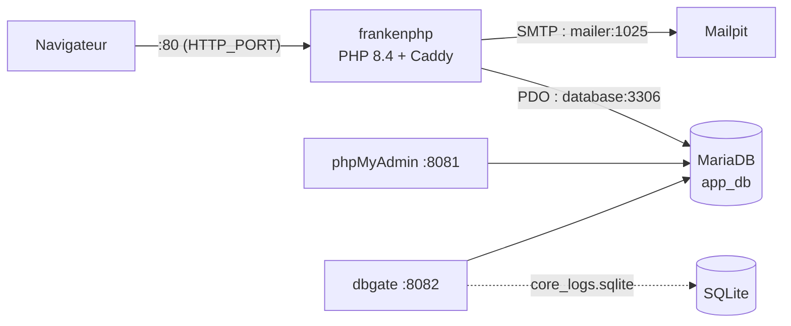

# L'application dans Docker

La page [Démarrer les services](start-services.md) décrit comment émuler les services (base de données, mailer...) dans Docker tout en exécutant l'application **sur votre poste** avec `php bin/edu start`.

Vous pouvez aller plus loin : exécuter **l'application elle-même** dans Docker, servie par [FrankenPHP](https://frankenphp.dev){:target="_blank"} — un serveur applicatif PHP basé sur Caddy qui embarque PHP 8.4, le HTTPS automatique et le protocole HTTP/3. Dans ce cas, plus besoin d'installer PHP ni Composer sur votre machine : seul [Docker Desktop](https://www.docker.com){:target="_blank"} est nécessaire.

!!! info "Deux façons de travailler, au choix"

    - **Flux classique** (inchangé) : les services dans Docker, l'application sur votre poste via `php bin/edu start` — voir [Start/Stop l'application](start-application.md)
    - **Flux 100 % Docker** (cette page) : l'application **et** les services dans Docker

## Architecture du stack

Le fichier `compose.yaml` à la racine du projet démarre cinq services :



| Composants                                                    | Socket (port d'écoute)          | URL                                            | Version  |
|---------------------------------------------------------------|--------------------------------|------------------------------------------------|----------|
| :simple-apache: [FrankenPHP](https://frankenphp.dev){:target="_blank"} | 80 (HTTP)<br/>443 (mode HTTPS)          | [http://127.0.0.1](http://127.0.0.1){:target="_blank"} | PHP 8.4  |
| :simple-mariadb: [MariaDB](https://hub.docker.com/_/mariadb){:target="_blank"} | 3306 | 127.0.0.1:3306                                 | latest   |
| :simple-phpmyadmin: [PHPMyAdmin](https://www.phpmyadmin.net/){:target="_blank"} | 8081 | [http://127.0.0.1:8081](http://127.0.0.1:8081){:target="_blank"} | latest |
| :octicons-mail-24: [MailPit](https://github.com/axllent/mailpit){:target="_blank"} | 1025 (SMTP) / 8025 (UI) | [http://127.0.0.1:8025](http://127.0.0.1:8025){:target="_blank"} | latest |
| :simple-docker: [dbgate](https://dbgate.org){:target="_blank"} | 8082                           | [http://127.0.0.1:8082](http://127.0.0.1:8082){:target="_blank"} | latest |

## Démarrer le stack complet

```bash
docker compose up -d --build
```

Le premier démarrage construit l'image de l'application (installation des extensions PHP puis des dépendances Composer) : comptez quelques minutes. Les démarrages suivants utilisent le cache de Docker et sont quasi instantanés.

!!! tip "Vos modifications sont prises en compte à chaud"

    Le projet est monté en volume dans le conteneur (`./:/app`) : chaque modification du code sur votre poste est directement servie par le conteneur, sans reconstruction de l'image. Seules les modifications du `Dockerfile` nécessitent de relancer avec `--build`.

Pour arrêter le stack :

```bash
docker compose down
```

Les données de la base MariaDB sont conservées dans `var/dbdata/` : elles survivent à l'arrêt des conteneurs.

!!! warning "Garder uniquement les services (flux classique)"

    Si vous développez avec `php bin/edu start` sur votre poste, vous pouvez ne démarrer que les services utiles, sans le serveur web :

    ```bash
    docker compose up -d database mailer dbgate phpmyadmin
    ```

## Les variables d'environnement

Docker Compose lit le fichier `.env` à la racine du projet et transmet ses variables au conteneur de l'application. La configuration reste donc centralisée dans un seul fichier :

| Variable       | Rôle                                                        | Exemple                |
|----------------|-------------------------------------------------------------|------------------------|
| `APP_NAME`     | Préfixe des noms de conteneurs                              | `edu-framework`       |
| `APP_ENV`      | Mode de l'application (`dev` affiche la barre de debug)     | `dev`                  |
| `DB_HOST_STATUS` | Active la connexion à la base de données                  | `true`                 |
| `DB_TYPE`      | Type de base (`mysql`, `mariadb`, `sqlite`)                 | `mysql`                |
| `DB_USER`, `DB_PASSWORD`, `DB_NAME` | Identifiants de la base  | `root` / `studoo` / `app_db` |
| `MAILER_DSN`   | Serveur SMTP pour l'envoi de mails                          | `smtp://localhost:1025` |
| `EDU_PROFILER` | Profiler de code : `off`, `trigger` (à la demande) ou `on`  | `trigger`              |
| `EDU_PROFILER_KEEP` | Nombre de profils de code conservés                    | `50`                   |
| `EDU_PROFILER_BUILD` | `0` construit l'image sans l'extension Excimer        | `1`                    |

!!! warning "Trois valeurs sont surchargées dans le conteneur"

    Dans le réseau Docker, l'application ne peut pas joindre `127.0.0.1` : les noms d'hôte sont les **noms des services**. Le `compose.yaml` surcharge donc automatiquement :

    - `DB_HOST=database` (au lieu de `127.0.0.1`)
    - `DB_SOCKET=3306` (le port interne du conteneur, même si le port publié sur la machine est différent)
    - `MAILER_DSN=smtp://mailer:1025` (au lieu de `localhost`)

## Ports et coexistence de plusieurs projets

Tous les ports publiés sur votre machine sont paramétrables dans le fichier `.env` : c'est ce qui permet de faire tourner plusieurs projets créés avec Edu Framework **simultanément** sur le même poste.

| Variable           | Service concerné   | Valeur par défaut |
|--------------------|--------------------|-------------------|
| `HTTP_PORT`        | FrankenPHP (HTTP)  | `80`              |
| `HTTPS_PORT`       | FrankenPHP (HTTPS) | `443`             |
| `DB_SOCKET`        | MariaDB            | `3306`            |
| `PMA_PORT`         | phpMyAdmin         | `8081`            |
| `DBGATE_PORT`      | dbgate             | `8082`            |
| `MAILER_SMTP_PORT` | MailPit (SMTP)     | `1025`            |
| `MAILER_UI_PORT`   | MailPit (interface web) | `8025`        |

Exemple : si un autre projet occupe déjà les ports par défaut, adaptez le `.env` de votre projet :

```dotenv
DB_SOCKET=3307
PMA_PORT=8083
DBGATE_PORT=8084
MAILER_UI_PORT=8026
```

Les noms de conteneurs sont préfixés par `APP_NAME` (`edu-framework-database`, `edu-framework-mailer`...) : deux projets peuvent donc cohabiter sans conflit de noms.

!!! tip "Le mode HTTPS"

    Par défaut, le serveur écoute en HTTP simple : la variable `SERVER_NAME` du fichier `.env` vaut `:80` et le port `443` n'est pas utilisé — `https://localhost` est alors **refusé, c'est le comportement attendu**.

    Pour activer le HTTPS local, changez la valeur puis recréez le conteneur (une variable d'environnement modifiée n'est prise en compte qu'à la recréation) :

    ```dotenv
    SERVER_NAME=localhost
    ```

    ```bash
    docker compose up -d
    ```

    Vérifié en mode HTTPS local : `https://localhost` répond en **HTTP/2** et `http://localhost` est automatiquement redirigé (**308**) vers `https://localhost`.

!!! warning "Certificat auto-signé : avertissement attendu"

    FrankenPHP génère un certificat émis par son autorité locale (*Caddy Local Authority*), que votre machine ne connaît pas :

    - **Navigateur** : avertissement de sécurité → choisissez « Procéder vers localhost (non sécurisé) »
    - **curl** : ajoutez l'option `-k` : `curl -k https://localhost`

    Facultatif — pour supprimer l'avertissement, exportez le certificat racine de l'autorité locale (stocké dans le volume `caddy_data`) puis déclarez-le comme approuvé dans votre système (Trousseaux sur macOS, magasin de certificats sur Windows) :

    ```bash
    docker compose exec frankenphp cat /data/caddy/pki/authorities/local/root.crt > caddy-root-ca.crt
    ```

!!! bug "En HTTPS local, utilisez `https://localhost` et pas `https://127.0.0.1`"

    Le certificat généré ne couvre pas l'adresse IP `127.0.0.1` : la connexion échoue avec une erreur TLS (`tlsv1 alert internal error`). C'est une [limitation connue de Docker et de FrankenPHP](https://frankenphp.dev/docs/known-issues/#using-https127001-with-docker){:target="_blank"} — avec un nom de domaine public en production, le HTTPS via Let's Encrypt est automatique.

## Vérifier les prérequis dans le conteneur

La commande officielle de vérification fonctionne également à l'intérieur du conteneur :

```bash
docker compose exec frankenphp php bin/edu check:config
```

!!! info "Le stack doit être démarré"

    La commande se connecte à la base de données dès son lancement (si `DB_HOST_STATUS=true`) : exécutez-la avec le stack démarré, comme dans l'exemple ci-dessus.

L'image embarque toutes les extensions requises par le framework : `pdo_sqlite` (service de logs, barre de debug et profiler), `pdo_mysql`, `mbstring`, `openssl` et `json`.

## Dépannage rapide

=== ":octicons-bug-16: Le port est déjà utilisé"

    ```console
    Error response from daemon: driver failed programming external connectivity: bind: address already in use
    ```

    Un autre service (souvent une autre instance Docker) occupe le port. Modifiez la variable concernée dans le fichier `.env` (voir [Ports et coexistence de plusieurs projets](#ports-et-coexistence-de-plusieurs-projets)) ou arrêtez le projet qui occupe le port.

=== ":octicons-bug-16: L'application ne répond pas"

    Consultez d'abord les logs du serveur :

    ```bash
    docker compose logs -f frankenphp
    ```

    Vérifiez ensuite l'état des services (le conteneur `database` doit être `healthy` avant le démarrage du serveur web) :

    ```bash
    docker compose ps
    ```

=== ":octicons-bug-16: J'ai modifié le Dockerfile ou les dépendances"

    Les modifications du `Dockerfile` ou de `composer.json` ne sont pas prises en compte automatiquement. Relancez la construction :

    ```bash
    docker compose up -d --build
    ```
