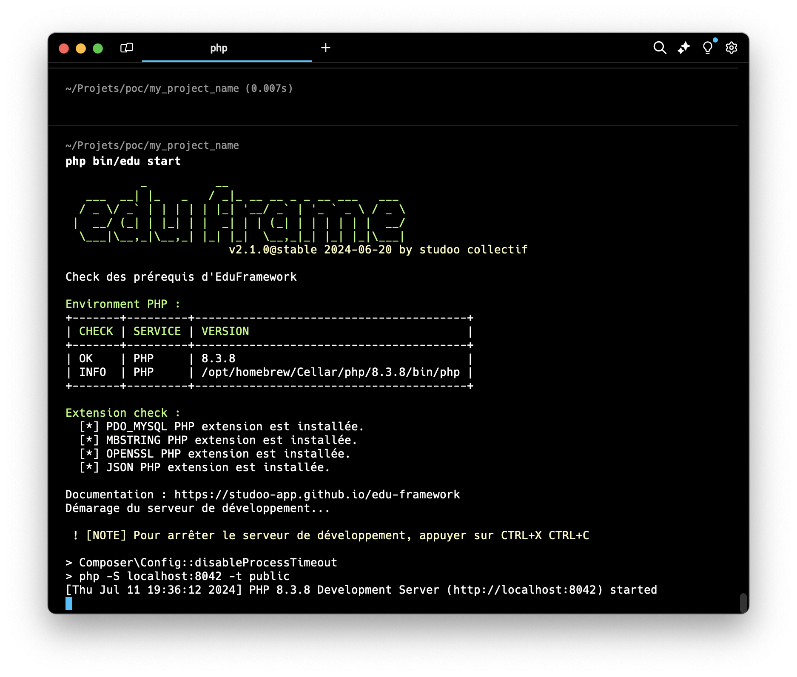
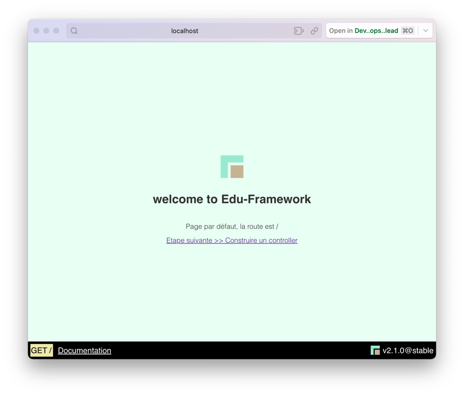

# Start/Stop the application

## Start the application

To start the application, simply open a terminal:

=== ":octicons-terminal-16: With Edu CLI"

    If you have the latest version v2.x or higher, start the application with the following command:

    ```bash
    php bin/edu start
    ```

=== ":octicons-terminal-16: With composer"

    If you have version v1.1 or lower, start the application with the following command:
    
    ```bash
    composer edu:start
    ```

=== ":octicons-terminal-16: Native mode"
    
    If you are at the root of your project, you can start the application with the following command

    ```bash
    php -S localhost:8042 -t public
    ```

Here is an example of the command-line output:

<figure markdown="span">

</figure>

Here is an example of the resulting web page:

<figure markdown="span">

</figure>

!!! info "Application address"

    This command starts the development server at [http://localhost:8042](http://localhost:8042){:target="_blank"}.

## The start command options

The `php bin/edu start` command has options (from version v2.3.0):

| Option            | Description                                                                                      |
|-------------------|--------------------------------------------------------------------------------------------------|
| `-p` or `--port`  | Changes the listening port of the development server (default: `8042`)                           |
| `--no-start`      | Checks your environment's prerequisites without starting the development server                  |

Example to start the application on port 9090:

```bash
php bin/edu start -p 9090
```

Example to check the prerequisites without starting the server:

```bash
php bin/edu start --no-start
```

!!! tip "Request logging"

    When the server is started with `php bin/edu start`, every HTTP request received is logged in an SQLite database (`var/logs/core_logs.sqlite`).
    These logs can be viewed from the [profiler](../build/debug-bar.md#the-profiler).

## Stop the application

To stop the application, simply go to the terminal where you started the application and press `CTRL + C`.

___

## Startup problem

```bash
Failed to listen on localhost:8042 (reason: Address already in use)
```

This error means that listening port (socket) 8042 is already in use (or was not closed properly).
To fix this error, you can "kill" the process attached to the listening port.


=== ":fontawesome-brands-windows: WINDOWS"

    On Windows, the command to kill the process bound to port 8042 is slightly different. Here is how to do it:
    
    ```bash
    FOR /F "tokens=5" %P IN ('netstat -a -n -o ^| findstr :8042') DO TaskKill.exe /F /PID %P
    ```
    
    This command works in two parts:
    
    1. `netstat -a -n -o ^| findstr :8042`: This command lists all the processes using port 8042.
    2. `TaskKill.exe /F /PID %P`: This command uses the extracted PID to kill the process.

=== ":fontawesome-brands-apple: MAC OS"

    The command to kill the process bound to port 8042 on macOS is the following:

    ```bash
    lsof -i :8042 | awk 'NR!=1 {print $2}' | xargs kill -9
    ```
    
    This command works in three parts:
    
    1. `lsof -i :8042`: This command lists all the processes using port 8042.
    2. `awk 'NR!=1 {print $2}'`: This command extracts the process number (PID) from the output of the previous command.
    3. `xargs kill -9`: This command uses the extracted PID to kill the process.


