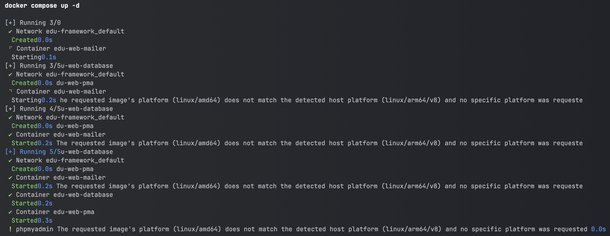
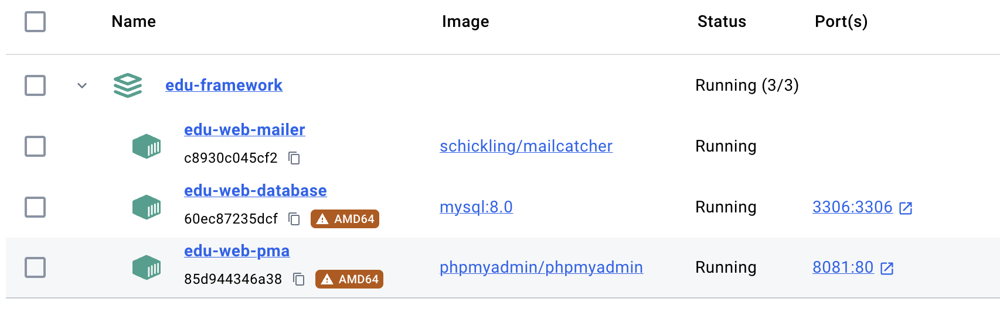

# How to install and manage the services?

Edu Framework relies on several services to run. To install them, you have two options:
    
- [Use Docker to emulate the services](#use-docker-to-emulate-the-services)
- [Install the services directly on your machine](#install-the-services-on-your-machine)


## Use Docker to emulate the services

!!! info "Docker Desktop"
    To use Docker, you need to install Docker Desktop on your machine. 
    You can download Docker Desktop from the official website: [Docker Desktop](https://www.docker.com){:target="_blank"}

Start Docker Desktop on your machine, then:

=== "Currently, from version 2.7"

    The `compose.yaml` file now includes a FrankenPHP web server that runs the application itself in Docker (see the dedicated page: [The application in Docker](docker.md)).

    To start all the services:

    ```bash
    docker compose up -d --build
    ```

    If you run the application on your machine with `php bin/edu start`, you can start only the services you need, without the web server:

    ```bash
    docker compose up -d database mailer dbgate phpmyadmin
    ```

    To stop the services, follow these instructions:

    ```bash
    docker compose down
    ```

=== "From version 2.0 to version 2.6"

    To install and start the services, follow these instructions:

    ```bash
    docker compose up -d
    ```

    To stop the services, follow these instructions:

    ```bash
    docker compose down
    ```

=== "Up to version 1.2"

    To use Docker to emulate the services, follow these instructions:
    
    ```bash
    composer edu:init
    ```

    Then type the following command to start the services:

    ```bash
    composer edu:docker:db-service:start mysql
    ```

    To stop the services, follow these instructions:

    ```bash
    composer edu:docker:db-service:stop mysql
    ```

The command used to start the services may vary depending on your Docker version; here is an example:

<figure markdown="span">

</figure>

Once the services are started, you can access them through Docker Desktop or through the terminal. Here is an example: 

<figure markdown="span">

</figure>

The services are ready to use. You can now start your Edu Framework application. The services are available on the following ports:

| Components                                                    | Socket (listening port) | URL                                            | Version   |
|---------------------------------------------------------------|------------------------|------------------------------------------------|-----------|
| :simple-frankenphp: [FrankenPHP](https://frankenphp.dev){:target="_blank"} | 80 / 443 | [http://127.0.0.1](http://127.0.0.1){:target="_blank"} | PHP 8.4 |
| :simple-mariadb: [MariaDB](https://hub.docker.com/_/mariadb){:target="_blank"} | 3306 | 127.0.0.1:3306 | latest |
| :simple-phpmyadmin: [PHPMyAdmin](https://www.phpmyadmin.net/){:target="_blank"} | 8081                   | [http://127.0.0.1:8081](http://127.0.0.1:8081){:target="_blank"} | latest |
| :octicons-mail-24: [MailPit](https://github.com/axllent/mailpit){:target="_blank"}  | 1025 (SMTP) / 8025 (UI)   | [http://127.0.0.1:8025](http://127.0.0.1:8025){:target="_blank"} | latest |
| :simple-docker: [dbgate](https://dbgate.org){:target="_blank"}  | 8082                   | [http://127.0.0.1:8082](http://127.0.0.1:8082){:target="_blank"} | latest |

!!! tip "Configurable ports"

    Since version 2.7, every port published on your machine can be configured in the `.env` file — handy for running several projects at the same time. See [Ports and running several projects side by side](docker.md#ports-and-running-several-projects-side-by-side).

!!! info "MailPit: the mail service"

    MailPit has replaced Mailcatcher since version v2.3.0.
    It acts as an SMTP server (port `1025`) to test sending emails from your application,
    and provides a web interface (port `8025`) to view the emails sent.

    The `MAILER_DSN` environment variable in your `.env` file must point to this service:

    ```dotenv
    MAILER_DSN="smtp://localhost:1025"
    ```

!!! info "dbgate: the database client"

    The [dbgate](https://dbgate.org){:target="_blank"} service is a convenient replacement for an SQL client installed on your machine.
    It provides two preconfigured connections:

    - **MySql**: server `database`, user `root`, password `studoo` (database `app_db`)
    - **SQLite**: file `var/logs/core_logs.sqlite` (request logs, also available from the [profiler](../boost/debug-bar.md#the-profiler))

!!! info 
    
    To access PHPMyAdmin, you can use the following credentials:
    
    - User: `root`
    - Password: `studoo`
    - Default database: `app_db`

You can also access the MariaDB database with an SQL client such as [DBeaver](https://dbeaver.io/){:target="_blank"} or [MySQL Workbench](https://www.mysql.com/products/workbench/){:target="_blank"}.

## Install the services on your machine

The second option is to install the services directly on your machine. To make installation and configuration easier, you can use bundles such as MAMP, XAMPP...

To install the services on your machine, you can install the following:


| Components      | Compatible OS                                                                      | URL                                                                    | Recommendation                                                                                                         |
|-----------------|------------------------------------------------------------------------------------|------------------------------------------------------------------------|------------------------------------------------------------------------------------------------------------------------|
| XAMPP | :fontawesome-brands-windows: :fontawesome-brands-apple: :fontawesome-brands-linux: | [https://www.apachefriends.org/fr](https://www.apachefriends.org/fr){:target="_blank"}                                  | :octicons-star-fill-16: :octicons-star-fill-16: :octicons-star-fill-16: :octicons-star-fill-16: :octicons-star-fill-16: |
| MAMP           | :fontawesome-brands-windows: :fontawesome-brands-apple:                            | [https://www.mamp.info](https://www.mamp.info){:target="_blank"}                         | :octicons-star-fill-16: :octicons-star-fill-16: :octicons-star-fill-16: :octicons-star-16: :octicons-star-16:          |
| WAMP            | :fontawesome-brands-windows:                                                       | [https://wampserver.aviatechno.net](https://wampserver.aviatechno.net){:target="_blank"} | :octicons-star-fill-16: :octicons-star-16: :octicons-star-16: :octicons-star-16: :octicons-star-16:                    |
| LAMP   | :fontawesome-brands-ubuntu:                                                        | [https://doc.ubuntu-fr.org/lamp](https://doc.ubuntu-fr.org/lamp){:target="_blank"}       | :octicons-star-fill-16: :octicons-star-fill-16: :octicons-star-16: :octicons-star-16: :octicons-star-16:           |


This list is not exhaustive and may change over time. 

!!! info "Important information"
    
    We recommend using Docker to emulate the services. 

    It will save you time and simplify the development process.
    Installing the services directly on your machine can be more complex and take longer. It also locks the versions of the installed services,
    which can cause compatibility problems with the versions used by the framework.
