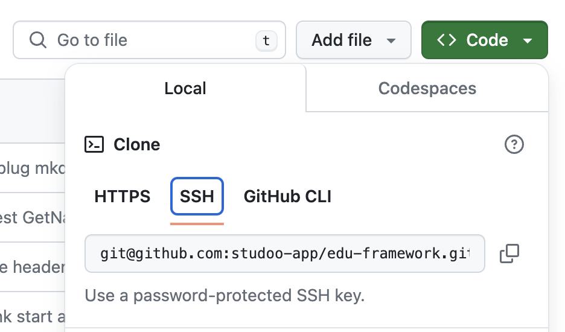

# How to version your project?

When working on a project, it is important to version your work. Even on your own! :smile:

The reasons are simple:

- Go back if you make a mistake or a botched implementation
- Have several versions: testing, stable…
- Manage issues (tasks)

That said, versioning your project is not mandatory. It is a plus for you (a professional skill).

## Prerequisites

You must already have: 

- an account with your GIT provider
    - [:simple-github: Github](https://github.com)
    - [:simple-gitlab: GitLab](https://gitlab.com)
    - [:simple-bitbucket: Bitbucket](https://bitbucket.org)
    - [:simple-gitea: Gitea](https://gitea.io/fr-fr)
    - [:simple-git: Gogs](https://gogs.io)
    - [:simple-codeberg: Codeberg](https://codeberg.org)
- GIT installed on your machine
    - [:simple-git: Version manager](prerequis.md#version-manager)

## To version the project:

1/ Create a new empty repository with your GIT provider (Github, GitLab ...)

!!! warning "Important information"
    
     Please note that the repository must be EMPTY when it is created.
     Otherwise, you will have trouble pushing your files.

2/ Open a terminal and go to the root of the project

3/ Type the following lines:

- Initialize the project

````Bash
git init
````

- Add the URL of the GIT repository (HTTPS or SSH)

!!! warning "Important information"
    
    Replace **URL_GIT_REPO** with the URL of the repository you created

    Copy the URL shown in the repository's GIT service

    Here is an example:

    ```bash
    git remote add origin git@github.com:studoo-app/edu-framework.git
    ```

    This is only an example and it will probably not be yours. Here we selected the SSH protocol to link to the repository. You can also use the HTTPS protocol.
    SSH is more secure and faster than HTTPS. However, it requires extra configuration on the machine, including installing an SSH key.
    Example of SSH configuration: [Github SSH](https://docs.github.com/fr/authentication/connecting-to-github-with-ssh/adding-a-new-ssh-key-to-your-github-account){:target="_blank"}

    <figure markdown="span">
    {width="500"}
    </figure>


````Bash
git remote add origin URL_GIT_REPO
````

- Add the "main" branch

````Bash
git branch -M main
````

- Add the files to the commit

````Bash
git add * .gitignore .env.example
````

- Add the 'init project' commit

````Bash
git commit -m 'init project'
````

- Push the local files to the remote repository

````Bash
git push -u origin main
````

## Push errors

If you get errors when pushing, here are a few commands to help you:

Show the URLs of the GIT repositories configured in your project:

````Bash
git remote show origin
````

To remove the origin URL already configured in your GIT:
````Bash
git remote rm origin
````

